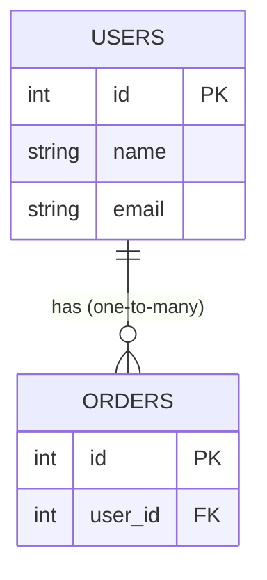

# 02 — Tables and Relationships

## Core structure

- A relational database is made of **tables**; each table has **rows** (records) and **columns** (fields) [`0:25`](https://www.youtube.com/watch?v=pEzrn6PIxRo&t=25).
- Example: a `users` table with columns `id`, `name`, `email`, and an `orders` table with its own `id` [`0:55`](https://www.youtube.com/watch?v=pEzrn6PIxRo&t=55).
- A **foreign key** in one table is what connects it to another table (e.g., `orders` pointing back to `users`) [`0:55`](https://www.youtube.com/watch?v=pEzrn6PIxRo&t=55).

## Relationship types

- **One-to-one** — a direct one-to-one mapping between rows [`0:55`](https://www.youtube.com/watch?v=pEzrn6PIxRo&t=55).
- **One-to-many** [`0:55`](https://www.youtube.com/watch?v=pEzrn6PIxRo&t=55).
- **Many-to-many** — the one people most often get confused by [`0:55`](https://www.youtube.com/watch?v=pEzrn6PIxRo&t=55).

