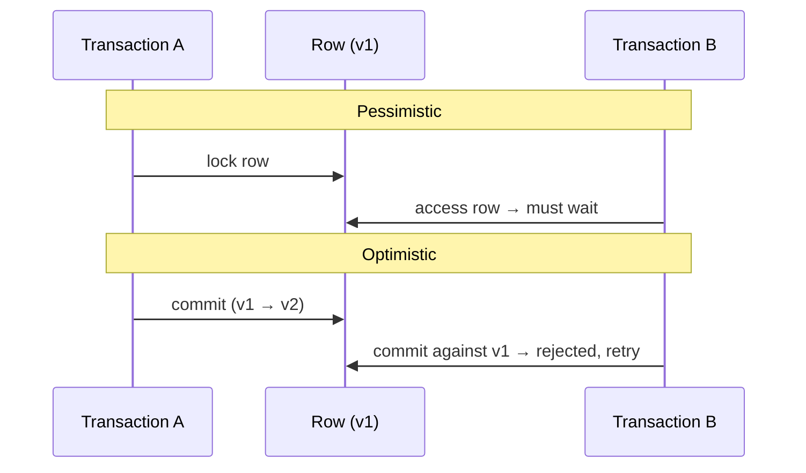

# 07 — Locking: Pessimistic vs Optimistic

A frequent interview topic: pessimistic vs optimistic locking [`6:29`](https://www.youtube.com/watch?v=pEzrn6PIxRo&t=389).

## Pessimistic locking

- Transaction A **locks the row first**; when transaction B tries to access the same row (imagine a seat reservation), it **has to wait** until the lock is released [`6:29`](https://www.youtube.com/watch?v=pEzrn6PIxRo&t=389).

## Optimistic locking

- Usually implemented with **versioning** [`7:02`](https://www.youtube.com/watch?v=pEzrn6PIxRo&t=422).
- Flow: A commits and the row version goes from v1 to v2; when B tries to commit against the now-stale version, it is **rejected** and must retry [`7:02`](https://www.youtube.com/watch?v=pEzrn6PIxRo&t=422).
- Rule: **if the versions don't match, the write gets rejected** [`7:02`](https://www.youtube.com/watch?v=pEzrn6PIxRo&t=422).

