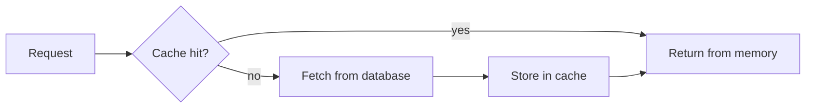

# 10 — Caching

- A cache **keeps hot results in fast memory**; introducing caching is very popular in system design discussions [`9:20`](https://www.youtube.com/watch?v=pEzrn6PIxRo&t=560).
- Read flow [`9:48`](https://www.youtube.com/watch?v=pEzrn6PIxRo&t=588):
  - **Cache hit** → return the result immediately (fast, because the cache sits in memory, not on disk).
  - **Cache miss** → fetch from the database, store the result in the cache, then return it.

