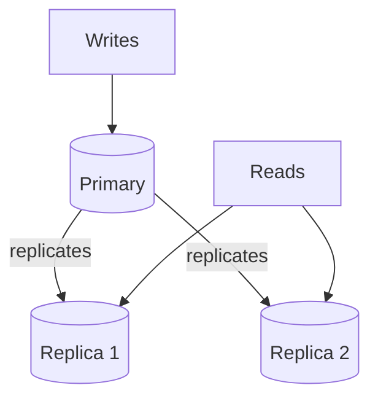

# 12 — Replication

- Replication **keeps live copies of your database** [`11:10`](https://www.youtube.com/watch?v=pEzrn6PIxRo&t=670).
- Architecture [`11:10`](https://www.youtube.com/watch?v=pEzrn6PIxRo&t=670):
  - **Writes go to the primary**.
  - The primary **replicates data to the replicas**.
  - **Reads go to the replicas**, which other applications can read from.
- Main benefit: **removes read pressure from the primary** [`11:10`](https://www.youtube.com/watch?v=pEzrn6PIxRo&t=670).
- This concept belongs more to system design territory [`11:45`](https://www.youtube.com/watch?v=pEzrn6PIxRo&t=705).

