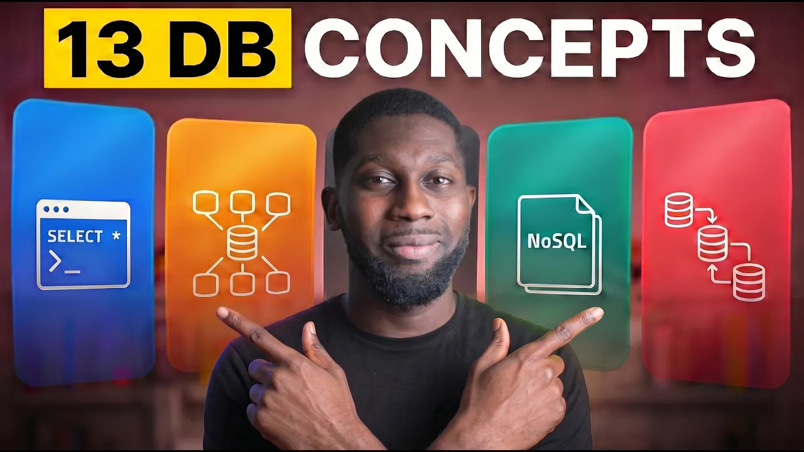
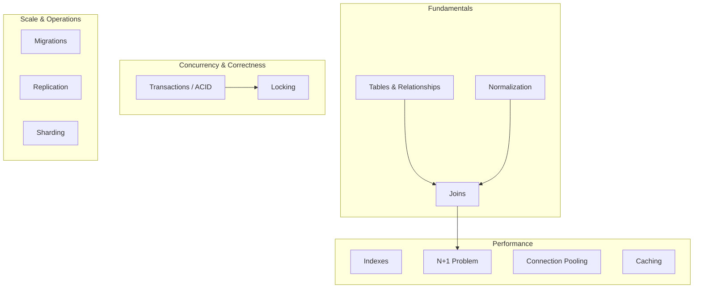

# 13 Database Concepts Every Backend Engineer Must Know

*Amigoscode · 13:17 · [Watch on YouTube](https://www.youtube.com/watch?v=pEzrn6PIxRo)*

## Summary

An educational overview of the core relational-database concepts a backend engineer needs, framed as interview-critical fundamentals that engineers shouldn't outsource to AI. The video walks through the basics (tables, relationships, joins, normalization), performance (indexes, N+1, connection pooling, caching), correctness under concurrency (transactions, ACID, locking), and operating at scale (migrations, replication, sharding). Each concept is explained conceptually with small examples rather than code walkthroughs.

## Topics

1. [Introduction: Why These Concepts Matter](01-introduction.md)
2. [Tables and Relationships](02-tables-and-relationships.md)
3. [Joins](03-joins.md)
4. [Normalization](04-normalization.md)
5. [Indexes](05-indexes.md)
6. [Transactions and ACID](06-transactions-and-acid.md)
7. [Locking: Pessimistic vs Optimistic](07-locking.md)
8. [The N+1 Problem](08-n-plus-one-problem.md)
9. [Connection Pooling](09-connection-pooling.md)
10. [Caching](10-caching.md)
11. [Migrations](11-migrations.md)
12. [Replication](12-replication.md)
13. [Sharding](13-sharding.md)

## Concept map

## Key takeaways

- These database concepts are presented as the differential factor between candidates who get hired and those who don't — they keep appearing in interviews even in the AI era [`0:25`](https://www.youtube.com/watch?v=pEzrn6PIxRo&t=25).
- An index turns a lookup from O(N) full-row scans into O(log N), and should be applied to columns used in frequent `WHERE` clauses [`4:29`](https://www.youtube.com/watch?v=pEzrn6PIxRo&t=269).
- Without transactions, a debit/credit pair can half-fail: account A loses 100 while account B never receives it — transactions make writes all-or-nothing [`5:35`](https://www.youtube.com/watch?v=pEzrn6PIxRo&t=335).
- Pessimistic locking makes the second transaction wait on a locked row; optimistic locking uses row versions (v1 → v2) and rejects any commit against a stale version [`6:29`](https://www.youtube.com/watch?v=pEzrn6PIxRo&t=389) [`7:02`](https://www.youtube.com/watch?v=pEzrn6PIxRo&t=422).
- The fix for the N+1 problem is a join (`JOIN FETCH` in Spring): one round trip with a constant query count, instead of one extra query per row [`8:11`](https://www.youtube.com/watch?v=pEzrn6PIxRo&t=491).
- Connection pooling exists because opening a database connection is expensive — the pool keeps a fixed set open, hands them out per request, and caps total connections [`8:43`](https://www.youtube.com/watch?v=pEzrn6PIxRo&t=523).
- Schema changes should live as versioned migration scripts in git — one giant SQL file "doesn't work" [`10:26`](https://www.youtube.com/watch?v=pEzrn6PIxRo&t=626).
- Replication routes writes to the primary and reads to replicas, removing read pressure from the primary [`11:10`](https://www.youtube.com/watch?v=pEzrn6PIxRo&t=670).
- Sharding solves data that doesn't fit in one database, but adds new problems of its own (shard routing via key/hashing) — it's always a trade-off, a recurring theme in system design interviews [`12:17`](https://www.youtube.com/watch?v=pEzrn6PIxRo&t=737).
