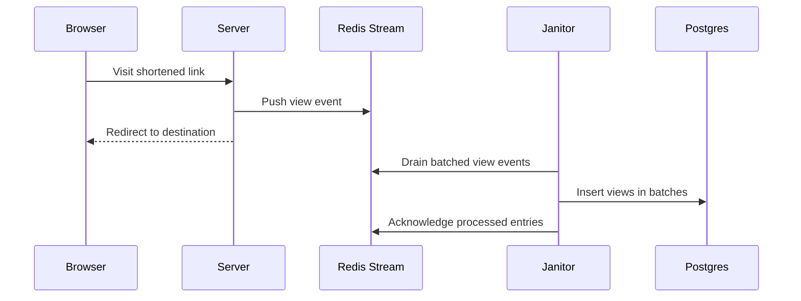

# Weer architecture

## Product behavior

- Weer is a URL shortener available at `weer.pro`, with its GitHub repository linked from the site footer. [`11:21`](https://www.youtube.com/watch?v=wL3maSWEoh8&t=681)
- Users can shorten links and choose link types, including a permanent six-character code and an ultra-short two-character code that requires login. [`12:09`](https://www.youtube.com/watch?v=wL3maSWEoh8&t=729) [`12:27`](https://www.youtube.com/watch?v=wL3maSWEoh8&t=747)
- Google login exists, and email/password login was still in development at recording time. [`12:39`](https://www.youtube.com/watch?v=wL3maSWEoh8&t=759)

## Backend components

- The backend uses Node.js for the server plus a second Node.js process called the janitor. [`12:39`](https://www.youtube.com/watch?v=wL3maSWEoh8&t=759)
- The janitor handles view-processing work and may eventually be rewritten in Rust or C++ because the long-term goal is about one million reads/second. [`12:55`](https://www.youtube.com/watch?v=wL3maSWEoh8&t=775) [`13:13`](https://www.youtube.com/watch?v=wL3maSWEoh8&t=793)
- The databases are Redis and Postgres; Redis Streams are used to buffer view events before they are persisted. [`13:23`](https://www.youtube.com/watch?v=wL3maSWEoh8&t=803)

## View logging design

- Redirects are reads from the user's perspective, but each view also needs a write because analytics/views are saved to Postgres. [`13:23`](https://www.youtube.com/watch?v=wL3maSWEoh8&t=803) [`13:47`](https://www.youtube.com/watch?v=wL3maSWEoh8&t=827)
- Instead of inserting every view directly into Postgres, the server pushes view data to Redis memory first. [`14:03`](https://www.youtube.com/watch?v=wL3maSWEoh8&t=843)
- The janitor drains Redis over time and writes the view records to Postgres in batches. [`14:28`](https://www.youtube.com/watch?v=wL3maSWEoh8&t=868)
- The speaker names RabbitMQ, Kafka, and Redis Streams as examples of systems used for this kind of offloading in distributed systems. [`14:28`](https://www.youtube.com/watch?v=wL3maSWEoh8&t=868)
- Weer can run with Redis enabled or disabled, enabling later benchmarks that compare direct database writes against Redis-backed buffering. [`15:01`](https://www.youtube.com/watch?v=wL3maSWEoh8&t=901)

## Frontend and monorepo

- The frontend is React plus Sass, where Sass compiles down to CSS. [`15:01`](https://www.youtube.com/watch?v=wL3maSWEoh8&t=901) [`15:19`](https://www.youtube.com/watch?v=wL3maSWEoh8&t=919)
- The repository is a monorepo with packages such as `server`, `web`, `reusable`, and `common`, each with its own package dependencies. [`15:57`](https://www.youtube.com/watch?v=wL3maSWEoh8&t=957) [`16:14`](https://www.youtube.com/watch?v=wL3maSWEoh8&t=974)
- Yarn workspaces keep packages in one repository while avoiding duplicated dependency installs by placing shared packages under one `node_modules`. [`16:53`](https://www.youtube.com/watch?v=wL3maSWEoh8&t=1013)
- The `common` package shares types between frontend and backend, so API shape changes can create compile-time errors instead of frontend/backend runtime mismatches. [`17:16`](https://www.youtube.com/watch?v=wL3maSWEoh8&t=1036) [`18:03`](https://www.youtube.com/watch?v=wL3maSWEoh8&t=1083)
- Link types are centralized in `common` as a single source of truth shared by frontend and backend. [`18:40`](https://www.youtube.com/watch?v=wL3maSWEoh8&t=1120)

## Build output

- The frontend build ultimately produces HTML, CSS, and JavaScript assets served by the backend. [`19:01`](https://www.youtube.com/watch?v=wL3maSWEoh8&t=1141) [`19:18`](https://www.youtube.com/watch?v=wL3maSWEoh8&t=1158)
- The project is TypeScript except for Sass files, and TypeScript must compile to JavaScript because browsers do not run TypeScript directly. [`19:32`](https://www.youtube.com/watch?v=wL3maSWEoh8&t=1172) [`19:48`](https://www.youtube.com/watch?v=wL3maSWEoh8&t=1188)
- The reusable frontend package acts like a mini framework for shared UI pieces such as dropdowns and modals. [`19:48`](https://www.youtube.com/watch?v=wL3maSWEoh8&t=1188) [`20:04`](https://www.youtube.com/watch?v=wL3maSWEoh8&t=1204)
- The backend is powered by Cpeak, a separately published NPM framework built by the speaker. [`20:40`](https://www.youtube.com/watch?v=wL3maSWEoh8&t=1240) [`21:02`](https://www.youtube.com/watch?v=wL3maSWEoh8&t=1262)
