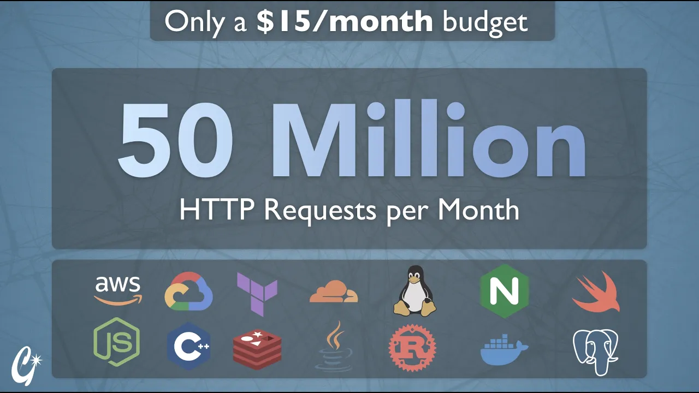
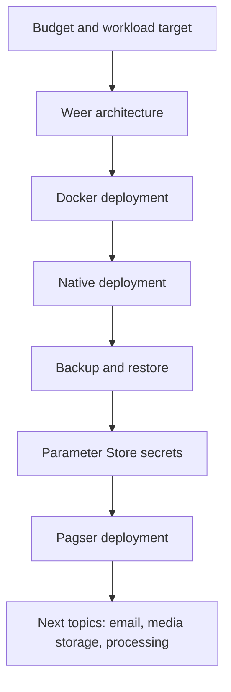

# 50 Million HTTP Requests/Month ($15 Budget) [First 2 Hours]

This tutorial begins a hands-on deployment course for running multiple real applications on a very small monthly budget. The first two hours set the target workload, deploy the Weer URL shortener with Docker and natively, configure SSH ergonomics, clean up Docker storage, use AWS AMI/snapshots for recovery and break periods, move secrets into AWS Systems Manager Parameter Store, and deploy the larger Pagser content-sharing application.

## Topic breakdown

1. [Project scope and workload target](01-project-scope-and-workload-target.md)
2. [Weer architecture](02-weer-architecture.md)
3. [Deploying Weer with Docker](03-deploying-weer-with-docker.md)
4. [SSH and remote workflow](04-ssh-and-remote-workflow.md)
5. [Docker storage and cleanup](05-docker-storage-and-cleanup.md)
6. [Native Weer deployment](06-native-weer-deployment.md)
7. [Backups, snapshots, and secrets](07-backups-snapshots-and-secrets.md)
8. [Pagser overview and deployment](08-pagser-overview-and-deployment.md)

## Key takeaways

- The target is not a toy benchmark: the setup is meant for 50 million monthly HTTP requests, roughly 20 requests/second on average, with provisioning expectations for 60 requests/second daily peaks and 200 requests/second rare spikes. [`5:48`](https://www.youtube.com/watch?v=wL3maSWEoh8&t=348) [`6:12`](https://www.youtube.com/watch?v=wL3maSWEoh8&t=372) [`6:30`](https://www.youtube.com/watch?v=wL3maSWEoh8&t=390)
- The course starts on one AWS `T4G.small` Ubuntu instance with 2 GB RAM, 2 CPU cores, and 25 GB of storage, intended to stay near a $15/month baseline before later optimizations. [`23:13`](https://www.youtube.com/watch?v=wL3maSWEoh8&t=1393) [`23:49`](https://www.youtube.com/watch?v=wL3maSWEoh8&t=1429) [`1:22:17`](https://www.youtube.com/watch?v=wL3maSWEoh8&t=4937)
- Weer avoids writing each redirect view directly to Postgres by pushing view events into Redis Streams first, then batch-writing them from a separate janitor process. [`14:03`](https://www.youtube.com/watch?v=wL3maSWEoh8&t=843) [`14:28`](https://www.youtube.com/watch?v=wL3maSWEoh8&t=868)
- Docker made the first Weer deployment a one-command setup with Redis, Postgres, server, and janitor services, but the native path was kept central because it teaches the underlying Unix and operations concepts. [`30:58`](https://www.youtube.com/watch?v=wL3maSWEoh8&t=1858) [`56:18`](https://www.youtube.com/watch?v=wL3maSWEoh8&t=3378)
- A snapshot/AMI can restore a damaged server state, but snapshot billing tracks written disk blocks, not just currently used filesystem space, so deleted large writes can still increase snapshot size. [`1:29:10`](https://www.youtube.com/watch?v=wL3maSWEoh8&t=5350) [`1:34:21`](https://www.youtube.com/watch?v=wL3maSWEoh8&t=5661)
- Moving `.env` values into AWS Systems Manager Parameter Store plus an EC2 IAM role removes manual secret setup from redeployments and prepares the deployment for automatic machine replacement. [`1:38:14`](https://www.youtube.com/watch?v=wL3maSWEoh8&t=5894) [`1:50:45`](https://www.youtube.com/watch?v=wL3maSWEoh8&t=6645) [`1:58:32`](https://www.youtube.com/watch?v=wL3maSWEoh8&t=7112)
- Pagser adds heavier production concerns than Weer: rich content editing, authentication emails, server-side rendering, comments, media processing, file uploads, S3 storage, and SES email delivery. [`2:03:40`](https://www.youtube.com/watch?v=wL3maSWEoh8&t=7420) [`2:08:42`](https://www.youtube.com/watch?v=wL3maSWEoh8&t=7722) [`2:09:52`](https://www.youtube.com/watch?v=wL3maSWEoh8&t=7792) [`2:11:19`](https://www.youtube.com/watch?v=wL3maSWEoh8&t=7879)
