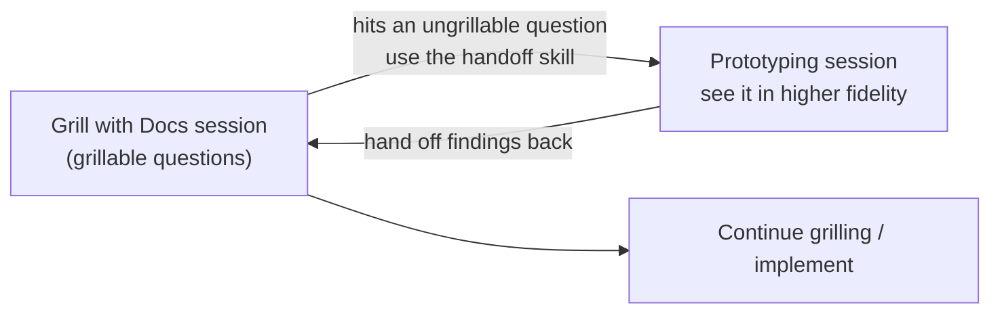

# 2. Low vs high fidelity questions

← Previous: [Overview](01-overview.md) · [README](videos-notes/9-things-people-get-wrong-with-my-grill-skills/README.md) · Next: [Managing scope correctly](03-managing-scope-correctly.md)

## The core framing

- A grilling session exists to **answer questions** about things you don't yet know about what you're building ([`1:28`](https://www.youtube.com/watch?v=UzMNBN6xLLA&t=88)).
- Questions differ in the **fidelity required to answer them** — vocabulary borrowed from Ryan Singer's *Shape Up* ([`1:28`](https://www.youtube.com/watch?v=UzMNBN6xLLA&t=88)).

| | High fidelity | Low fidelity |
|---|---|---|
| Definition | Needs a zoomed-in, detailed image to understand ([`1:28`](https://www.youtube.com/watch?v=UzMNBN6xLLA&t=88)) | Answerable without a prototype or detailed image ([`1:55`](https://www.youtube.com/watch?v=UzMNBN6xLLA&t=115)) |
| Examples | *How will this UI feel to use?* · *Split the form fields across multiple pages, or one enormous form?* ([`1:55`](https://www.youtube.com/watch?v=UzMNBN6xLLA&t=115)) | *What URL should this route live on?* ([`2:21`](https://www.youtube.com/watch?v=UzMNBN6xLLA&t=141)) |
| How to answer | A high-fidelity prototype, or actually building the thing ([`1:55`](https://www.youtube.com/watch?v=UzMNBN6xLLA&t=115)) | Just answer it in conversation ([`2:21`](https://www.youtube.com/watch?v=UzMNBN6xLLA&t=141)) |
| Term | **Ungrillable** | **Grillable** |

## Failure mode #1

- **Trying to answer high-fidelity questions during a grilling session** ([`2:21`](https://www.youtube.com/watch?v=UzMNBN6xLLA&t=141)).
- Questions about *feel* cannot be resolved by talking — you need to see the thing ([`2:49`](https://www.youtube.com/watch?v=UzMNBN6xLLA&t=169)).

## The fix: a prototyping handoff

The author's routine when a grilling session hits an ungrillable question ([`2:49`](https://www.youtube.com/watch?v=UzMNBN6xLLA&t=169), [`3:22`](https://www.youtube.com/watch?v=UzMNBN6xLLA&t=202)):

- The handoff is bidirectional: prototype the one question (or a batch of them), then return to the **original** grilling session with what you learned ([`3:22`](https://www.youtube.com/watch?v=UzMNBN6xLLA&t=202)).
- This grill → prototype → grill shape is what many of the author's sessions look like ([`3:22`](https://www.youtube.com/watch?v=UzMNBN6xLLA&t=202)).
