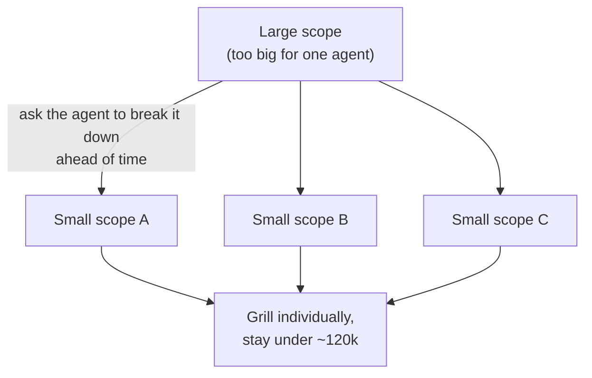

# 3. Managing scope correctly

← Previous: [Low vs high fidelity questions](02-low-vs-high-fidelity-questions.md) · [README](videos-notes/9-things-people-get-wrong-with-my-grill-skills/README.md) · Next: [Being active, not passive](04-being-active-not-passive.md)

**Scope = how large a thing you are grilling** ([`3:44`](https://www.youtube.com/watch?v=UzMNBN6xLLA&t=224)).

Too-large scope causes two distinct problems ([`3:44`](https://www.youtube.com/watch?v=UzMNBN6xLLA&t=224)):

## Problem 1 — hidden high-fidelity questions

- A large scope conceals high-fidelity questions inside it that are hard to answer without seeing the whole thing built ([`3:44`](https://www.youtube.com/watch?v=UzMNBN6xLLA&t=224)).
- Principle: **it is always easier to build off something you know works** than to endlessly plan scope out into the future ([`3:44`](https://www.youtube.com/watch?v=UzMNBN6xLLA&t=224)).
- People who schedule *days and days* of tasks end up with poor results because they aren't building on a foundation they're aligned with — they pushed too far into the future without something solid underneath ([`4:14`](https://www.youtube.com/watch?v=UzMNBN6xLLA&t=254)).

## Problem 2 — the model's "dumb zone"

- **~120k tokens** is where the author estimates the dumb zone begins for most state-of-the-art models ([`5:07`](https://www.youtube.com/watch?v=UzMNBN6xLLA&t=307)).
- Past that point the model's attention relationships get strained and it **starts making stupider decisions** ([`5:07`](https://www.youtube.com/watch?v=UzMNBN6xLLA&t=307)).
- A big-scope grill starts on a near-empty context window but grows until you're in the dumb zone *before you've answered half the questions* — forcing an awkward handoff or compaction ([`4:42`](https://www.youtube.com/watch?v=UzMNBN6xLLA&t=282)).
- All of that is avoidable by picking a smaller scope up front, so the whole grill fits comfortably in the **smart zone** ([`4:42`](https://www.youtube.com/watch?v=UzMNBN6xLLA&t=282)).

## The fix

- **Ahead of time, ask the agent to break the large scope into smaller scopes**, then grill each one individually and answer its questions ([`5:07`](https://www.youtube.com/watch?v=UzMNBN6xLLA&t=307)).
- Keep a keen eye on the context window throughout ([`5:07`](https://www.youtube.com/watch?v=UzMNBN6xLLA&t=307)).
