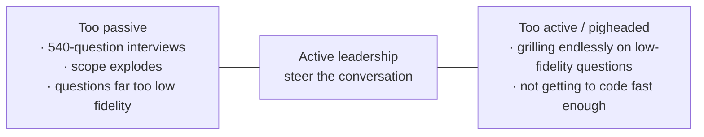

# 4. Being active, not passive

← Previous: [Managing scope correctly](03-managing-scope-correctly.md) · [README](videos-notes/9-things-people-get-wrong-with-my-grill-skills/README.md) · Next: [Preserving grilling session value](05-preserving-grilling-session-value.md)

## The axis

Grilling is **a conversation, not an interview** — the agent asks the questions, but *you* decide where it goes, set the scope and keep things on track ([`5:41`](https://www.youtube.com/watch?v=UzMNBN6xLLA&t=341)).

## Failure mode — too passive

- The author suspects the huge grilling sessions people report are the result of **sitting back too much** ([`5:41`](https://www.youtube.com/watch?v=UzMNBN6xLLA&t=341)).
- Left unled, the agent will do stupid things with the interview: ask **540 questions**, explode the scope, ask about things far too low fidelity to matter ([`6:10`](https://www.youtube.com/watch?v=UzMNBN6xLLA&t=370)).
- Remedy: take an active hand ([`6:10`](https://www.youtube.com/watch?v=UzMNBN6xLLA&t=370)).

## Failure mode — too active

- The opposite failure is also real: **being pigheaded** and continuing to grill on low-fidelity questions when you should build something and see it in action ([`6:10`](https://www.youtube.com/watch?v=UzMNBN6xLLA&t=370)).
- Two failure modes hide in this single lens: sitting back too much, and **not getting to code fast enough** ([`6:36`](https://www.youtube.com/watch?v=UzMNBN6xLLA&t=396)).

## Practical check

- While using the skills, explicitly ask yourself **where you fall on the passive ↔ pushy axis** ([`6:36`](https://www.youtube.com/watch?v=UzMNBN6xLLA&t=396)).
