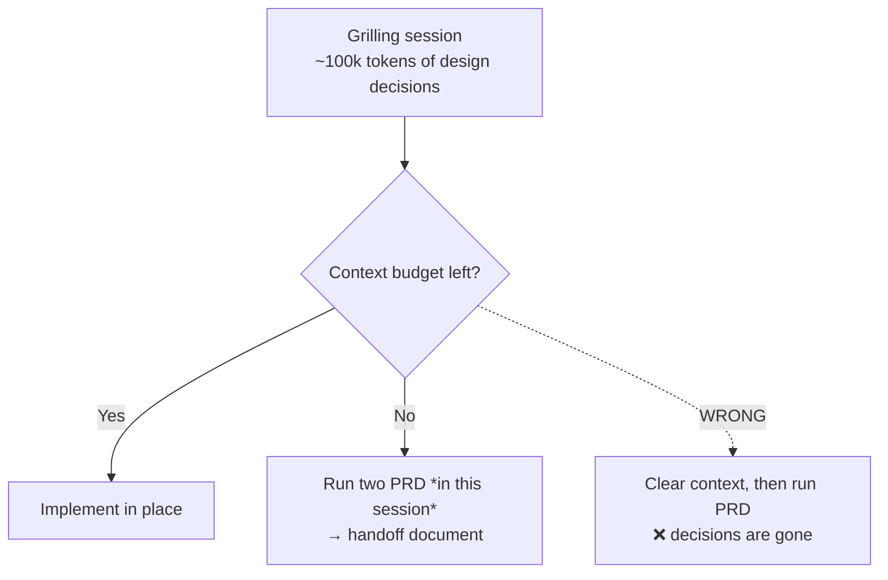

# 5. Preserving grilling session value

← Previous: [Being active, not passive](04-being-active-not-passive.md) · [README](videos-notes/9-things-people-get-wrong-with-my-grill-skills/README.md) · Next: [Using smart models for grilling](06-using-smart-models-for-grilling.md)

## The asset you are building

- While answering questions you are growing a context window full of **answers you gave and design decisions you took** — that context is *incredibly valuable* ([`6:55`](https://www.youtube.com/watch?v=UzMNBN6xLLA&t=415)).
- The failure mode: **people don't value what they created during the grilling session** ([`6:55`](https://www.youtube.com/watch?v=UzMNBN6xLLA&t=415)).

## Decision rule at the end of a grill

| Situation | What to do |
|---|---|
| Enough context budget left | **Implement immediately** in the same session, off the design decisions already made — no handoff needed ([`6:55`](https://www.youtube.com/watch?v=UzMNBN6xLLA&t=415), [`7:21`](https://www.youtube.com/watch?v=UzMNBN6xLLA&t=441)) |
| Budget exhausted / must quit out | **Make a PRD** — the `two PRD` skill produces an engineering-tailored handoff document, useful multi-session or even single-session ([`7:21`](https://www.youtube.com/watch?v=UzMNBN6xLLA&t=441)) |

## The "crazy one"

- Some people **clear the context first**, open a new context window, and only then run the PRD skill ([`7:45`](https://www.youtube.com/watch?v=UzMNBN6xLLA&t=465)).
- That throws away a session holding on the order of **100,000 tokens of good design decisions** — the author calls this totally crazy ([`7:45`](https://www.youtube.com/watch?v=UzMNBN6xLLA&t=465)).

## Principle

- Every decision made in a grilling session must be **recorded somewhere** — turned into code, or into a handoff document you can refer to later ([`8:09`](https://www.youtube.com/watch?v=UzMNBN6xLLA&t=489)).
- The author diagnoses this as a skill issue: people need much more awareness of **context management** — when to clear, compact, or hand off ([`8:09`](https://www.youtube.com/watch?v=UzMNBN6xLLA&t=489)).
