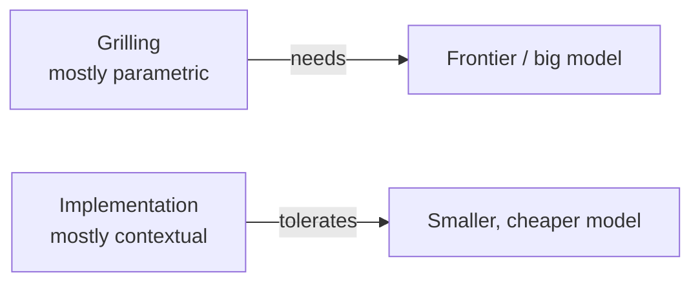

# 6. Using smart models for grilling

← Previous: [Preserving grilling session value](05-preserving-grilling-session-value.md) · [README](videos-notes/9-things-people-get-wrong-with-my-grill-skills/README.md) · Next: [Running parallel grilling sessions](07-running-parallel-grilling-sessions.md)

## The failure mode

- **Using too dumb a model for grilling** ([`8:40`](https://www.youtube.com/watch?v=UzMNBN6xLLA&t=520)).
- Grilling demands hard judgement calls from the model: telling low-fidelity from high-fidelity questions, and figuring out which questions will prompt a stronger design ([`8:40`](https://www.youtube.com/watch?v=UzMNBN6xLLA&t=520)).

## Two sources of model knowledge

| Source | What it is | Reliability |
|---|---|---|
| **Contextual knowledge** | What you passed in: files read, user prompts, tool-call results brought back from research ([`8:40`](https://www.youtube.com/watch?v=UzMNBN6xLLA&t=520), [`9:05`](https://www.youtube.com/watch?v=UzMNBN6xLLA&t=545)) | Higher |
| **Parametric knowledge** | What the model was trained to see and understand ([`9:05`](https://www.youtube.com/watch?v=UzMNBN6xLLA&t=545)) | *Much less reliable* — but it's what grilling depends on ([`9:05`](https://www.youtube.com/watch?v=UzMNBN6xLLA&t=545)) |

## Why grilling is parametric-heavy

- Grilling leans on the model's **innate understanding of systems and applications** to surface ideas you hadn't considered ([`9:05`](https://www.youtube.com/watch?v=UzMNBN6xLLA&t=545)).
- Logical consequence: anything you *had* considered you would already have passed in as contextual knowledge — so the value the model adds is precisely the off-the-wall suggestions and strange ideas from its parameters ([`9:32`](https://www.youtube.com/watch?v=UzMNBN6xLLA&t=572)).
- Relying on parametric knowledge means you need **a model with lots of parameters** — i.e. the big frontier models, which are also top-of-the-line trained and simply more capable than smaller ones ([`9:32`](https://www.youtube.com/watch?v=UzMNBN6xLLA&t=572)).

## The corollary most people miss

- You **can** use a dumber model for *implementation*, because by then most of the information is contextual: a detailed implementation plan plus the relevant codebase files to copy from ([`9:58`](https://www.youtube.com/watch?v=UzMNBN6xLLA&t=598), [`10:21`](https://www.youtube.com/watch?v=UzMNBN6xLLA&t=621)).

