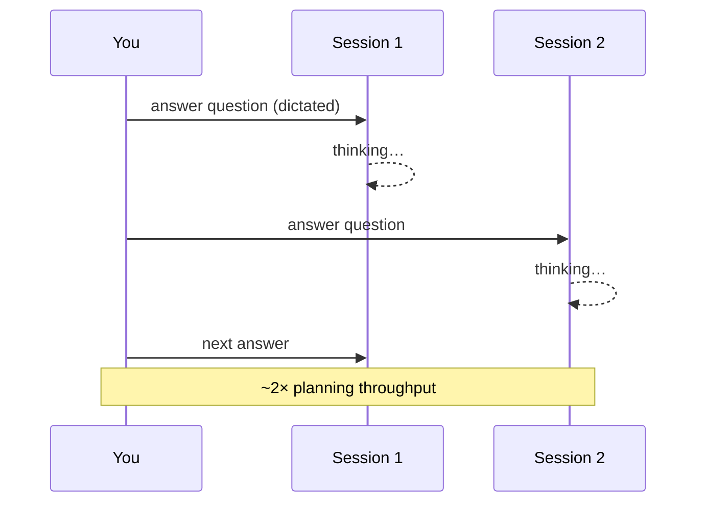

# 7. Running parallel grilling sessions

← Previous: [Using smart models for grilling](06-using-smart-models-for-grilling.md) · [README](videos-notes/9-things-people-get-wrong-with-my-grill-skills/README.md)

## The practice

- Described as *dead simple*, yet **so many people don't do it**: grill multiple sessions in parallel ([`10:25`](https://www.youtube.com/watch?v=UzMNBN6xLLA&t=625)).
- The author's loop ([`10:25`](https://www.youtube.com/watch?v=UzMNBN6xLLA&t=625)):
  1. Answer the current session's question (usually by **dictating**, not typing).
  2. Switch to the second session, which has normally finished thinking by then.
  3. Answer its question, switch back — and bounce like that.

## Answer to the "context switching" objection

- The author's rebuttal: it's really just **managing two Slack threads at once** — not that hard ([`10:43`](https://www.youtube.com/watch?v=UzMNBN6xLLA&t=643)).
- You are making a lot of high-level decisions, but this is *the only way he has found* to increase throughput and get more planning done in less time ([`10:43`](https://www.youtube.com/watch?v=UzMNBN6xLLA&t=643)).

## How many sessions

| Count | When |
|---|---|
| **2** | The normal maximum — his default limit ([`10:43`](https://www.youtube.com/watch?v=UzMNBN6xLLA&t=643)) |
| **3** | Only when one session is on a long-running task such as research, and he's "feeling spicy" / high energy ([`10:43`](https://www.youtube.com/watch?v=UzMNBN6xLLA&t=643)) |
| **4** | Suggested as reachable for someone with a more plastic brain, after mastering the basics ([`12:19`](https://www.youtube.com/watch?v=UzMNBN6xLLA&t=739)) |

- Claimed result at two sessions: **doubled throughput** ([`11:12`](https://www.youtube.com/watch?v=UzMNBN6xLLA&t=672)).
- Grilling is a **learnable skill** — as you get better at it you can add more throughput and more parallelism ([`11:12`](https://www.youtube.com/watch?v=UzMNBN6xLLA&t=672)).
- Caveat given: do it *if you have the mental capacity for it* ([`11:12`](https://www.youtube.com/watch?v=UzMNBN6xLLA&t=672)).
