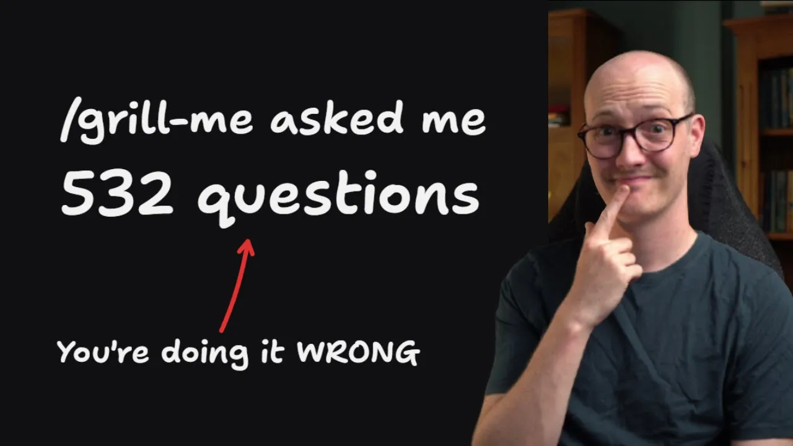
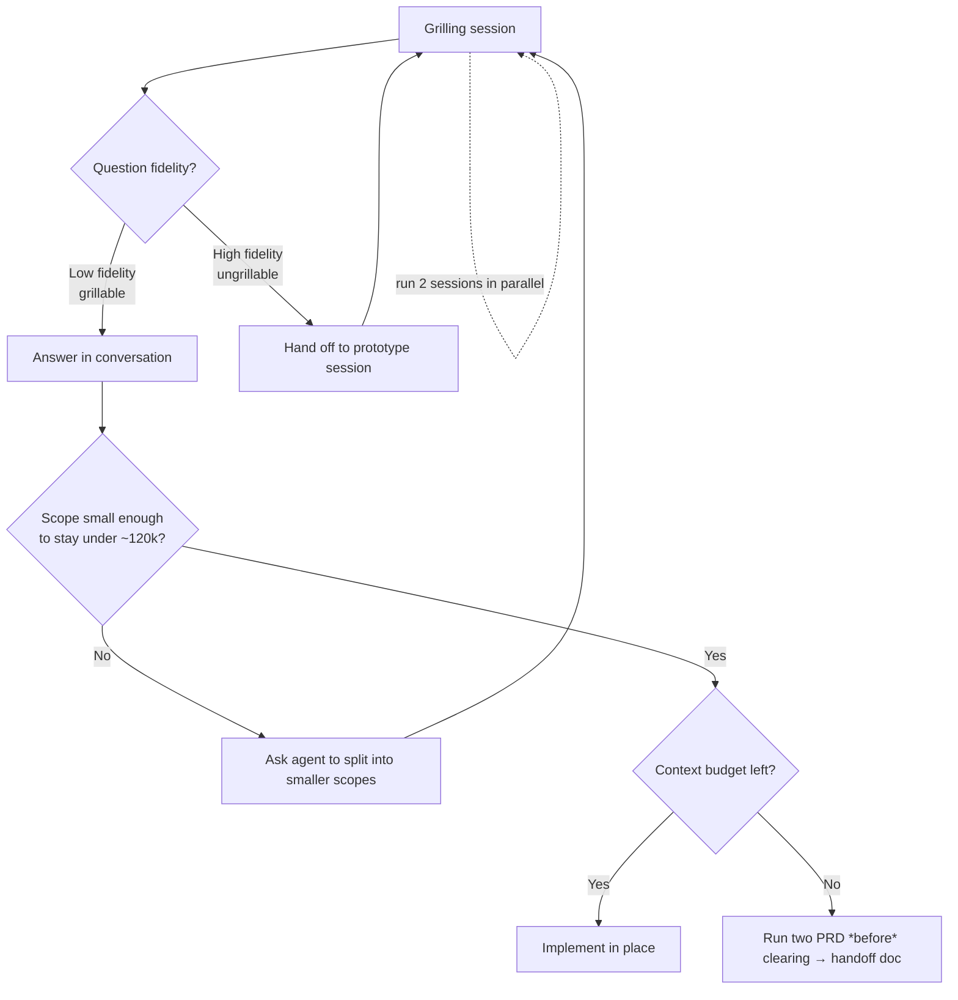

# 9 Things People Get Wrong With My /grill-* skills

*Matt Pocock · 13:28 · [Watch on YouTube](https://www.youtube.com/watch?v=UzMNBN6xLLA)*

## Summary

An educational video about **using the `Grill Me` / `Grill with Docs` skills well** — agent skills that replace plan mode by relentlessly questioning you until you and the agent share an understanding of what to build. The premise is that the reported failures ("it asked me 200 questions") come from the human side, not the skill: these are short files designed to *aid* an engineer, not replace one, so their output quality tracks the user's planning ability ([`0:25`](https://www.youtube.com/watch?v=UzMNBN6xLLA&t=25)).

Rather than listing nine bugs, the video teaches six **lenses** — question fidelity, scope, active vs passive participation, the value of the session's context, model choice, and parallelism — and derives the failure modes from each ([`0:53`](https://www.youtube.com/watch?v=UzMNBN6xLLA&t=53)).

## Topics

1. [Overview — what the grill skills are for](01-overview.md) — intent of the skills, why the failure modes are user-side, and the lenses used in the rest of the video ([`0:00`](https://www.youtube.com/watch?v=UzMNBN6xLLA&t=0))
2. [Low vs high fidelity questions](02-low-vs-high-fidelity-questions.md) — grillable vs ungrillable questions and the prototyping handoff ([`1:28`](https://www.youtube.com/watch?v=UzMNBN6xLLA&t=88))
3. [Managing scope correctly](03-managing-scope-correctly.md) — hidden high-fidelity questions and the model's dumb zone ([`3:44`](https://www.youtube.com/watch?v=UzMNBN6xLLA&t=224))
4. [Being active, not passive](04-being-active-not-passive.md) — the two-sided axis of leading the conversation ([`5:41`](https://www.youtube.com/watch?v=UzMNBN6xLLA&t=341))
5. [Preserving grilling session value](05-preserving-grilling-session-value.md) — implement, or PRD, but never clear first ([`6:55`](https://www.youtube.com/watch?v=UzMNBN6xLLA&t=415))
6. [Using smart models for grilling](06-using-smart-models-for-grilling.md) — parametric vs contextual knowledge ([`8:40`](https://www.youtube.com/watch?v=UzMNBN6xLLA&t=520))
7. [Running parallel grilling sessions](07-running-parallel-grilling-sessions.md) — two sessions, doubled throughput ([`10:25`](https://www.youtube.com/watch?v=UzMNBN6xLLA&t=625))

Full source: [transcript.md](transcript.md)

## Key takeaways

- **Grilling is primarily about questions**, and questions split by the fidelity needed to answer them: low-fidelity ones are *grillable* (answer them in the conversation), high-fidelity ones are *ungrillable* ([`11:26`](https://www.youtube.com/watch?v=UzMNBN6xLLA&t=686)).
- **Ungrillable questions are resolved by a round trip, not by more talking**: use the handoff skill to move into a prototyping session, settle that question (or a batch of them), then hand back to the original grilling session ([`2:49`](https://www.youtube.com/watch?v=UzMNBN6xLLA&t=169), [`11:26`](https://www.youtube.com/watch?v=UzMNBN6xLLA&t=686)).
- **~120k tokens is the estimated start of the "dumb zone"** for most state-of-the-art models; past it, attention gets strained and decisions get stupider — so scope each grill to finish inside the smart zone ([`5:07`](https://www.youtube.com/watch?v=UzMNBN6xLLA&t=307)).
- **Over-scoped grills fail twice**: they hide high-fidelity questions inside them, and they blow the context window, your stamina, and leave nothing to show for it ([`3:44`](https://www.youtube.com/watch?v=UzMNBN6xLLA&t=224), [`11:53`](https://www.youtube.com/watch?v=UzMNBN6xLLA&t=713)). Fix: have the agent break a large scope into smaller ones *before* grilling ([`5:07`](https://www.youtube.com/watch?v=UzMNBN6xLLA&t=307)).
- **Both ends of the passive/active axis are failure modes**: too passive gets you a 540-question interview with exploded scope; too active means grilling endlessly on low-fidelity questions when you should be writing code ([`6:10`](https://www.youtube.com/watch?v=UzMNBN6xLLA&t=370), [`6:36`](https://www.youtube.com/watch?v=UzMNBN6xLLA&t=396)).
- **Never clear the context before generating your handoff**: running `two PRD` in a fresh window discards ~100k tokens of design decisions built up in the grilling session — decisions must end up either as code or as a handoff document ([`7:45`](https://www.youtube.com/watch?v=UzMNBN6xLLA&t=465), [`8:09`](https://www.youtube.com/watch?v=UzMNBN6xLLA&t=489)).
- **Model choice should be asymmetric**: grilling depends on *parametric* knowledge (the model's innate sense of systems, which is what surfaces ideas you hadn't considered), so it needs a big frontier model; implementation is mostly *contextual* (plan + relevant files), so a dumber model is acceptable there ([`9:32`](https://www.youtube.com/watch?v=UzMNBN6xLLA&t=572), [`9:58`](https://www.youtube.com/watch?v=UzMNBN6xLLA&t=598)).
- **Two parallel grilling sessions roughly double planning throughput** and are, in the author's experience, the only method that increases it; his cap is 2 (3 when one is on a long research task, and 4 is plausible for others) ([`10:43`](https://www.youtube.com/watch?v=UzMNBN6xLLA&t=643), [`11:12`](https://www.youtube.com/watch?v=UzMNBN6xLLA&t=672), [`12:19`](https://www.youtube.com/watch?v=UzMNBN6xLLA&t=739)).
- **Grilling is a learnable skill** — as it improves, you can sustain more parallelism and throughput ([`11:12`](https://www.youtube.com/watch?v=UzMNBN6xLLA&t=672)).
