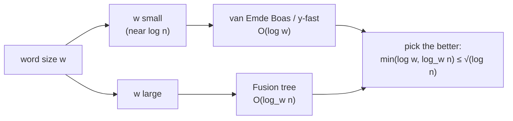

# 4. The landscape: bounds, combination, and sorting consequences

## The two families

| Structure | Reference | Query | Update | Space |
| --- | --- | --- | --- | --- |
| van Emde Boas tree | van Emde Boas, 1970s [`19:36`](https://www.youtube.com/watch?v=0JUN9aDxVmI&t=1176) | `O(log w)` | `O(log w)`, dynamic [`20:23`](https://www.youtube.com/watch?v=0JUN9aDxVmI&t=1223) | `Θ(u)` as published; `Θ(n)` with randomization [`20:51`](https://www.youtube.com/watch?v=0JUN9aDxVmI&t=1251), [`21:16`](https://www.youtube.com/watch?v=0JUN9aDxVmI&t=1276) |
| y-fast trie | Willard, IPL 1983 [`22:03`](https://www.youtube.com/watch?v=0JUN9aDxVmI&t=1323) | same bounds as vEB [`21:16`](https://www.youtube.com/watch?v=0JUN9aDxVmI&t=1276) | dynamic | linear |
| Fusion tree | Fredman & Willard, JCSS '93 [`22:48`](https://www.youtube.com/watch?v=0JUN9aDxVmI&t=1368) | `O(log_w n)` | static in class; dynamic exists [`22:48`](https://www.youtube.com/watch?v=0JUN9aDxVmI&t=1368) | linear |

- `Θ(u)` space is unacceptable in practice: on a 64-bit machine `u = 2^64` [`21:16`](https://www.youtube.com/watch?v=0JUN9aDxVmI&t=1276).
- The `u → linear` space fix turns out to be simple (see topic 6); the original vEB paper did not achieve linear space [`22:03`](https://www.youtube.com/watch?v=0JUN9aDxVmI&t=1323).

## Fusion trees already beat BSTs

- `log_w n = log n / log w`, and since `w ≥ log n`, this is **never more than `log n / log log n`** [`23:35`](https://www.youtube.com/watch?v=0JUN9aDxVmI&t=1415).

## Combining the two

- The machine's `w` is known at coding time, so pick the better of fusion trees and vEB/y-fast tries, achieving `min(log w, log_w n)` [`23:58`](https://www.youtube.com/watch?v=0JUN9aDxVmI&t=1438).
- The worst case of that min is where the two are equal: `log w = log n / log w`, i.e. `log n = (log w)^2`, so the bound is **always at most `√(log n)`** [`24:23`](https://www.youtube.com/watch?v=0JUN9aDxVmI&t=1463).

## Sorting consequences in the word-RAM

- Dynamic fusion trees ⇒ **`O(n √(log n))` sorting** [`25:01`](https://www.youtube.com/watch?v=0JUN9aDxVmI&t=1501).
- Not covered in class, but better is known:
  - `O(n log log n)` **deterministic** — Han & Stock, 2002 [`26:18`](https://www.youtube.com/watch?v=0JUN9aDxVmI&t=1578).
  - `O(n √(log log n))` **expected time, randomized** — Han & Thorup, FOCS 2002, about five months later [`26:18`](https://www.youtube.com/watch?v=0JUN9aDxVmI&t=1578), [`27:03`](https://www.youtube.com/watch?v=0JUN9aDxVmI&t=1623).
- **Open question**: whether linear-time sorting is possible in this model — nothing rules it out [`27:03`](https://www.youtube.com/watch?v=0JUN9aDxVmI&t=1623).

## Why the static fusion tree isn't enough for sorting

- A student asks why the dynamic version matters. Answer: **pre-processing time**. Building the static fusion tree costs polynomial time, which ruins the sorting application; a dynamic structure starts empty, so that cost never appears [`25:40`](https://www.youtube.com/watch?v=0JUN9aDxVmI&t=1540), [`25:55`](https://www.youtube.com/watch?v=0JUN9aDxVmI&t=1555).

## These bounds are optimal

- A later paper proves a **matching lower bound**: you can never beat the min of van Emde Boas (or a slightly tweaked version) and fusion trees. So both are optimal for linear or nearly linear space predecessor structures [`1:27:49`](https://www.youtube.com/watch?v=0JUN9aDxVmI&t=5269).

## Audience calibration

- Only one student had seen vEB trees, and none had seen fusion trees [`30:01`](https://www.youtube.com/watch?v=0JUN9aDxVmI&t=1801), [`30:32`](https://www.youtube.com/watch?v=0JUN9aDxVmI&t=1832).
