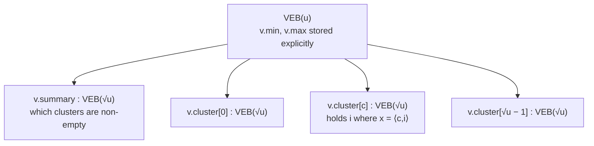

# 5. van Emde Boas trees: structure, query, insert

## Core idea

- Divide and conquer on the **universe**, not on the item count; the structure is defined recursively and parametrized by universe size `u` [`31:26`](https://www.youtube.com/watch?v=0JUN9aDxVmI&t=1886).
- A `VEB(u)` contains `√u` child structures each on a universe of size `√u`, plus one **summary** structure on a universe of size `√u`, plus the minimum stored separately [`32:19`](https://www.youtube.com/watch?v=0JUN9aDxVmI&t=1939), [`32:58`](https://www.youtube.com/watch?v=0JUN9aDxVmI&t=1978).

## Fields of `v = VEB(u)`

- `v.cluster[0 … √u − 1]` — an array of `√u` instances of `VEB(√u)`; elements inside each are in `0 … √u − 1` [`34:02`](https://www.youtube.com/watch?v=0JUN9aDxVmI&t=2042), [`34:47`](https://www.youtube.com/watch?v=0JUN9aDxVmI&t=2087).
- `v.summary` — also a `VEB(√u)` instance [`34:47`](https://www.youtube.com/watch?v=0JUN9aDxVmI&t=2087).
- `v.min`, `v.max` — integers in `0 … u − 1` [`35:22`](https://www.youtube.com/watch?v=0JUN9aDxVmI&t=2122).

## Splitting an item

- Write `x` in binary and cut it into its **left half** `c` and **right half** `i`, so `x = ⟨c, i⟩` — effectively writing `x` in base `√u`, with both `c, i ∈ [0, √u − 1]` [`36:03`](https://www.youtube.com/watch?v=0JUN9aDxVmI&t=2163), [`36:58`](https://www.youtube.com/watch?v=0JUN9aDxVmI&t=2218), [`37:36`](https://www.youtube.com/watch?v=0JUN9aDxVmI&t=2256).
- `c` and `i` are each extracted in **constant time** by shifting and masking with bitwise AND [`38:14`](https://www.youtube.com/watch?v=0JUN9aDxVmI&t=2294), [`40:01`](https://www.youtube.com/watch?v=0JUN9aDxVmI&t=2401).
- Storage rule: if `x ∈ S`, store `i` inside `cluster[c]` [`37:36`](https://www.youtube.com/watch?v=0JUN9aDxVmI&t=2256).
- **Summary rule**: when inserting into a cluster that was empty, also insert `c` into the summary — so the summary tracks **which clusters are non-empty** [`38:45`](https://www.youtube.com/watch?v=0JUN9aDxVmI&t=2325).

## Query: `Predecessor(v, x = ⟨c, i⟩)`

1. If `x > v.max`, return `v.max` — everything in the structure is smaller than `x` [`41:13`](https://www.youtube.com/watch?v=0JUN9aDxVmI&t=2473).
2. Else if `v.cluster[c].min < x`, the predecessor lives in my own cluster: **recurse** on `i` in `cluster[c]` [`40:01`](https://www.youtube.com/watch?v=0JUN9aDxVmI&t=2401), [`42:11`](https://www.youtube.com/watch?v=0JUN9aDxVmI&t=2531).
3. Else (cluster empty, or `x ≤` its min) the predecessor is in the largest non-empty cluster before me: set `c' = Predecessor(v.summary, c)` and **return `v.cluster[c'].max`** — no recursion into that cluster needed [`40:52`](https://www.youtube.com/watch?v=0JUN9aDxVmI&t=2452), [`43:28`](https://www.youtube.com/watch?v=0JUN9aDxVmI&t=2608).

A student first proposed recursing into the found cluster; the lecturer's refinement is that storing `min` (and `max`) explicitly **saves one recursive call** [`39:15`](https://www.youtube.com/watch?v=0JUN9aDxVmI&t=2355), [`39:37`](https://www.youtube.com/watch?v=0JUN9aDxVmI&t=2377).

## Insert: `Insert(v, x = ⟨c, i⟩)`

The minimum is treated as **special** — it lives only in `v.min` and is *not* also stored recursively in its cluster; think of `v.min` as a buffer [`43:28`](https://www.youtube.com/watch?v=0JUN9aDxVmI&t=2608), [`44:29`](https://www.youtube.com/watch?v=0JUN9aDxVmI&t=2669), [`46:20`](https://www.youtube.com/watch?v=0JUN9aDxVmI&t=2780).

1. If `v` is empty: `v.min ← x`; **return** [`44:54`](https://www.youtube.com/watch?v=0JUN9aDxVmI&t=2694).
2. If `x < v.min`: **swap** `x` with `v.min` (recompute `c, i` for the new `x`) so that the value being recursively inserted is never the minimum [`45:56`](https://www.youtube.com/watch?v=0JUN9aDxVmI&t=2756), [`46:20`](https://www.youtube.com/watch?v=0JUN9aDxVmI&t=2780).
3. If `v.cluster[c].min` is null (cluster was empty): `Insert(v.summary, c)` [`46:44`](https://www.youtube.com/watch?v=0JUN9aDxVmI&t=2804), [`47:03`](https://www.youtube.com/watch?v=0JUN9aDxVmI&t=2823).
4. `Insert(v.cluster[c], i)` [`47:51`](https://www.youtube.com/watch?v=0JUN9aDxVmI&t=2871).

Deletion is left to the reader — conceptually not very different [`47:51`](https://www.youtube.com/watch?v=0JUN9aDxVmI&t=2871).

## Time analysis

- **Predecessor**: at most one recursive call in every branch, so `T(u) = T(√u) + O(1)`, giving `T(u) = O(log log u) = O(log w)`, since `u = 2^w` [`47:51`](https://www.youtube.com/watch?v=0JUN9aDxVmI&t=2871), [`48:45`](https://www.youtube.com/watch?v=0JUN9aDxVmI&t=2925), [`49:13`](https://www.youtube.com/watch?v=0JUN9aDxVmI&t=2953).
- **Insert, naive reading**: the summary insert doesn't return, so `T(u) ≤ 2·T(√u) + O(1)`, equivalently `T(w) ≤ 2·T(w/2) + O(1)` — square-rooting `u` is halving `w` — which solves to `O(w)`, i.e. `log u`. Too slow [`50:23`](https://www.youtube.com/watch?v=0JUN9aDxVmI&t=3023), [`51:00`](https://www.youtube.com/watch?v=0JUN9aDxVmI&t=3060).
- **Why that is pessimistic** (student observation): if the cluster *was* empty, then the subsequent cluster insertion hits the "empty" base case and returns immediately in constant time. So the two recursive calls are never both deep — the `2` becomes a `1` [`51:38`](https://www.youtube.com/watch?v=0JUN9aDxVmI&t=3098), [`51:58`](https://www.youtube.com/watch?v=0JUN9aDxVmI&t=3118).
- Hence insertion is also `O(log log u)` [`52:30`](https://www.youtube.com/watch?v=0JUN9aDxVmI&t=3150).

## The payoff of the min-as-buffer trick

- Storing the min separately is exactly what makes insertion `O(log log u)` instead of `O(w) = O(log u)` [`52:30`](https://www.youtube.com/watch?v=0JUN9aDxVmI&t=3150).
- If the min were stored like any other element, insertions would repeatedly need to recurse into **both** the summary and the cluster, pushing the cost to `w` [`53:13`](https://www.youtube.com/watch?v=0JUN9aDxVmI&t=3193), [`53:32`](https://www.youtube.com/watch?v=0JUN9aDxVmI&t=3212).
