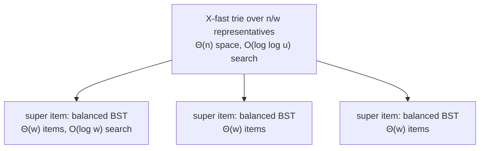

# 8. Y-fast tries: fixing X-fast tries by indirection

## The source

- Y-fast tries are due to **Willard, IPL 1983** — a roughly four-page paper including intro and bibliography. X-fast tries occupy the first page or two; the very next section presents y-fast tries, which eliminate the extra factor of `w` [`1:21:39`](https://www.youtube.com/watch?v=0JUN9aDxVmI&t=4899), [`1:22:07`](https://www.youtube.com/watch?v=0JUN9aDxVmI&t=4927).

## The technique: indirection

The lecturer flags this as a **general technique worth knowing**, in line with the course goal of learning which technique to reach for [`1:22:30`](https://www.youtube.com/watch?v=0JUN9aDxVmI&t=4950), [`1:23:08`](https://www.youtube.com/watch?v=0JUN9aDxVmI&t=4988).

- Build the X-fast trie over only **`n / w` "super items"** instead of `n` items. Since X-fast costs `n·w` space on `n` items, on `n/w` items it costs **`Θ(n)` space** [`1:23:08`](https://www.youtube.com/watch?v=0JUN9aDxVmI&t=4988).
- Each super item bundles roughly `w` consecutive elements — the first `w` items, the next `w` items, and so on — and one of them acts as the **representative** that actually lives in the X-fast trie [`1:23:46`](https://www.youtube.com/watch?v=0JUN9aDxVmI&t=5026).
- Inside each super item, the elements are stored in a **balanced BST** [`1:24:20`](https://www.youtube.com/watch?v=0JUN9aDxVmI&t=5060).
- Super items are kept at `Θ(w)` size, between roughly `w/2` and `2w` items [`1:24:20`](https://www.youtube.com/watch?v=0JUN9aDxVmI&t=5060), [`1:25:54`](https://www.youtube.com/watch?v=0JUN9aDxVmI&t=5154).

## Why both defects vanish

- **Space**: definitely linear now [`1:25:25`](https://www.youtube.com/watch?v=0JUN9aDxVmI&t=5125).
- **Query**: `O(log log u)` in the X-fast trie, then `O(log w)` in the super item's BST — and `log w = log log u`, so the total stays `O(log log u)` [`1:25:41`](https://www.youtube.com/watch?v=0JUN9aDxVmI&t=5141).
- **Insertion**: don't touch the X-fast trie at all — locate the right super item and insert into its BST. Only when a super item **overflows past `2w`** do you split it into two and insert into the trie above. That happens roughly once every `w` insertions, and costs `O(log w)` when it does — so **amortized constant** for the trie-level work [`1:25:54`](https://www.youtube.com/watch?v=0JUN9aDxVmI&t=5154), [`1:26:42`](https://www.youtube.com/watch?v=0JUN9aDxVmI&t=5202), [`1:27:03`](https://www.youtube.com/watch?v=0JUN9aDxVmI&t=5223).

## Depth of coverage

- Only sketched. The lecturer deliberately stops short of full details because y-fast tries achieve **exactly the same bound** as the hashed vEB structure, which he considers simpler; full details are left as optional reading [`1:24:52`](https://www.youtube.com/watch?v=0JUN9aDxVmI&t=5092), [`1:27:03`](https://www.youtube.com/watch?v=0JUN9aDxVmI&t=5223).

## Closing note: optimality

- A paper proves a **matching lower bound**: no structure can beat the min of van Emde Boas (or a slightly tweaked version) and fusion trees. Both are therefore **optimal** among linear- or nearly-linear-space predecessor data structures [`1:27:49`](https://www.youtube.com/watch?v=0JUN9aDxVmI&t=5269).
- **Next lecture**: fusion trees [`1:27:23`](https://www.youtube.com/watch?v=0JUN9aDxVmI&t=5243).
