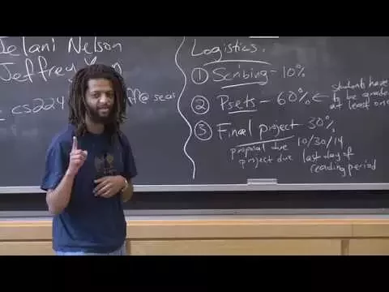
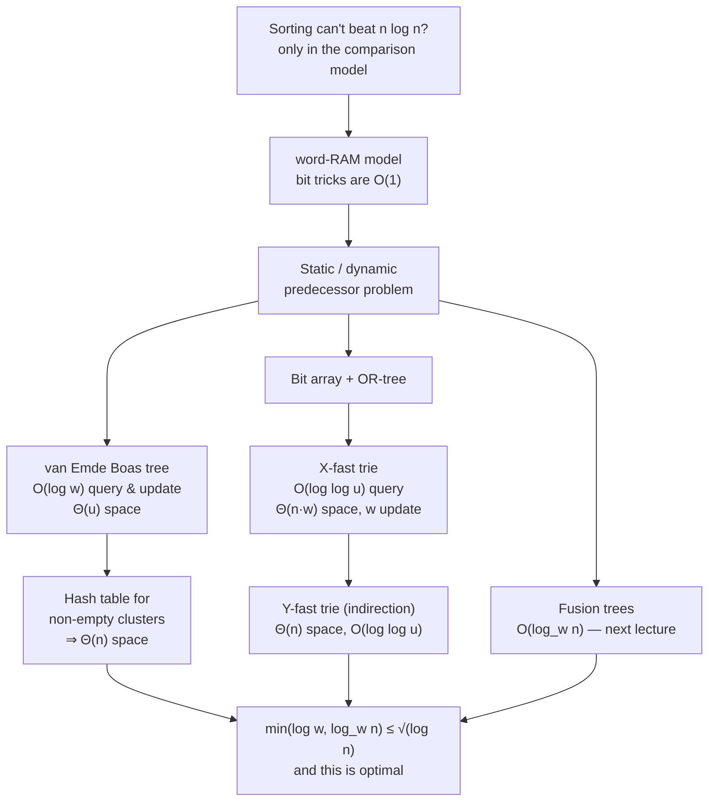

# Advanced Algorithms (COMPSCI 224), Lecture 1

*Harvard University · Jelani Nelson · 1:28:19 · [Watch on YouTube](https://www.youtube.com/watch?v=0JUN9aDxVmI)*

**Type:** university lecture (educational).

## Summary

The opening lecture of Harvard's CS224 covers course logistics, then immediately attacks the belief that sorting cannot beat `n log n` — showing that bound only holds in the **comparison model**, which real machines don't obey. The lecture introduces the **word-RAM model** (integers in `[0, 2^w)`, all C-style bit and arithmetic operations in `O(1)`, `w ≥ log n`) and uses it to study the **static predecessor problem**, since a fast dynamic predecessor structure immediately yields a fast sorting algorithm. It then builds **van Emde Boas trees** in full (recursive `√u` clusters plus a summary, min-as-buffer, `O(log log u)` query and insert), shrinks their `Θ(u)` space to `Θ(n)` with a hash table and a charging argument, and sketches the alternative **X-fast / Y-fast trie** route to the same bound.

## Topics

1. [Course logistics and goals](./01-course-logistics-and-goals.md) — grading, scribing, P-sets, and how CS224 differs from CS124.
2. [The predecessor problem, and why it beats the n log n sorting bound](./02-static-predecessor-and-sorting.md) — definition, baselines, and the reduction from sorting.
3. [The word-RAM model](./03-word-ram-model.md) — universe size, word size, and the constant-time operation set.
4. [The landscape: bounds, combination, and sorting consequences](./04-landscape-of-bounds.md) — vEB vs. fusion trees, `√(log n)`, and known sorting results.
5. [van Emde Boas trees: structure, query, insert](./05-van-emde-boas-trees.md) — the recursive design and its `O(log log u)` analysis.
6. [From `Θ(u)` space to `Θ(n)`: hashing and the dictionary problem](./06-linear-space-and-the-dictionary-problem.md) — the charging argument and the dictionary black box.
7. [X-fast tries](./07-x-fast-tries.md) — bit array, OR-tree, monotone-path binary search, hashed levels.
8. [Y-fast tries: fixing X-fast tries by indirection](./08-y-fast-tries-and-indirection.md) — super items, balanced BSTs, amortized splits, and the matching lower bound.

## Key takeaways

- The `Ω(n log n)` sorting bound is an artifact of the **comparison model**; in the word-RAM model, where XOR, shifts, and integer arithmetic are `O(1)`, both predecessor and sorting go faster [`9:47`](https://www.youtube.com/watch?v=0JUN9aDxVmI&t=587), [`16:31`](https://www.youtube.com/watch?v=0JUN9aDxVmI&t=991), [`17:08`](https://www.youtube.com/watch?v=0JUN9aDxVmI&t=1028).
- **van Emde Boas trees achieve `O(log w) = O(log log u)` for both query and update** — beating the `O(log n)` of balanced BSTs — via `√u` recursion plus a summary structure, with the minimum kept in a separate buffer so insertion never recurses deeply twice [`20:23`](https://www.youtube.com/watch?v=0JUN9aDxVmI&t=1223), [`49:13`](https://www.youtube.com/watch?v=0JUN9aDxVmI&t=2953), [`51:58`](https://www.youtube.com/watch?v=0JUN9aDxVmI&t=3118), [`52:30`](https://www.youtube.com/watch?v=0JUN9aDxVmI&t=3150).
- The naive vEB layout costs `Θ(u)` space (unusable at `u = 2^64`), but replacing the cluster array with a **hash table keyed on non-empty cluster IDs cuts it to `Θ(n)`** — proved by charging each `(ID, pointer)` pair to the minimum element of that cluster, which is charged exactly once [`55:20`](https://www.youtube.com/watch?v=0JUN9aDxVmI&t=3320), [`57:51`](https://www.youtube.com/watch?v=0JUN9aDxVmI&t=3471), [`59:44`](https://www.youtube.com/watch?v=0JUN9aDxVmI&t=3584), [`1:00:39`](https://www.youtube.com/watch?v=0JUN9aDxVmI&t=3639).
- Choosing the better of vEB (`log w`) and fusion trees (`log_w n`) gives `min(log w, log_w n)`, which is **always at most `√(log n)`**, and dynamic fusion trees therefore sort in `O(n √(log n))` — with better results known: `O(n log log n)` deterministic (Han & Stock 2002) and `O(n √(log log n))` expected (Han & Thorup, FOCS 2002); linear-time sorting in this model is **still open** [`23:58`](https://www.youtube.com/watch?v=0JUN9aDxVmI&t=1438), [`24:23`](https://www.youtube.com/watch?v=0JUN9aDxVmI&t=1463), [`25:01`](https://www.youtube.com/watch?v=0JUN9aDxVmI&t=1501), [`26:18`](https://www.youtube.com/watch?v=0JUN9aDxVmI&t=1578), [`27:03`](https://www.youtube.com/watch?v=0JUN9aDxVmI&t=1623).
- **X-fast tries reach `O(log log u)` query by binary-searching the monotone leaf-to-root path** of an OR-tree (with `k`-th ancestors reachable in `O(1)` through a heap array layout and a bit shift), but pay `Θ(n·w)` space and `w` update time; **Y-fast tries remove both factors of `w` by indirection** — an X-fast trie over `n/w` representative "super items", each a balanced BST of `Θ(w)` elements, split only on overflow [`1:13:56`](https://www.youtube.com/watch?v=0JUN9aDxVmI&t=4436), [`1:15:41`](https://www.youtube.com/watch?v=0JUN9aDxVmI&t=4541), [`1:21:39`](https://www.youtube.com/watch?v=0JUN9aDxVmI&t=4899), [`1:23:08`](https://www.youtube.com/watch?v=0JUN9aDxVmI&t=4988), [`1:26:42`](https://www.youtube.com/watch?v=0JUN9aDxVmI&t=5202).
- These bounds are **provably optimal**: a matching lower bound shows no linear- or nearly-linear-space predecessor structure can beat the min of van Emde Boas and fusion trees [`1:27:49`](https://www.youtube.com/watch?v=0JUN9aDxVmI&t=5269).
