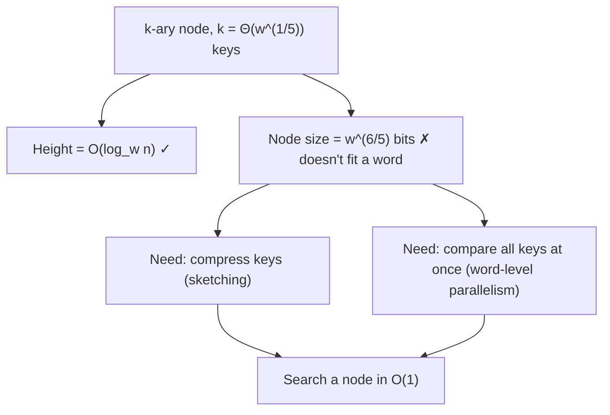

# 3. The k-ary tree structure and the constant-time-per-node constraint

## Basic idea

- Replace binary search trees with **k-ary search trees**, `k > 2` — the same shape as 2-3-4 trees / B-trees ([`4:14`](https://www.youtube.com/watch?v=3_o0-zPRQqw&t=254)).
- Every node holds roughly **k sorted keys** (e.g. 5, 15, 27, 32, 48) with a subtree hanging between each consecutive pair: everything `< 5` on the far left, everything between 5 and 15 next, and so on ([`4:50`](https://www.youtube.com/watch?v=3_o0-zPRQqw&t=290), [`5:16`](https://www.youtube.com/watch?v=3_o0-zPRQqw&t=316)).
- The chosen fan-out is **k = Θ(w^(1/5))** keys per node ([`6:04`](https://www.youtube.com/watch?v=3_o0-zPRQqw&t=364)).

## Height calculation

- Height of a k-ary tree is `log_k n` ([`6:39`](https://www.youtube.com/watch?v=3_o0-zPRQqw&t=399)).
- With `k = w^(1/5)`: height `= O(log_{w^(1/5)} n) = log n / ((1/5) log w) = O(log_w n)` — exactly the target bound ([`6:39`](https://www.youtube.com/watch?v=3_o0-zPRQqw&t=399), [`7:10`](https://www.youtube.com/watch?v=3_o0-zPRQqw&t=430)).

## Why only O(1) time per node is affordable

Total query time = depth × time spent at each node ([`7:10`](https://www.youtube.com/watch?v=3_o0-zPRQqw&t=430)):

| Per-node strategy | Total cost | Verdict |
| --- | --- | --- |
| Linear scan of the k keys | `k · log_k n` | always **worse** than `log_2 n` ([`7:37`](https://www.youtube.com/watch?v=3_o0-zPRQqw&t=457), [`7:53`](https://www.youtube.com/watch?v=3_o0-zPRQqw&t=473)) |
| Binary search inside the node | `log k · log_k n = log n` | the `log k` cancels — **no gain** ([`7:53`](https://www.youtube.com/watch?v=3_o0-zPRQqw&t=473)) |
| **O(1) per node** | `O(log_w n)` | the only option that works ([`7:53`](https://www.youtube.com/watch?v=3_o0-zPRQqw&t=473)) |

## The blatant obstacle

- Each key occupies a **full word `w`** (not `log w`) — a key fits in exactly one word ([`8:18`](https://www.youtube.com/watch?v=3_o0-zPRQqw&t=498), [`8:40`](https://www.youtube.com/watch?v=3_o0-zPRQqw&t=520)).
- So a node of `w^(1/5)` keys needs **`w^(6/5)` bits** — it does not even fit in a single machine word, let alone get processed in constant time ([`8:40`](https://www.youtube.com/watch?v=3_o0-zPRQqw&t=520)).
- Central question of the lecture: **how do we search a single fusion tree node in constant time?** ([`8:59`](https://www.youtube.com/watch?v=3_o0-zPRQqw&t=539))

