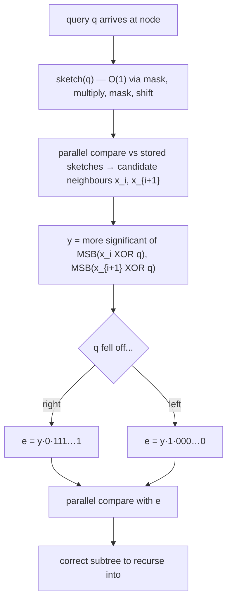

# 6. When the query's sketch lies about where it belongs

## The counterexample

Four keys with `w = 4` ([`22:02`](https://www.youtube.com/watch?v=3_o0-zPRQqw&t=1322)):

| Key | Sketch (bits 0 and 3, read from the left) |
| --- | --- |
| `0000` | `00` |
| `0010` | `01` |
| `1100` | `10` |
| `1111` | `11` |

- Two branch bits: the **0th and 3rd bits from the left** ([`22:22`](https://www.youtube.com/watch?v=3_o0-zPRQqw&t=1342), [`24:30`](https://www.youtube.com/watch?v=3_o0-zPRQqw&t=1470)).
- Query `q = 0101` has `sketch(q) = 00` ([`24:55`](https://www.youtube.com/watch?v=3_o0-zPRQqw&t=1495), [`25:25`](https://www.youtube.com/watch?v=3_o0-zPRQqw&t=1525)).
- **Truth:** `q` belongs between `0010` and `1100`. **Sketch says:** it sits at the very bottom, between the first two keys ([`25:25`](https://www.youtube.com/watch?v=3_o0-zPRQqw&t=1525), [`25:52`](https://www.youtube.com/watch?v=3_o0-zPRQqw&t=1552)).
- Formally: `sketch(q)` between `sketch(x_i)` and `sketch(x_{i+1})` **does not imply** `q` is between `x_i` and `x_{i+1}` ([`27:25`](https://www.youtube.com/watch?v=3_o0-zPRQqw&t=1645)).
- Cause: `q` branched off at a position that is **not a stored branch bit**, so the sketch lost the information ([`27:03`](https://www.youtube.com/watch?v=3_o0-zPRQqw&t=1623)).

## The fix: build a surrogate key `e`

Let **`y`** be the node (trie prefix) where `q` **first falls off** the highlighted paths ([`28:15`](https://www.youtube.com/watch?v=3_o0-zPRQqw&t=1695)). Two cases:

- `q` falls off to the **right** → `e = y · 0 · 111...1` (y, then a 0, then all ones) ([`29:21`](https://www.youtube.com/watch?v=3_o0-zPRQqw&t=1761), [`29:56`](https://www.youtube.com/watch?v=3_o0-zPRQqw&t=1796)).
- `q` falls off to the **left** → `e = y · 1 · 000...0` ([`29:56`](https://www.youtube.com/watch?v=3_o0-zPRQqw&t=1796)).

**Claim:** where `sketch(e)` falls among the `sketch(x_i)` is the same as where **`q` falls among the `x_i`** — which is what we actually want ([`29:56`](https://www.youtube.com/watch?v=3_o0-zPRQqw&t=1796), [`31:43`](https://www.youtube.com/watch?v=3_o0-zPRQqw&t=1903)). The proof is left as an exercise ([`33:40`](https://www.youtube.com/watch?v=3_o0-zPRQqw&t=2020)).

## The resulting two-pass query procedure

1. Run the parallel comparison of `sketch(q)` against the stored sketches to find where it lands ([`32:10`](https://www.youtube.com/watch?v=3_o0-zPRQqw&t=1930)).
2. Use the two neighbours found to form `e`.
3. Run the comparison **again** with `e`; that second result determines which subtree to descend into ([`32:10`](https://www.youtube.com/watch?v=3_o0-zPRQqw&t=1930)).

## Finding `y` with MSB and XOR

- `x_i XOR q` marks exactly the bits where the two differ; its **most significant set bit** is the **first bit** where they diverge ([`34:08`](https://www.youtube.com/watch?v=3_o0-zPRQqw&t=2048)).
- The XOR is applied to the **actual `x_i`** (which are stored in full), not to the sketches ([`34:37`](https://www.youtube.com/watch?v=3_o0-zPRQqw&t=2077), [`41:03`](https://www.youtube.com/watch?v=3_o0-zPRQqw&t=2463)).
- Compute `MSB(x_i XOR q)` **and** `MSB(x_{i+1} XOR q)`, then take **the more significant of the two** — that gives the first place `q` falls off between the two neighbours ([`34:54`](https://www.youtube.com/watch?v=3_o0-zPRQqw&t=2094)).
- This is why constant-time MSB (topic 10) is a prerequisite ([`35:34`](https://www.youtube.com/watch?v=3_o0-zPRQqw&t=2134)).

## Ties

- When `sketch(e)` equals one of the stored sketches there are only **two candidate positions left**, so a direct comparison against `x_i` and `x_{i+1}` resolves it ([`45:02`](https://www.youtube.com/watch?v=3_o0-zPRQqw&t=2702), [`45:37`](https://www.youtube.com/watch?v=3_o0-zPRQqw&t=2737), [`45:54`](https://www.youtube.com/watch?v=3_o0-zPRQqw&t=2754)).

