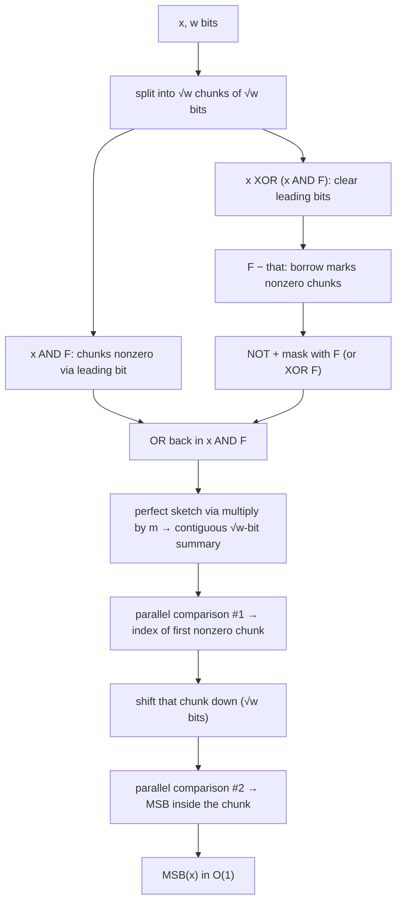

# 10. Constant-time most significant bit

The last missing piece, built from **multiplication, sketching, word-level parallelism** and the counting idea already developed ([`1:12:44`](https://www.youtube.com/watch?v=3_o0-zPRQqw&t=4364), [`1:13:06`](https://www.youtube.com/watch?v=3_o0-zPRQqw&t=4386)).

## Strategy: split into chunks

- Split `x` into **√w chunks of √w bits each** — a one-time split, **not** a recursive vEB-style recursion ([`1:13:06`](https://www.youtube.com/watch?v=3_o0-zPRQqw&t=4386), [`1:13:40`](https://www.youtube.com/watch?v=3_o0-zPRQqw&t=4420)).
- Running example: `w = 16`, `√w = 4`, `x = 0101 0000 1000 0110 1` ([`1:13:40`](https://www.youtube.com/watch?v=3_o0-zPRQqw&t=4420), [`1:14:18`](https://www.youtube.com/watch?v=3_o0-zPRQqw&t=4458)).
- Two phases: (1) build a contiguous `√w`-bit summary saying **which chunks are nonzero**; (2) find the first nonzero **within** the winning chunk ([`1:14:18`](https://www.youtube.com/watch?v=3_o0-zPRQqw&t=4458), [`1:14:38`](https://www.youtube.com/watch?v=3_o0-zPRQqw&t=4478)). `√w`-size numbers can be manipulated "crazy fast" ([`1:14:38`](https://www.youtube.com/watch?v=3_o0-zPRQqw&t=4478)).

## Phase 1 — which chunks are nonempty

Let `F = 1000 1000 1000 1000` — a 1 in the leading bit of each chunk ([`1:15:03`](https://www.youtube.com/watch?v=3_o0-zPRQqw&t=4503)).

1. `x AND F` — records which chunks are nonzero **because of their leading bit** ([`1:15:26`](https://www.youtube.com/watch?v=3_o0-zPRQqw&t=4526), [`1:15:48`](https://www.youtube.com/watch?v=3_o0-zPRQqw&t=4548)).
   - The leading bit is handled separately because the **borrow/subtraction trick needs a free 1 bit** at the top of every chunk ([`1:16:05`](https://www.youtube.com/watch?v=3_o0-zPRQqw&t=4565)).
2. `x XOR (x AND F)` — clears every leading bit ([`1:16:29`](https://www.youtube.com/watch?v=3_o0-zPRQqw&t=4589), [`1:16:50`](https://www.youtube.com/watch?v=3_o0-zPRQqw&t=4610)).
3. `F − (x XOR (x AND F))` — within each chunk `F` is larger (its top bit was just cleared in the other operand), so **the leading 1 is borrowed exactly when the chunk is nonzero** ([`1:16:50`](https://www.youtube.com/watch?v=3_o0-zPRQqw&t=4610), [`1:17:34`](https://www.youtube.com/watch?v=3_o0-zPRQqw&t=4654), [`1:18:04`](https://www.youtube.com/watch?v=3_o0-zPRQqw&t=4684), [`1:18:29`](https://www.youtube.com/watch?v=3_o0-zPRQqw&t=4709)).
4. **NOT, then mask** with `F` to drop the junk — a correction raised from the audience; equivalently, XOR with `F` ([`1:18:29`](https://www.youtube.com/watch?v=3_o0-zPRQqw&t=4709), [`1:18:51`](https://www.youtube.com/watch?v=3_o0-zPRQqw&t=4731), [`1:20:00`](https://www.youtube.com/watch?v=3_o0-zPRQqw&t=4800), [`1:20:34`](https://www.youtube.com/watch?v=3_o0-zPRQqw&t=4834)).
5. `OR` back in `x AND F` to restore the leading-bit information that step 2 destroyed ([`1:18:51`](https://www.youtube.com/watch?v=3_o0-zPRQqw&t=4731), [`1:19:14`](https://www.youtube.com/watch?v=3_o0-zPRQqw&t=4754)).

**Invariant achieved:** each `√w`-sized chunk carries a 1 in its leading position **iff** that chunk is nonempty ([`1:19:41`](https://www.youtube.com/watch?v=3_o0-zPRQqw&t=4781), [`1:20:34`](https://www.youtube.com/watch?v=3_o0-zPRQqw&t=4834)).

## Phase 2 — perfect sketch of the summary

- Now do a **perfect sketch** (no `r^4` slack), again by multiplication ([`1:21:00`](https://www.youtube.com/watch?v=3_o0-zPRQqw&t=4860)).
- Why perfect is possible here: the important bit positions are no longer arbitrary branch bits — they are exactly `b_i = i·√w + √w − 1` ([`1:21:00`](https://www.youtube.com/watch?v=3_o0-zPRQqw&t=4860), [`1:21:30`](https://www.youtube.com/watch?v=3_o0-zPRQqw&t=4890)).
- **Lemma:** for such regularly spaced `b_i` there exists an `m` whose multiplication makes all the important bits **consecutive with no gaps**; the proof is left as homework ([`1:21:30`](https://www.youtube.com/watch?v=3_o0-zPRQqw&t=4890), [`1:22:23`](https://www.youtube.com/watch?v=3_o0-zPRQqw&t=4943)).
- Multiplying by `m` plus a shift and mask yields the contiguous summary word (e.g. `1011`) in constant time ([`1:22:23`](https://www.youtube.com/watch?v=3_o0-zPRQqw&t=4943), [`1:23:00`](https://www.youtube.com/watch?v=3_o0-zPRQqw&t=4980)).

## Phase 3 — two parallel comparisons

1. **Parallel-compare** the summary word against the `√w` powers-of-two vector (`0001, 0010, 0100, 1000`, each `√w` wide, `√w` of them) to locate the **first nonzero chunk** ([`1:23:21`](https://www.youtube.com/watch?v=3_o0-zPRQqw&t=5001), [`1:23:52`](https://www.youtube.com/watch?v=3_o0-zPRQqw&t=5032), [`1:24:06`](https://www.youtube.com/watch?v=3_o0-zPRQqw&t=5046)).
   - Space check: `√w` items of `√w` bits fit in a word **even with the sentinel 1s** used by parallel comparison — it still fits in two words ([`1:23:52`](https://www.youtube.com/watch?v=3_o0-zPRQqw&t=5032)).
2. **Shift that chunk down** (it fits in `√w` bits) and run a **second parallel comparison** against the same `√w` values to find the MSB inside it ([`1:24:06`](https://www.youtube.com/watch?v=3_o0-zPRQqw&t=5046), [`1:24:26`](https://www.youtube.com/watch?v=3_o0-zPRQqw&t=5066)).

That yields the most significant bit in **O(1)** — completing fusion trees, modulo the homework lemma ([`1:24:26`](https://www.youtube.com/watch?v=3_o0-zPRQqw&t=5066)).

