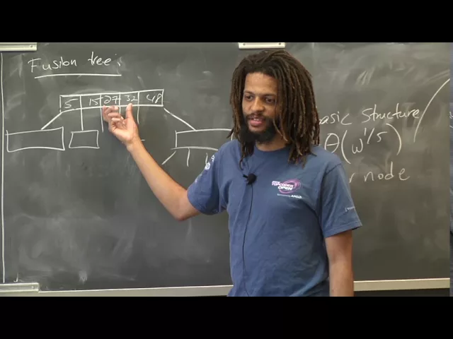
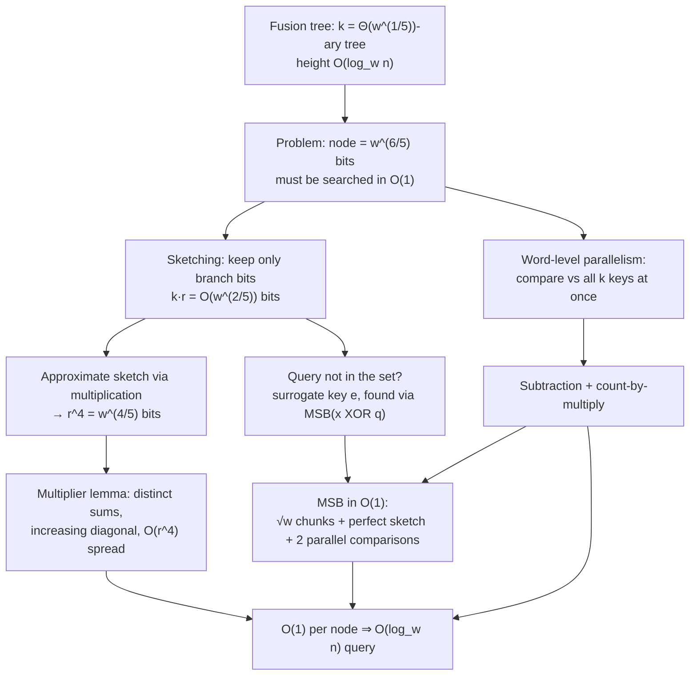

# Advanced Algorithms (COMPSCI 224), Lecture 2

*Harvard University · 1:25:39 · [Watch on YouTube](https://www.youtube.com/watch?v=3_o0-zPRQqw)*

## Summary

A full lecture on **fusion trees** (Fredman–Willard), the Word-RAM data structure that answers static predecessor queries in `O(log_w n)` time. After a short erratum about the van Emde Boas space argument from lecture 1, the lecture builds a `Θ(w^(1/5))`-ary search tree whose height is `O(log_w n)`, then spends the rest of the hour solving the one hard problem this creates: a node holding `w^(1/5)` full-word keys occupies `w^(6/5)` bits, so it cannot even fit in a machine word — yet it must be searched in **constant time**.

The solution is assembled from four bit-level ingredients: **sketching** (project keys onto their branch bits), **multiplication** as an approximate bit-gathering instruction, **word-level parallelism** (compare the query against all k keys with one subtraction and one multiplication), and a **constant-time most-significant-bit** routine. Along the way the lecture handles the subtle case where the query is not one of the stored keys, and proves the multiplier lemma that makes approximate sketching work.

## Topics

1. [Correction to the van Emde Boas space argument](01-van-emde-boas-correction.md) — [`0:00`](https://www.youtube.com/watch?v=3_o0-zPRQqw&t=0)
2. [Fusion trees: problem statement and known bounds](02-fusion-trees-overview-and-bounds.md) — [`1:35`](https://www.youtube.com/watch?v=3_o0-zPRQqw&t=95)
3. [The k-ary tree structure and the constant-time-per-node constraint](03-k-ary-search-tree-structure.md) — [`4:14`](https://www.youtube.com/watch?v=3_o0-zPRQqw&t=254)
4. [The Word-RAM toolkit](04-word-ram-toolkit.md) — [`9:52`](https://www.youtube.com/watch?v=3_o0-zPRQqw&t=592)
5. [Sketching: branch bits](05-sketching-and-branch-bits.md) — [`13:52`](https://www.youtube.com/watch?v=3_o0-zPRQqw&t=832)
6. [When the query's sketch lies about where it belongs](06-queries-outside-the-set.md) — [`21:14`](https://www.youtube.com/watch?v=3_o0-zPRQqw&t=1274)
7. [Approximate sketching via multiplication](07-approximate-sketching-via-multiplication.md) — [`37:37`](https://www.youtube.com/watch?v=3_o0-zPRQqw&t=2257)
8. [Proof of the multiplier lemma](08-proof-of-the-multiplier-lemma.md) — [`56:05`](https://www.youtube.com/watch?v=3_o0-zPRQqw&t=3365)
9. [Node layout and parallel comparison](09-node-layout-and-parallel-comparison.md) — [`1:03:39`](https://www.youtube.com/watch?v=3_o0-zPRQqw&t=3819)
10. [Constant-time most significant bit](10-constant-time-most-significant-bit.md) — [`1:12:44`](https://www.youtube.com/watch?v=3_o0-zPRQqw&t=4364)

Full [transcript](transcript.md).

## Key takeaways

- **CLRS Exercise 20-1(f)'s intended solution is wrong.** Replacing vEB arrays with hash tables does *not* actually give `O(n)` space — it is slightly worse, and this is not just a gap in the argument. `O(n)` is still reachable (assigned as a P-set problem), and y-fast tries as presented already achieve it via indirection ([`0:39`](https://www.youtube.com/watch?v=3_o0-zPRQqw&t=39), [`0:56`](https://www.youtube.com/watch?v=3_o0-zPRQqw&t=56), [`1:12`](https://www.youtube.com/watch?v=3_o0-zPRQqw&t=72)).
- **Fusion trees achieve `O(log_w n)` static predecessor queries** with `k = Θ(w^(1/5))` keys per node; the height `log_{w^(1/5)} n` reduces exactly to `log_w n`. Andersson–Thorup later added deterministic `log_w n + log log n` updates, Raman expected `log_w n` updates ([`2:35`](https://www.youtube.com/watch?v=3_o0-zPRQqw&t=155), [`6:39`](https://www.youtube.com/watch?v=3_o0-zPRQqw&t=399), [`7:10`](https://www.youtube.com/watch?v=3_o0-zPRQqw&t=430)).
- **Only `O(1)` time per node is affordable.** Scanning a node costs `k·log_k n` (worse than `log n`); binary search inside a node costs `log k · log_k n = log n`, cancelling the gain entirely — which is why the whole lecture is spent on constant-time node search ([`7:37`](https://www.youtube.com/watch?v=3_o0-zPRQqw&t=457), [`7:53`](https://www.youtube.com/watch?v=3_o0-zPRQqw&t=473)).
- **Sketching shrinks a node from `w^(6/5)` bits to `O(w^(2/5))`.** Projecting keys onto their `r < k` branch bits preserves their relative order, and all k sketches then fit in a single word ([`18:23`](https://www.youtube.com/watch?v=3_o0-zPRQqw&t=1103), [`20:03`](https://www.youtube.com/watch?v=3_o0-zPRQqw&t=1203)).
- **Multiplication substitutes for the missing "gather bits" instruction.** With a multiplier `m` satisfying the lemma (all `r²` sums `b_i + m_j` distinct → no carries; diagonal sums increasing; spread `O(r^4)`), a sketch costs exactly four word operations — mask, multiply, mask, shift — and works on an online query, compressing the important bits from a width of `w` down to `r^4 = w^(4/5)` ([`48:09`](https://www.youtube.com/watch?v=3_o0-zPRQqw&t=2889), [`49:41`](https://www.youtube.com/watch?v=3_o0-zPRQqw&t=2981), [`53:51`](https://www.youtube.com/watch?v=3_o0-zPRQqw&t=3231), [`1:03:39`](https://www.youtube.com/watch?v=3_o0-zPRQqw&t=3819)).
- **The lemma's multiplier exists by a counting argument:** at most `t·r² < r³` values are forbidden at each inductive step while `r³` residues are available, so a valid `m'_t` always exists; adding `i·r³` then separates the sums into distinct blocks ([`58:39`](https://www.youtube.com/watch?v=3_o0-zPRQqw&t=3519), [`1:01:01`](https://www.youtube.com/watch?v=3_o0-zPRQqw&t=3661)).
- **A sketch alone can point to the wrong subtree.** Shown concretely with `q = 0101` against keys `0000, 0010, 1100, 1111`: `sketch(q) = 00` places it at the bottom although `q` really lies between `0010` and `1100`. The fix is a surrogate `e = y·0·11…1` or `y·1·00…0`, where `y` is located by taking the more significant of `MSB(x_i XOR q)` and `MSB(x_{i+1} XOR q)` ([`22:02`](https://www.youtube.com/watch?v=3_o0-zPRQqw&t=1322), [`25:52`](https://www.youtube.com/watch?v=3_o0-zPRQqw&t=1552), [`29:56`](https://www.youtube.com/watch?v=3_o0-zPRQqw&t=1796), [`34:54`](https://www.youtube.com/watch?v=3_o0-zPRQqw&t=2094)).
- **Parallel comparison beats all k keys at once with one subtraction plus one multiplication.** Sentinel 1 bits stop carries from crossing blocks; the resulting leading bits are monotone, so the position of the first 1 is recovered by *counting* 1s — a multiply that sums all copies into a single `log k`-wide field. MSB is deliberately avoided here to prevent circularity, since MSB is itself built from this trick ([`1:06:04`](https://www.youtube.com/watch?v=3_o0-zPRQqw&t=3964), [`1:07:46`](https://www.youtube.com/watch?v=3_o0-zPRQqw&t=4066), [`1:09:21`](https://www.youtube.com/watch?v=3_o0-zPRQqw&t=4161), [`1:12:15`](https://www.youtube.com/watch?v=3_o0-zPRQqw&t=4335)).
- **MSB drops from `O(w)` (loop) or `O(log w)` (binary search) to `O(1)`** by splitting into `√w` chunks of `√w` bits, marking nonempty chunks with an `F − x` borrow trick, compacting the summary with a *perfect* sketch (possible because the bit positions `i√w + √w − 1` are regular), then running two parallel comparisons — one to find the chunk, one to find the bit inside it ([`12:02`](https://www.youtube.com/watch?v=3_o0-zPRQqw&t=722), [`12:19`](https://www.youtube.com/watch?v=3_o0-zPRQqw&t=739), [`1:18:29`](https://www.youtube.com/watch?v=3_o0-zPRQqw&t=4709), [`1:21:30`](https://www.youtube.com/watch?v=3_o0-zPRQqw&t=4890), [`1:24:26`](https://www.youtube.com/watch?v=3_o0-zPRQqw&t=5066)).
- **The static structure cannot be used for sorting** — preprocessing is polynomial and exceeds sorting time — but the dynamic Andersson–Thorup and Raman variants can. In practice the constant-time MSB is asymptotic only: on 64-bit words `log log w ≈ 6`, and the constant-time method uses more than 6 operations ([`3:48`](https://www.youtube.com/watch?v=3_o0-zPRQqw&t=228), [`13:09`](https://www.youtube.com/watch?v=3_o0-zPRQqw&t=789)).
