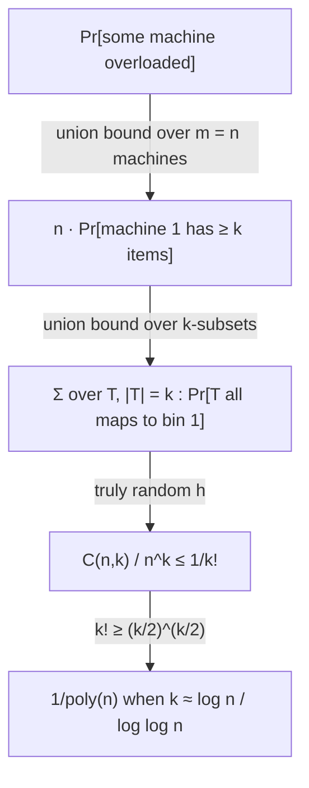

# 2. Load balancing: jobs, machines and balls-in-bins

## The motivating problem

- `n` jobs must be assigned to `m` identical machines; each job carries a job ID drawn from the universe `U` [`4:54`](https://www.youtube.com/watch?v=WqBc0ZCU4Uw&t=294), [`5:37`](https://www.youtube.com/watch?v=WqBc0ZCU4Uw&t=337).
- If all jobs are known up front, split them evenly: first `n/m` to machine 1, next `n/m` to machine 2, etc. [`6:07`](https://www.youtube.com/watch?v=WqBc0ZCU4Uw&t=367).
- Online arrivals break that. "Send to the least-loaded machine" works but needs a **global view** of every machine's load, which we want to avoid [`6:26`](https://www.youtube.com/watch?v=WqBc0ZCU4Uw&t=386), [`6:47`](https://www.youtube.com/watch?v=WqBc0ZCU4Uw&t=407).
- The stateless alternative: when job `j` arrives, process it on machine `h(j)` — i.e. hash the job ID to a machine [`6:47`](https://www.youtube.com/watch?v=WqBc0ZCU4Uw&t=407).
- This is exactly the **balls and bins** process: `n` balls thrown randomly into `m` bins. The question is whether any bin gets badly overloaded relative to the `n/m` average [`7:32`](https://www.youtube.com/watch?v=WqBc0ZCU4Uw&t=452), [`8:05`](https://www.youtube.com/watch?v=WqBc0ZCU4Uw&t=485).

## The Chernoff bound (stated, not fully proved)

- Setup: `X1, …, Xn` independent, each `Xi ∈ {0,1}` with `E[Xi] = pi`; let `X = Σ Xi` [`8:42`](https://www.youtube.com/watch?v=WqBc0ZCU4Uw&t=522), [`9:33`](https://www.youtube.com/watch?v=WqBc0ZCU4Uw&t=573).
- Bound: `Pr[X > (1+δ)·E[X]] ≤ ( e^δ / (1+δ)^(1+δ) )^E[X]` [`10:00`](https://www.youtube.com/watch?v=WqBc0ZCU4Uw&t=600).
- Proof sketch given in class [`16:35`](https://www.youtube.com/watch?v=WqBc0ZCU4Uw&t=995), [`17:00`](https://www.youtube.com/watch?v=WqBc0ZCU4Uw&t=1020):
  - **Markov's inequality**: for non-negative `X` and any `λ > 0`, `Pr[X > λ] ≤ E[X]/λ`.
  - Exponentiate both sides: `Pr[X > λ] = Pr[e^{tX} > e^{tλ}]` for any `t > 0` [`17:54`](https://www.youtube.com/watch?v=WqBc0ZCU4Uw&t=1074), [`18:29`](https://www.youtube.com/watch?v=WqBc0ZCU4Uw&t=1109).
  - Apply Markov: `≤ e^{-tλ}·E[e^{tX}]`, then bound the moment generating function and optimise `t`; the calculation ends up choosing `t = ln(1+δ)` [`18:29`](https://www.youtube.com/watch?v=WqBc0ZCU4Uw&t=1109), [`18:47`](https://www.youtube.com/watch?v=WqBc0ZCU4Uw&t=1127).
  - The full derivation is left to references (e.g. Wikipedia) [`19:10`](https://www.youtube.com/watch?v=WqBc0ZCU4Uw&t=1150).

## Result for the case m = n

- With `m = n`, average load is exactly 1 per machine, and:
  `Pr[∃ machine with more than c·log n / log log n jobs] ≤ 1/poly(n)` [`10:36`](https://www.youtube.com/watch?v=WqBc0ZCU4Uw&t=636).
- Chernoff derivation: fix machine `t`, set `Xi = 1` iff `h(i) = t`, so `X` counts jobs on machine `t` and `E[X] = 1` [`11:44`](https://www.youtube.com/watch?v=WqBc0ZCU4Uw&t=704), [`12:53`](https://www.youtube.com/watch?v=WqBc0ZCU4Uw&t=773).
- With `δ ≈ log n / log log n`, the bound collapses to `(e/k)^k` with `k ≈ log n / log log n` [`13:10`](https://www.youtube.com/watch?v=WqBc0ZCU4Uw&t=790), [`13:59`](https://www.youtube.com/watch?v=WqBc0ZCU4Uw&t=839).
- Why `k^k = poly(n)` forces `k ≈ log n / log log n`: take logs, giving `k·ln k = c·ln n`; a smaller constant makes it too small, a larger one too big [`14:27`](https://www.youtube.com/watch?v=WqBc0ZCU4Uw&t=867), [`15:04`](https://www.youtube.com/watch?v=WqBc0ZCU4Uw&t=904).
- **Union bound over the `n` machines** multiplies the per-machine failure probability by `n`, leaving `1/n^{c'-1}` — still `1/poly(n)`, so with high probability no machine exceeds that load [`15:19`](https://www.youtube.com/watch?v=WqBc0ZCU4Uw&t=919), [`16:05`](https://www.youtube.com/watch?v=WqBc0ZCU4Uw&t=965).

## The simpler union-bound proof (Chernoff is overkill)

Chernoff was stated because it is a broadly useful tool, but this result needs far less [`11:25`](https://www.youtube.com/watch?v=WqBc0ZCU4Uw&t=685), [`19:10`](https://www.youtube.com/watch?v=WqBc0ZCU4Uw&t=1150):

1. All machines are symmetric, so `Pr[∃ overloaded]` ≤ `n · Pr[machine 1 overloaded]` [`19:10`](https://www.youtube.com/watch?v=WqBc0ZCU4Uw&t=1150), [`20:01`](https://www.youtube.com/watch?v=WqBc0ZCU4Uw&t=1201).
2. "Overloaded" means at least `k` items land there; union-bound over all `k`-subsets `T` [`20:29`](https://www.youtube.com/watch?v=WqBc0ZCU4Uw&t=1229).
3. For a truly random `h` and `m = n`, `Pr[all of T maps to bin 1] = 1/n^k` [`21:21`](https://www.youtube.com/watch?v=WqBc0ZCU4Uw&t=1281), [`21:50`](https://www.youtube.com/watch?v=WqBc0ZCU4Uw&t=1310).
4. Summing over `C(n,k)` subsets gives `C(n,k)/n^k ≤ 1/k!` [`22:14`](https://www.youtube.com/watch?v=WqBc0ZCU4Uw&t=1334).
5. Crude but sufficient: `k! ≥ (k/2)^{k/2}` — no Stirling needed [`22:54`](https://www.youtube.com/watch?v=WqBc0ZCU4Uw&t=1374).
6. Solving `(k/2)^{k/2} = poly(n)` again yields `k ≈ log n / log log n`, the same answer [`23:16`](https://www.youtube.com/watch?v=WqBc0ZCU4Uw&t=1396), [`23:33`](https://www.youtube.com/watch?v=WqBc0ZCU4Uw&t=1413).

> The crucial observation for the next topic: this second proof only ever asks about **`k` items at a time**, never about all `n` simultaneously [`23:33`](https://www.youtube.com/watch?v=WqBc0ZCU4Uw&t=1413), [`24:02`](https://www.youtube.com/watch?v=WqBc0ZCU4Uw&t=1442).
