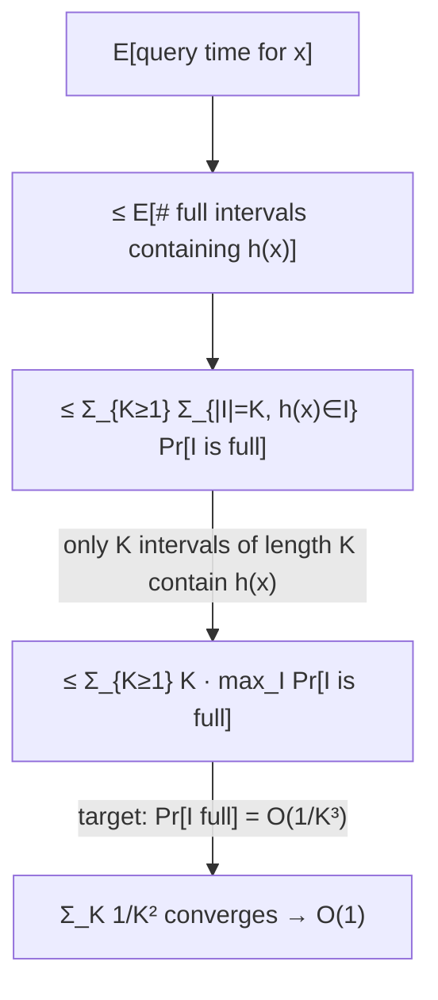

# 6. Analysing linear probing: full intervals and the moment method

## The claim being proved

> If `m ≥ c·n` and `h` is **7-wise independent**, then the expected query time (identical to update time, since the procedure is the same) is `O(1)` [`1:08:34`](https://www.youtube.com/watch?v=WqBc0ZCU4Uw&t=4114).

The whole question reduces to: starting at `h(x)`, how many non-empty cells must be touched before an empty one appears — i.e. how long is the **run** [`1:09:47`](https://www.youtube.com/watch?v=WqBc0ZCU4Uw&t=4187), [`1:10:12`](https://www.youtube.com/watch?v=WqBc0ZCU4Uw&t=4212), [`1:10:32`](https://www.youtube.com/watch?v=WqBc0ZCU4Uw&t=4232)?

## Definitions

- For an interval `I` of cells in `A`, `L(I)` = the number of items that **hash into** `I`, i.e. `|{i : h(i) ∈ I}|` [`1:11:07`](https://www.youtube.com/watch?v=WqBc0ZCU4Uw&t=4267).
- `I` is **full** if `L(I) ≥ |I|` — an interval of length `k` is full when at least `k` items hash there [`1:11:07`](https://www.youtube.com/watch?v=WqBc0ZCU4Uw&t=4267), [`1:12:08`](https://www.youtube.com/watch?v=WqBc0ZCU4Uw&t=4328).
- Critical subtlety: "full" counts items that *hashed to* the interval, not items that merely *ended up* in it after walking [`1:15:38`](https://www.youtube.com/watch?v=WqBc0ZCU4Uw&t=4538), [`1:15:59`](https://www.youtube.com/watch?v=WqBc0ZCU4Uw&t=4559).

## Lemma and its (corrected) proof

**Lemma**: if a query on `x` makes `K` probes, then `h(x)` lies in a full interval of length `K` [`1:13:26`](https://www.youtube.com/watch?v=WqBc0ZCU4Uw&t=4406).

Proof sketch [`1:14:30`](https://www.youtube.com/watch?v=WqBc0ZCU4Uw&t=4470), [`1:15:08`](https://www.youtube.com/watch?v=WqBc0ZCU4Uw&t=4508), [`1:15:38`](https://www.youtube.com/watch?v=WqBc0ZCU4Uw&t=4538):

- `A[h(x)]` is occupied by some item that either hashed there or walked forward from an earlier cell — meaning every cell between its hash position and `h(x)` is also occupied.
- The query then walks forward `K` cells, all occupied, so a contiguous block of occupied cells surrounds `h(x)`, and all its occupants originally hashed inside it.

**Correction from the audience**: the argument as first stated is incomplete because the chain of walkers can reach far back into the past. The fix, accepted by the lecturer, is to state the interval as having length **at least** `K` rather than exactly `K` [`1:16:34`](https://www.youtube.com/watch?v=WqBc0ZCU4Uw&t=4594), [`1:17:13`](https://www.youtube.com/watch?v=WqBc0ZCU4Uw&t=4633). A second audience point — that keys must be unique — was confirmed [`1:16:56`](https://www.youtube.com/watch?v=WqBc0ZCU4Uw&t=4616).

## From the lemma to a bound on expected time

- Expected query time `≤` expected number of full intervals containing `h(x)` [`1:18:34`](https://www.youtube.com/watch?v=WqBc0ZCU4Uw&t=4714).
- Expand as a sum over lengths `K` and over intervals `I` of length `K` containing `h(x)`, of `Pr[I is full]` [`1:19:23`](https://www.youtube.com/watch?v=WqBc0ZCU4Uw&t=4763).
- There are exactly `K` intervals of length `K` containing `h(x)`, so the sum is `≤ Σ_K K · max_I Pr[I full]` [`1:20:10`](https://www.youtube.com/watch?v=WqBc0ZCU4Uw&t=4810).
- **Sufficient target**: show `Pr[I full] = O(1/K³)`. Then the sum becomes `Σ_K 1/K²`, which converges to a constant [`1:20:49`](https://www.youtube.com/watch?v=WqBc0ZCU4Uw&t=4849), [`1:21:29`](https://www.youtube.com/watch?v=WqBc0ZCU4Uw&t=4889).

## Why the interval is unlikely to be full

- Fix `m = 2n` (the constant may need to grow later); `n` is the number of currently active keys [`1:21:55`](https://www.youtube.com/watch?v=WqBc0ZCU4Uw&t=4915), [`1:22:32`](https://www.youtube.com/watch?v=WqBc0ZCU4Uw&t=4952).
- Expected number of items hashing into an interval of length `K` is `K/2`, so "full" means deviating from the mean by a factor of 2 — i.e. by `K/2`, its own expectation [`1:23:08`](https://www.youtube.com/watch?v=WqBc0ZCU4Uw&t=4988), [`1:24:42`](https://www.youtube.com/watch?v=WqBc0ZCU4Uw&t=5082), [`1:25:13`](https://www.youtube.com/watch?v=WqBc0ZCU4Uw&t=5113).
- This is *exactly* the Chernoff setup from the start of the lecture (`xi = 1` iff item `i` lands in the interval), but **Chernoff needs full independence**, which we do not have [`1:23:08`](https://www.youtube.com/watch?v=WqBc0ZCU4Uw&t=4988), [`1:23:35`](https://www.youtube.com/watch?v=WqBc0ZCU4Uw&t=5015), [`1:23:52`](https://www.youtube.com/watch?v=WqBc0ZCU4Uw&t=5032), [`1:25:13`](https://www.youtube.com/watch?v=WqBc0ZCU4Uw&t=5113).
- Also needed, per a student question: k-wise independence alone does not pin down per-cell probabilities, so the family must additionally be **almost uniform** [`1:24:12`](https://www.youtube.com/watch?v=WqBc0ZCU4Uw&t=5052).

## The moment method (setup for the next lecture)

- Mirror the Chernoff trick — apply a function to both sides, then Markov — but with a **power instead of an exponential** [`1:25:47`](https://www.youtube.com/watch?v=WqBc0ZCU4Uw&t=5147), [`1:26:06`](https://www.youtube.com/watch?v=WqBc0ZCU4Uw&t=5166).
- Concretely: `Pr[ |L(I) - E[L(I)]| > K/2 ] = Pr[ (L(I)-E[L(I)])⁶ > (K/2)⁶ ] ≤ (K/2)^{-6} · E[ (L(I)-E[L(I)])⁶ ]` by Markov [`1:26:06`](https://www.youtube.com/watch?v=WqBc0ZCU4Uw&t=5166), [`1:26:40`](https://www.youtube.com/watch?v=WqBc0ZCU4Uw&t=5200).
- Bounding that 6th moment yields the desired `O(1/K³)`; the 6th power is exactly why **6-wise (hence 7-wise overall) independence** appears — note `6/2 = 3`, matching the `1/K³` target [`1:21:55`](https://www.youtube.com/watch?v=WqBc0ZCU4Uw&t=4915), [`1:26:40`](https://www.youtube.com/watch?v=WqBc0ZCU4Uw&t=5200).
- The 6th-power expansion itself will be mostly skipped next time as mechanical, perhaps with one term shown [`1:27:17`](https://www.youtube.com/watch?v=WqBc0ZCU4Uw&t=5237).

### Intuition for the moment method

- Raising a random variable to a high power and applying Markov is called the **moment method** [`1:27:17`](https://www.youtube.com/watch?v=WqBc0ZCU4Uw&t=5237).
- It works well for variables **concentrated** around their mean; if there is a large chance of being far from the mean, the high power blows the expectation up and the bound dies [`1:27:39`](https://www.youtube.com/watch?v=WqBc0ZCU4Uw&t=5259), [`1:28:02`](https://www.youtube.com/watch?v=WqBc0ZCU4Uw&t=5282).
- Recipe: suspect concentration → take a large moment → compute → the bound confirms the concentration [`1:28:13`](https://www.youtube.com/watch?v=WqBc0ZCU4Uw&t=5293).
- Chernoff itself can be derived by the moment method with a sufficiently large exponent; floated as a possible exercise [`1:28:13`](https://www.youtube.com/watch?v=WqBc0ZCU4Uw&t=5293), [`1:28:30`](https://www.youtube.com/watch?v=WqBc0ZCU4Uw&t=5310).
