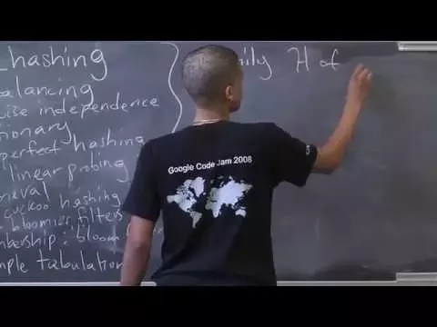
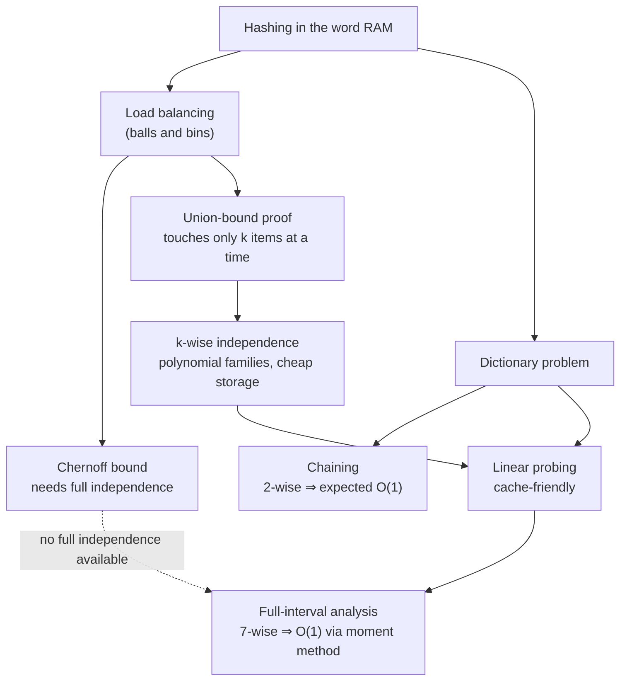

# Advanced Algorithms (COMPSCI 224), Lecture 3

*Harvard University · 1:28:46 · <https://www.youtube.com/watch?v=WqBc0ZCU4Uw>*

## Summary

A Harvard graduate lecture on **hashing in the word RAM model**. It starts with hashing as load balancing — the balls-and-bins process — proving that `n` jobs hashed to `n` machines leave no machine with more than `O(log n / log log n)` jobs, first via the Chernoff bound and then via a much simpler union-bound argument. That second proof motivates the lecture's central concept, **k-wise independence**: because the argument only ever inspects `k` items at a time, an expensive truly-random hash function (`u log u` bits) can be replaced by a degree-`k-1` polynomial family (`k log u` bits). The lecture then applies hashing to the **dictionary problem** — chaining with a 2-wise family for expected `O(1)` operations — before turning to **linear probing**, its cache-friendliness, its historical results, and the beginning of a proof that 7-wise independence gives constant expected query time via full intervals and the moment method.

## Topics

1. [Course roadmap and what hashing is](./01-course-roadmap-and-what-hashing-is.md) — the day's agenda, the formal `H : U → M` setup, and the notation used throughout.
2. [Load balancing: jobs, machines and balls-in-bins](./02-load-balancing-balls-and-bins.md) — the Chernoff bound, its Markov-based proof sketch, and two proofs of the max-load result.
3. [k-wise independence](./03-k-wise-independence.md) — definitions, polynomial families, storage savings, the `mod p mod m` wraparound bias.
4. [The dictionary problem and hashing with chaining](./04-dictionary-problem-and-chaining.md) — `update`/`query`, chaining with a 2-wise family, expected `O(1)`.
5. [Linear probing: the scheme, why it wins in practice, and known results](./05-linear-probing-and-known-results.md) — prefetching, Knuth 1963, the 2007/09 5-wise breakthrough, Pătraşcu–Thorup 2010.
6. [Analysing linear probing: full intervals and the moment method](./06-analyzing-linear-probing-full-intervals.md) — the full-interval lemma, the `O(1/K³)` target, the 6th-moment argument.

## Key takeaways

- Hashing `n` jobs onto `n` machines keeps the maximum load at `O(log n / log log n)` with probability `1 - 1/poly(n)`; the same bound comes out of both the Chernoff bound and a plain union bound over `k`-subsets [`10:36`](https://www.youtube.com/watch?v=WqBc0ZCU4Uw&t=636), [`23:16`](https://www.youtube.com/watch?v=WqBc0ZCU4Uw&t=1396).
- Chernoff is overkill for that result: the union-bound proof only needs `E[Π Xi] = Π E[Xi]` over sets of size `k`, so `log n / log log n`-wise independence suffices instead of full independence [`19:10`](https://www.youtube.com/watch?v=WqBc0ZCU4Uw&t=1150), [`25:56`](https://www.youtube.com/watch?v=WqBc0ZCU4Uw&t=1556), [`34:44`](https://www.youtube.com/watch?v=WqBc0ZCU4Uw&t=2084).
- Storing a truly random hash function costs `u·log m ≈ u log u` bits, while a degree-`k-1` polynomial family costs only `k·log u` — `O(log u)` for constant `k` [`32:26`](https://www.youtube.com/watch?v=WqBc0ZCU4Uw&t=1946), [`33:39`](https://www.youtube.com/watch?v=WqBc0ZCU4Uw&t=2019).
- Degree-`k-1` polynomials mod a prime `p` are k-wise independent by polynomial interpolation (`p^k` coefficient vectors biject with `p^k` output tuples), and are *not* fully independent for the same reason: any `k` evaluations determine all the rest [`38:19`](https://www.youtube.com/watch?v=WqBc0ZCU4Uw&t=2299), [`50:40`](https://www.youtube.com/watch?v=WqBc0ZCU4Uw&t=3040).
- Reducing `mod p mod m` with `m < p` breaks exact uniformity — worst case `p = m+1`, where one residue is twice as likely — but no outcome exceeds `2/m`, so probabilities are bounded by `(2/m)^k` and the load-balancing conclusion is unchanged [`42:56`](https://www.youtube.com/watch?v=WqBc0ZCU4Uw&t=2576), [`44:11`](https://www.youtube.com/watch?v=WqBc0ZCU4Uw&t=2651), [`46:06`](https://www.youtube.com/watch?v=WqBc0ZCU4Uw&t=2766).
- Chaining with a 2-wise independent family solves the dynamic dictionary in expected `O(1)` per operation as long as `m ≥ n` [`54:22`](https://www.youtube.com/watch?v=WqBc0ZCU4Uw&t=3262), [`57:46`](https://www.youtube.com/watch?v=WqBc0ZCU4Uw&t=3466).
- Linear probing's edge is hardware, not asymptotics: prefetching makes its sequential probe runs far faster on real machines than chaining's pointer chases [`59:36`](https://www.youtube.com/watch?v=WqBc0ZCU4Uw&t=3576), [`1:00:51`](https://www.youtube.com/watch?v=WqBc0ZCU4Uw&t=3651).
- Independence thresholds for linear probing are sharp: Knuth (1963) got `O(1/ε²)` with a truly random `h` and `m = (1+ε)n`; the 2007/09 breakthrough paper showed 5-wise independence already gives `O(1)`; Pătraşcu–Thorup (ICALP 2010) exhibited a 4-wise family forcing `Θ(log n)` [`1:04:36`](https://www.youtube.com/watch?v=WqBc0ZCU4Uw&t=3876), [`1:05:55`](https://www.youtube.com/watch?v=WqBc0ZCU4Uw&t=3955), [`1:06:40`](https://www.youtube.com/watch?v=WqBc0ZCU4Uw&t=4000).
- The 4-wise counterexample is existential, not universal — a merely 3-wise family with extra structure still performs well for linear probing, promised for the next lecture [`1:07:03`](https://www.youtube.com/watch?v=WqBc0ZCU4Uw&t=4023), [`1:07:24`](https://www.youtube.com/watch?v=WqBc0ZCU4Uw&t=4044).
- Expected linear-probing query time reduces to `Σ_K K·Pr[interval of length K is full]`, so proving `Pr[full] = O(1/K³)` makes the sum converge; the odd-looking independence constants come from conditioning on one element (5 = 1 + 4, 7 = 1 + 6) [`1:08:11`](https://www.youtube.com/watch?v=WqBc0ZCU4Uw&t=4091), [`1:20:49`](https://www.youtube.com/watch?v=WqBc0ZCU4Uw&t=4849), [`1:21:29`](https://www.youtube.com/watch?v=WqBc0ZCU4Uw&t=4889).
- Since Chernoff is unavailable without full independence, the `O(1/K³)` bound is obtained by the **moment method** — raise the deviation to the 6th power and apply Markov — which works precisely because concentrated random variables survive high powers [`1:25:47`](https://www.youtube.com/watch?v=WqBc0ZCU4Uw&t=5147), [`1:26:40`](https://www.youtube.com/watch?v=WqBc0ZCU4Uw&t=5200), [`1:27:39`](https://www.youtube.com/watch?v=WqBc0ZCU4Uw&t=5259).
- The full-interval lemma needed an in-class correction: the surrounding full interval has length **at least** `K`, not exactly `K`, since the displacing chain can start far earlier [`1:16:34`](https://www.youtube.com/watch?v=WqBc0ZCU4Uw&t=4594), [`1:17:13`](https://www.youtube.com/watch?v=WqBc0ZCU4Uw&t=4633).
