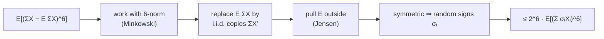

# 2. The Moment Method and the Symmetrization Trick

With the fullness probability written as a deviation, the analysis raises both sides to the **sixth power** (the moment method) — hence the 7-wise-independence requirement. [`8:36`](https://www.youtube.com/watch?v=edOWKZE1t84&t=516)

## Where the sixth moment lands

- There are `k` intervals of length `k` containing `h(x)`, so the sum becomes `Σ_k k · (2/k)^6 · E[(L(I) − E L(I))^6]`. [`8:55`](https://www.youtube.com/watch?v=edOWKZE1t84&t=535) [`9:13`](https://www.youtube.com/watch?v=edOWKZE1t84&t=553)
- Indicators: `X_i = 1` if `h(i) ∈ I`, else `0`; then `L(I) = Σ_{i∈S} X_i`. [`10:13`](https://www.youtube.com/watch?v=edOWKZE1t84&t=613)
- `Pr[X_i = 1] = |I|/m ≈ k/(2n)`; call it `p`. [`17:43`](https://www.youtube.com/watch?v=edOWKZE1t84&t=1063) [`18:13`](https://www.youtube.com/watch?v=edOWKZE1t84&t=1093)

## Symmetrization

The trick for handling `E[(Σ X_i − E Σ X_i)^p]`. [`11:30`](https://www.youtube.com/watch?v=edOWKZE1t84&t=690)

Two facts used:

- **Minkowski's inequality** — `‖X‖_p = (E|X|^p)^{1/p}` is a genuine norm for `p ≥ 1` (scaling, triangle inequality). [`12:28`](https://www.youtube.com/watch?v=edOWKZE1t84&t=748)
- **Jensen's inequality** — for convex `f`, `f(E X) ≤ E[f(X)]`. [`13:04`](https://www.youtube.com/watch?v=edOWKZE1t84&t=784)

The steps:

1. Bound the 6-norm instead of the 6th moment; raise the answer to the 6th at the end. [`13:44`](https://www.youtube.com/watch?v=edOWKZE1t84&t=824)
2. Replace `E[Σ X_i]` with `Σ X'_i`, independent identically distributed copies — the expectation is just a number, so the value is unchanged. [`14:01`](https://www.youtube.com/watch?v=edOWKZE1t84&t=841) [`14:29`](https://www.youtube.com/watch?v=edOWKZE1t84&t=869)
3. `|·|^p` is convex for `p ≥ 1`, so **Jensen** pulls the inner expectation outside and it only gets bigger: `‖Σ_i (X_i − X'_i)‖_6` over both variables. [`15:04`](https://www.youtube.com/watch?v=edOWKZE1t84&t=904) [`16:01`](https://www.youtube.com/watch?v=edOWKZE1t84&t=961)
4. `X_i − X'_i` is symmetric, so it has the same distribution as attaching **independent random signs** `σ_i`. [`16:01`](https://www.youtube.com/watch?v=edOWKZE1t84&t=961)
5. By the norm property, this is at most `2·‖Σ_i σ_i X_i‖_6`. [`16:32`](https://www.youtube.com/watch?v=edOWKZE1t84&t=992)

**Net result:** the original 6th moment is at most `2^6` times the 6th moment of the symmetrized, mean-zero variable. [`17:00`](https://www.youtube.com/watch?v=edOWKZE1t84&t=1020)

## Why it pays off

- Expanding `E[(Σ σ_i X_i)^6]` gives `Σ_{i1..i6} E[σ_{i1}···σ_{i6}] · E[X_{i1}···X_{i6}]`, and the sign expectation is **0 or 1**. [`19:11`](https://www.youtube.com/watch?v=edOWKZE1t84&t=1151) [`19:54`](https://www.youtube.com/watch?v=edOWKZE1t84&t=1194)
- It is 1 exactly when **every distinct index appears an even number of times** — so the surviving cases are one index six times, one four + one two, or three indices twice each. [`20:31`](https://www.youtube.com/watch?v=edOWKZE1t84&t=1231) [`20:49`](https://www.youtube.com/watch?v=edOWKZE1t84&t=1249)
- Since `X_i ∈ {0,1}`, `X_i^6 = X_i`, so the six-times case contributes `p`; three-distinct contributes `p^3`. [`20:49`](https://www.youtube.com/watch?v=edOWKZE1t84&t=1249) [`21:15`](https://www.youtube.com/watch?v=edOWKZE1t84&t=1275)
- **Dominant term:** three distinct items each appearing twice — about `n^3` choices, giving `O(n^3 p^3) = O(k^3)`. [`21:35`](https://www.youtube.com/watch?v=edOWKZE1t84&t=1295) [`22:06`](https://www.youtube.com/watch?v=edOWKZE1t84&t=1326) [`22:26`](https://www.youtube.com/watch?v=edOWKZE1t84&t=1346)
- Dividing by `k^6` and multiplying by the `k` intervals gives `1/k^2` per term — **and `Σ_k 1/k^2` converges**. [`22:26`](https://www.youtube.com/watch?v=edOWKZE1t84&t=1346)

## Why bother symmetrizing at all

- Without it you would face `n^6` monomials with positive and negative terms and would have to argue cancellation explicitly; symmetrization does that for you and leaves only non-negative terms, turning the problem into pure counting. [`23:29`](https://www.youtube.com/watch?v=edOWKZE1t84&t=1409) [`23:48`](https://www.youtube.com/watch?v=edOWKZE1t84&t=1428) [`24:47`](https://www.youtube.com/watch?v=edOWKZE1t84&t=1487)
- Nelson's own framing: "It's just a trick. It doesn't come from anywhere other than trickery." [`24:47`](https://www.youtube.com/watch?v=edOWKZE1t84&t=1487)
- **Why 7-wise:** conditioning on `I ∋ h(x)` uses one hash evaluation; the remaining six in the product must still act independently — 1 + 6 = 7. [`25:09`](https://www.youtube.com/watch?v=edOWKZE1t84&t=1509) [`25:34`](https://www.youtube.com/watch?v=edOWKZE1t84&t=1534)
