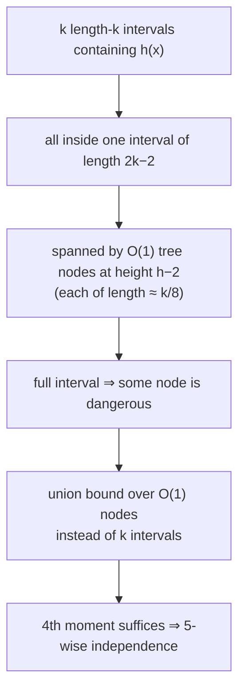

# 3. 5-wise Independence Suffices (Pagh, Pagh & Ružić)

## The landscape

- **7-wise independent** ⇒ expected constant insertion time (proved in the previous topic). [`25:34`](https://www.youtube.com/watch?v=edOWKZE1t84&t=1534)
- **5-wise independent** ⇒ still expected constant time — Pagh, Pagh & Ružić, original paper ~2007 with a later journal version. [`25:34`](https://www.youtube.com/watch?v=edOWKZE1t84&t=1534) [`26:46`](https://www.youtube.com/watch?v=edOWKZE1t84&t=1606)
- **4-wise is not sufficient** — Pătraşcu and Thorup exhibit a 4-wise-independent family where there is a good chance the number of probes is `Θ(log n)` rather than constant. [`27:30`](https://www.youtube.com/watch?v=edOWKZE1t84&t=1650)
- The claim being proved is about the **expected** insertion time being `O(1)`, not a high-probability bound. [`27:08`](https://www.youtube.com/watch?v=edOWKZE1t84&t=1628)

## The obstacle

The 7-wise proof needed the 6th moment only because of the factor `k` from union-bounding over the `k` length-`k` intervals containing `h(x)`. Kill that `k` and a **4th moment** suffices — which needs only 4 + 1 = 5-wise independence. [`25:57`](https://www.youtube.com/watch?v=edOWKZE1t84&t=1557) [`26:22`](https://www.youtube.com/watch?v=edOWKZE1t84&t=1582) [`29:17`](https://www.youtube.com/watch?v=edOWKZE1t84&t=1757)

## The binary-tree construction

- Build a **perfect binary tree** over the array of size `m` (a power of 2); each node corresponds to the interval of memory locations in its subtree. [`27:55`](https://www.youtube.com/watch?v=edOWKZE1t84&t=1675) [`29:17`](https://www.youtube.com/watch?v=edOWKZE1t84&t=1757)
- A node at height `h` is **dangerous** if at least `(3/4)·2^h` items hash into it. [`29:45`](https://www.youtube.com/watch?v=edOWKZE1t84&t=1785) [`30:21`](https://www.youtube.com/watch?v=edOWKZE1t84&t=1821)
- Why `3/4`: with `m = 2n` the expected occupancy of a length-`2^h` interval is `(1/2)·2^h`, so a constant factor above the mean is an anomaly — **any constant above `1/2` would work**, `3/4` is just a convenient choice. [`31:04`](https://www.youtube.com/watch?v=edOWKZE1t84&t=1864) [`43:04`](https://www.youtube.com/watch?v=edOWKZE1t84&t=2584) [`43:46`](https://www.youtube.com/watch?v=edOWKZE1t84&t=2626)

## Lemma prime (a second correction)

> `k` probes ⇒ at least `k` full intervals containing `h(x)`, **each of a different length**. [`33:16`](https://www.youtube.com/watch?v=edOWKZE1t84&t=1996)

This restatement is what makes `E[#probes] ≤ Σ_k Pr[∃ a full length-k interval containing h(x)]` legitimate. [`31:50`](https://www.youtube.com/watch?v=edOWKZE1t84&t=1910) [`32:35`](https://www.youtube.com/watch?v=edOWKZE1t84&t=1955)

## The spanning argument

- Given an interval `I` of length `k` with `2^h ≤ k < 2^{h+1}`, look at the tree nodes **two levels below**, at height `h − 2` (intervals 4–8× smaller). [`34:02`](https://www.youtube.com/watch?v=edOWKZE1t84&t=2042) [`34:39`](https://www.youtube.com/watch?v=edOWKZE1t84&t=2079)
- The number of such nodes spanning `I` is **at least 4 and at most 9** — a constant. [`35:11`](https://www.youtube.com/watch?v=edOWKZE1t84&t=2111) [`46:15`](https://www.youtube.com/watch?v=edOWKZE1t84&t=2775)
- If `I` is full, everyone in the **first four** of those nodes hashed to point `A` (the start) or later, and they collectively hold at least `3·2^{h−2} + 1` items — so one of the four has `L > (3/4)·2^{h−2}`, i.e. is **dangerous**. [`37:59`](https://www.youtube.com/watch?v=edOWKZE1t84&t=2279) [`38:37`](https://www.youtube.com/watch?v=edOWKZE1t84&t=2317)
- All length-`k` intervals containing `h(x)` fit inside a single interval of length `2k − 2`, which is itself spanned by a **constant** number of height-`(h−2)` nodes. [`38:37`](https://www.youtube.com/watch?v=edOWKZE1t84&t=2317) [`39:33`](https://www.youtube.com/watch?v=edOWKZE1t84&t=2373) [`46:15`](https://www.youtube.com/watch?v=edOWKZE1t84&t=2775)
- Therefore: if **none** of that constant set of nodes is dangerous, **no** interval under consideration can be full. [`41:06`](https://www.youtube.com/watch?v=edOWKZE1t84&t=2466)

## Closing the bound

- `Pr[∃ full length-k interval ∋ h(x)] ≤ O(1)·Pr[some length-k/8 interval is dangerous]`. [`41:30`](https://www.youtube.com/watch?v=edOWKZE1t84&t=2490) [`42:22`](https://www.youtube.com/watch?v=edOWKZE1t84&t=2542)
- Dangerous means `L(I') − E[L(I')] > |I'|/4`, i.e. a deviation of half the expectation, since `E[L(I')] = |I'|/2` but `3|I'|/4` landed there. [`44:12`](https://www.youtube.com/watch?v=edOWKZE1t84&t=2652)
- Fourth-moment (Markov) step: `≤ (2/|I'|)^4 · E[(L(I') − E L(I'))^4]`, and the moment works out to `≈ |I'|^2 = Θ(k^2)`, leaving `Θ(1/k^2)` — a **convergent** sum over `k`. [`44:50`](https://www.youtube.com/watch?v=edOWKZE1t84&t=2690) [`45:13`](https://www.youtube.com/watch?v=edOWKZE1t84&t=2713) [`46:31`](https://www.youtube.com/watch?v=edOWKZE1t84&t=2791)
- **Where 5-wise enters:** conditioning on `I ∋ h(x)` fixes one evaluation, leaving four more that still behave independently — five in total. [`46:55`](https://www.youtube.com/watch?v=edOWKZE1t84&t=2815) [`47:29`](https://www.youtube.com/watch?v=edOWKZE1t84&t=2849)
- The folklore one-liner Nelson quotes: 5-wise works "because when you condition on one, it's 4-wise" — cryptic until you see this argument. [`47:46`](https://www.youtube.com/watch?v=edOWKZE1t84&t=2866)
