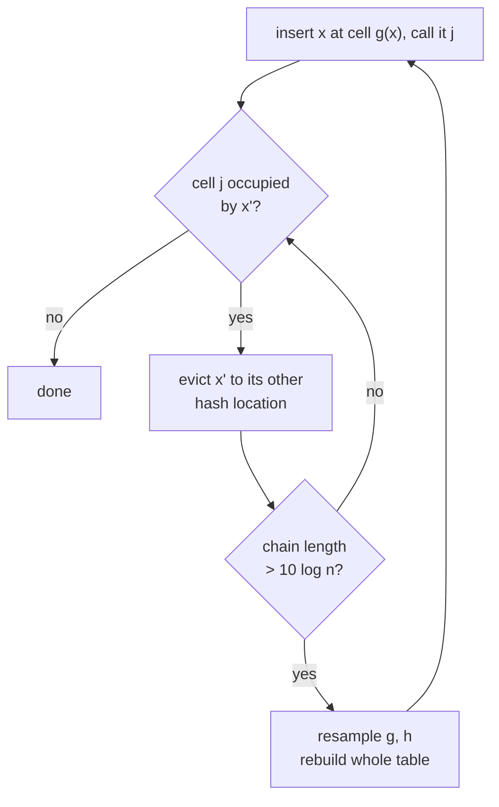

# 6. Cuckoo Hashing

A solution to the **dynamic dictionary** problem, due to **Pagh and Rodler, Journal of Algorithms, 2004**. [`1:03:39`](https://www.youtube.com/watch?v=edOWKZE1t84&t=3819) [`1:04:11`](https://www.youtube.com/watch?v=edOWKZE1t84&t=3851)

## Setup

- Core idea: **two hash functions instead of one** — the same theme that later reappears in the power of two choices, in a different guise. [`1:04:11`](https://www.youtube.com/watch?v=edOWKZE1t84&t=3851)
- One array `A` of length `m = c·n` (Nelson imagines `4n`). [`1:04:53`](https://www.youtube.com/watch?v=edOWKZE1t84&t=3893)
- Two hash functions `g, h : U → [m]`, assumed for the analysis to be **fully random**. [`1:05:54`](https://www.youtube.com/watch?v=edOWKZE1t84&t=3954)
- The name: a cuckoo bird lays its eggs in another bird's nest — here the "nests" are memory cells. [`1:06:42`](https://www.youtube.com/watch?v=edOWKZE1t84&t=4002) [`1:06:56`](https://www.youtube.com/watch?v=edOWKZE1t84&t=4016)

## Insertion algorithm

1. Put `x` in `A[g(x)]`; call that location `j`. [`1:06:56`](https://www.youtube.com/watch?v=edOWKZE1t84&t=4016)
2. If some `x'` already lived at `j`, **evict it to its other choice**: if `g(x') = j` move it to `h(x')`, otherwise move it to `g(x')`. [`1:07:30`](https://www.youtube.com/watch?v=edOWKZE1t84&t=4050) [`1:08:16`](https://www.youtube.com/watch?v=edOWKZE1t84&t=4096)
3. That may evict yet another item, producing a **chain of displacements** that could in principle run forever. [`1:08:28`](https://www.youtube.com/watch?v=edOWKZE1t84&t=4108)
4. **Safety valve:** if the chain exceeds `10 log n` steps, pick fresh random `g` and `h`, rebuild the whole table, and reinsert everyone — repeating until it succeeds. [`1:09:10`](https://www.youtube.com/watch?v=edOWKZE1t84&t=4150) [`1:09:48`](https://www.youtube.com/watch?v=edOWKZE1t84&t=4188) [`1:10:06`](https://www.youtube.com/watch?v=edOWKZE1t84&t=4206)

## The goal

> Expected update time is `O(1)` — **including** the amortized cost of the occasional full rebuild. [`1:10:06`](https://www.youtube.com/watch?v=edOWKZE1t84&t=4206) [`1:10:30`](https://www.youtube.com/watch?v=edOWKZE1t84&t=4230) [`1:10:49`](https://www.youtube.com/watch?v=edOWKZE1t84&t=4249)

Note the guarantee is in **expectation**, not "never loops". [`1:08:52`](https://www.youtube.com/watch?v=edOWKZE1t84&t=4132) [`1:10:06`](https://www.youtube.com/watch?v=edOWKZE1t84&t=4206)

## Edge cases raised by the class

- If `h(x') = g(x')`, the eviction bounces `x` straight back out — a cycle, but **a single cycle is not fatal**. Two cycles are the real problem, and the analysis will bound the probability of that. [`1:10:49`](https://www.youtube.com/watch?v=edOWKZE1t84&t=4249) [`1:11:43`](https://www.youtube.com/watch?v=edOWKZE1t84&t=4303) [`1:12:05`](https://www.youtube.com/watch?v=edOWKZE1t84&t=4325)

## The cuckoo graph — the main analysis tool

- An **undirected multigraph** with `m` vertices (cells) and `n` edges (items). [`1:13:06`](https://www.youtube.com/watch?v=edOWKZE1t84&t=4386)
- For each `x ∈ S`, draw an edge between `g(x)` and `h(x)`. [`1:13:06`](https://www.youtube.com/watch?v=edOWKZE1t84&t=4386)
- Parallel edges are allowed, and `h(x) = g(x)` produces a **self-loop**. [`1:14:02`](https://www.youtube.com/watch?v=edOWKZE1t84&t=4442) [`1:14:25`](https://www.youtube.com/watch?v=edOWKZE1t84&t=4465)
- It is a **random graph** (it depends on the hashing), and the `O(1)` bound will be proved by reasoning about its structure. [`1:14:25`](https://www.youtube.com/watch?v=edOWKZE1t84&t=4465)

The full proof of the `O(1)` bound is deferred — Nelson says he will either cover it next time or assign it as homework, wanting to wrap up hashing. [`1:23:44`](https://www.youtube.com/watch?v=edOWKZE1t84&t=5024)
