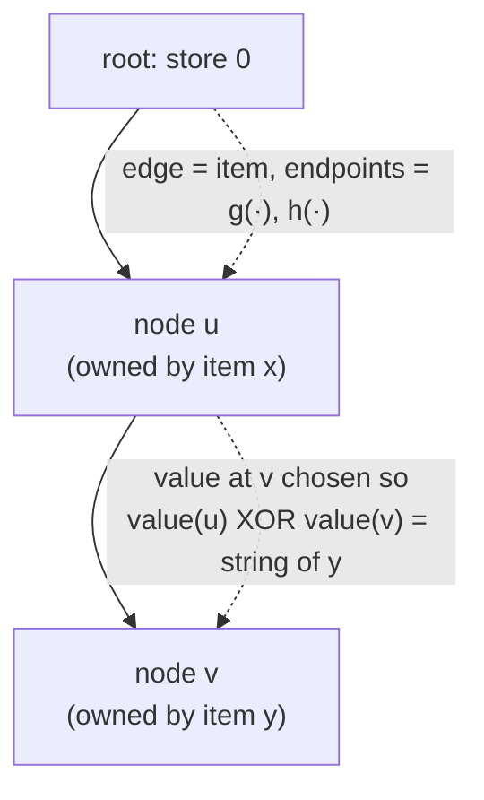

# 7. Building Bloomier Filters from Cuckoo Hashing

The static retrieval structure of Chazelle, Kilian, Rubinfeld and Tal (2004) is assembled on top of a cuckoo hash table. [`1:14:51`](https://www.youtube.com/watch?v=edOWKZE1t84&t=4491) [`1:15:31`](https://www.youtube.com/watch?v=edOWKZE1t84&t=4531)

## Step 1 — get an acyclic cuckoo graph

- Build a cuckoo hash table on the (known, static) item set. [`1:16:03`](https://www.youtube.com/watch?v=edOWKZE1t84&t=4563)
- **Key fact (stated, not proved here):** `Pr[∃ any cycle anywhere in the cuckoo graph] ≤ 1/2`. [`1:16:41`](https://www.youtube.com/watch?v=edOWKZE1t84&t=4601)
- So: build, check for cycles, and if any exist resample the hash functions and retry. **Expected number of attempts: 2** — cheap pre-processing. [`1:17:09`](https://www.youtube.com/watch?v=edOWKZE1t84&t=4629) [`1:17:29`](https://www.youtube.com/watch?v=edOWKZE1t84&t=4649)
- No cycles ⇒ the cuckoo graph is a **forest**. [`1:17:29`](https://www.youtube.com/watch?v=edOWKZE1t84&t=4649)

## Step 2 — orient the forest and assign ownership

- Root every tree in the forest so nodes acquire depths. [`1:18:15`](https://www.youtube.com/watch?v=edOWKZE1t84&t=4695)
- Each edge is an item `x`, joining its two cells `g(x)` and `h(x)`; say **`x` owns its deeper endpoint**. [`1:18:15`](https://www.youtube.com/watch?v=edOWKZE1t84&t=4695) [`1:18:56`](https://www.youtube.com/watch?v=edOWKZE1t84&t=4736)

## Step 3 — fill in the table

- Every **node** (memory cell of `A`) stores an `r`-bit string. [`1:18:56`](https://www.youtube.com/watch?v=edOWKZE1t84&t=4736)
- Store `0` at every root. [`1:18:56`](https://www.youtube.com/watch?v=edOWKZE1t84&t=4736)
- Fill the trees **top down**: at each node `v`, the parent value is already fixed, so choose `A[v]` to make the XOR come out to the `r`-bit string of `v`'s owner. [`1:19:24`](https://www.youtube.com/watch?v=edOWKZE1t84&t=4764) [`1:19:46`](https://www.youtube.com/watch?v=edOWKZE1t84&t=4786) [`1:21:17`](https://www.youtube.com/watch?v=edOWKZE1t84&t=4877)

## Step 4 — query

> `query(x) = A[g(x)] XOR A[h(x)]`. [`1:20:17`](https://www.youtube.com/watch?v=edOWKZE1t84&t=4817)

## Why XOR rather than storing the string directly

A student objects that there are more nodes than edges, so each item could just store its string at its own deeper node. [`1:21:17`](https://www.youtube.com/watch?v=edOWKZE1t84&t=4877) [`1:22:14`](https://www.youtube.com/watch?v=edOWKZE1t84&t=4934)

- The rebuttal, supplied by the class and accepted by Nelson: **at query time you cannot tell which of `g(x)`, `h(x)` is the deeper node**, because the elements are never stored, so no lookup table of that bit exists. [`1:23:03`](https://www.youtube.com/watch?v=edOWKZE1t84&t=4983) [`1:23:14`](https://www.youtube.com/watch?v=edOWKZE1t84&t=4994)
- Storing that bit would itself be a **1-bit retrieval problem** — the scheme would be circular. The XOR of both cells sidesteps the question entirely. [`1:23:03`](https://www.youtube.com/watch?v=edOWKZE1t84&t=4983) [`1:23:31`](https://www.youtube.com/watch?v=edOWKZE1t84&t=5011)
