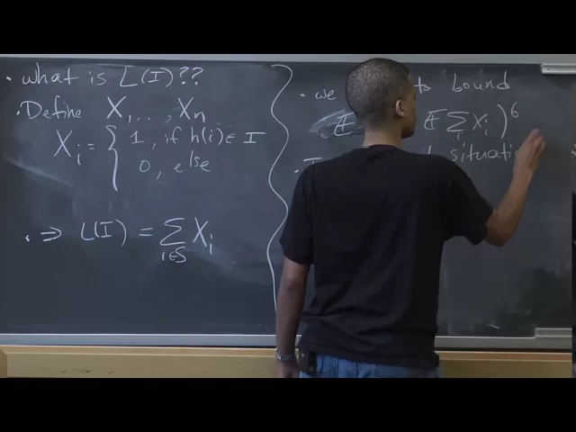
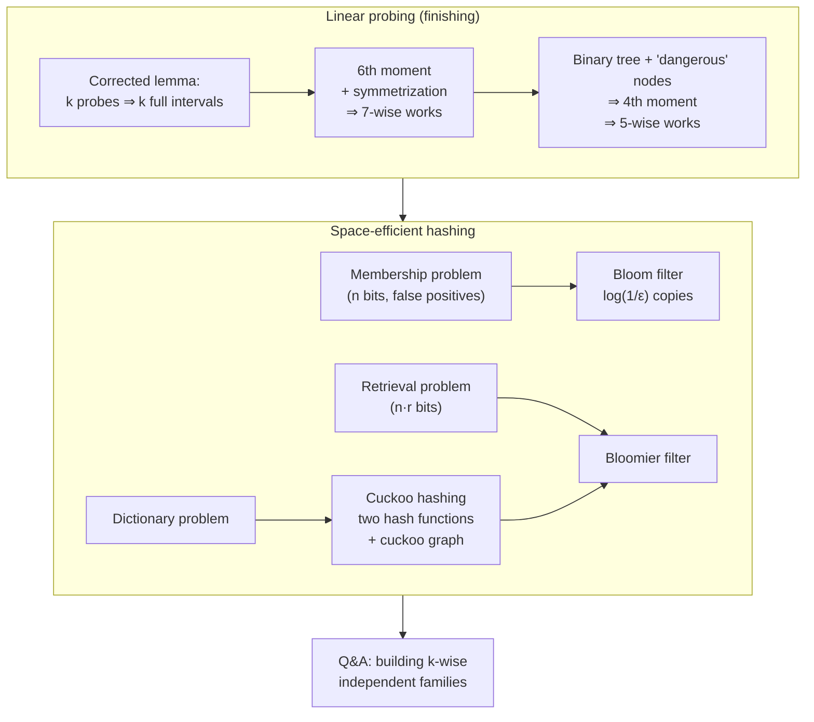

# Advanced Algorithms (COMPSCI 224), Lecture 4

*Harvard University · Jelani Nelson · 1:27:51 · [Watch on YouTube](https://www.youtube.com/watch?v=edOWKZE1t84)*

## Summary

The last lecture devoted exclusively to hashing. It opens by repairing a lemma about linear probing from the previous class, then shows how the moment-method analysis works — first with 7-wise independence via a symmetrization trick, then with only **5-wise** independence via the Pagh–Pagh–Ružić binary-tree argument that replaces a union bound over `k` intervals with one over `O(1)` tree nodes. The second half moves to space-efficient hashing: the **approximate membership** problem and Bloom filters, the **retrieval** problem and Bloomier filters, and **cuckoo hashing** with its cuckoo-graph analysis, closing with a construction of Bloomier filters from an acyclic cuckoo hash table and a Q&A on how `k`-wise independent hash families are actually built.

## Topics

1. [Linear Probing Recap and the Corrected Full-Interval Lemma](01-linear-probing-recap-and-the-corrected-lemma.md) — [`0:00`](https://www.youtube.com/watch?v=edOWKZE1t84&t=0)
2. [The Moment Method and the Symmetrization Trick](02-the-moment-method-and-symmetrization.md) — [`8:36`](https://www.youtube.com/watch?v=edOWKZE1t84&t=516)
3. [5-wise Independence Suffices (Pagh, Pagh & Ružić)](03-five-wise-independence-for-linear-probing.md) — [`25:34`](https://www.youtube.com/watch?v=edOWKZE1t84&t=1534)
4. [Approximate Membership and Bloom Filters](04-approximate-membership-and-bloom-filters.md) — [`48:19`](https://www.youtube.com/watch?v=edOWKZE1t84&t=2899)
5. [The Retrieval Problem and Bloomier Filters](05-the-retrieval-problem-and-bloomier-filters.md) — [`1:00:39`](https://www.youtube.com/watch?v=edOWKZE1t84&t=3639)
6. [Cuckoo Hashing](06-cuckoo-hashing.md) — [`1:03:39`](https://www.youtube.com/watch?v=edOWKZE1t84&t=3819)
7. [Building Bloomier Filters from Cuckoo Hashing](07-building-bloomier-filters-from-cuckoo-hashing.md) — [`1:14:51`](https://www.youtube.com/watch?v=edOWKZE1t84&t=4491)
8. [Closing Q&A — Constructing k-wise Independent Hash Families](08-constructing-k-wise-independent-hash-families.md) — [`1:24:14`](https://www.youtube.com/watch?v=edOWKZE1t84&t=5054)

## Key takeaways

- The linear-probing lemma needed two corrections before it worked: first that `k` probes imply `k` full intervals **each of length at least `k`**, then further that they must each be of a **different length** so the per-`k` union bound is legitimate. [`3:34`](https://www.youtube.com/watch?v=edOWKZE1t84&t=214) [`33:16`](https://www.youtube.com/watch?v=edOWKZE1t84&t=1996)
- **Symmetrization** (Minkowski + Jensen + random signs) reduces a `p`-th central moment to `2^p` times the moment of a mean-zero variable, after which only monomials with all-even exponents survive — turning the bound into a counting problem with no cancellation to argue. The dominant term is three distinct indices appearing twice each, giving `O(n^3p^3) = O(k^3)`. [`17:00`](https://www.youtube.com/watch?v=edOWKZE1t84&t=1020) [`21:35`](https://www.youtube.com/watch?v=edOWKZE1t84&t=1295) [`23:48`](https://www.youtube.com/watch?v=edOWKZE1t84&t=1428)
- **5-wise independence gives `O(1)` expected linear-probing insertion time** (Pagh, Pagh & Ružić), because covering the length-`k` intervals with `O(1)` tree nodes at height `h−2` removes the factor `k` and lets a 4th moment replace the 6th. **4-wise is provably not enough** — Pătraşcu and Thorup exhibit a 4-wise family where probes reach `Θ(log n)`. [`25:57`](https://www.youtube.com/watch?v=edOWKZE1t84&t=1557) [`27:30`](https://www.youtube.com/watch?v=edOWKZE1t84&t=1650) [`46:55`](https://www.youtube.com/watch?v=edOWKZE1t84&t=2815)
- A single `2n`-bit array with a **merely 2-wise independent** hash function already gives no false negatives and a `1/2` false-positive rate; `log(1/ε)` such copies drive the rate to `ε` in `n·log(1/ε)` bits and `O(log 1/ε)` time — the Bloom filter (Bloom, 1970). Widening one array to `n/ε` bits is the alternative trade-off, buying `O(1)` query time with more space. [`56:56`](https://www.youtube.com/watch?v=edOWKZE1t84&t=3416) [`59:41`](https://www.youtube.com/watch?v=edOWKZE1t84&t=3581) [`1:05:33`](https://www.youtube.com/watch?v=edOWKZE1t84&t=3933)
- **Bloomier filters solve retrieval in `n·r` bits**: because `Pr[the cuckoo graph has a cycle] ≤ 1/2`, two rebuild attempts in expectation yield a forest; storing `0` at roots and filling top-down so that `A[g(x)] XOR A[h(x)]` equals `x`'s string answers queries exactly for members and returns garbage for non-members. The XOR is necessary, not decorative — identifying the deeper endpoint at query time would itself be a 1-bit retrieval problem. [`1:16:41`](https://www.youtube.com/watch?v=edOWKZE1t84&t=4601) [`1:17:29`](https://www.youtube.com/watch?v=edOWKZE1t84&t=4649) [`1:20:17`](https://www.youtube.com/watch?v=edOWKZE1t84&t=4817) [`1:23:14`](https://www.youtube.com/watch?v=edOWKZE1t84&t=4994)
- Cuckoo hashing (Pagh & Rodler, 2004) achieves **`O(1)` expected update time even counting full rebuilds**, using two hash functions, eviction chains, and a `10 log n` step cutoff that triggers a complete resample-and-rebuild. [`1:09:10`](https://www.youtube.com/watch?v=edOWKZE1t84&t=4150) [`1:10:30`](https://www.youtube.com/watch?v=edOWKZE1t84&t=4230)
