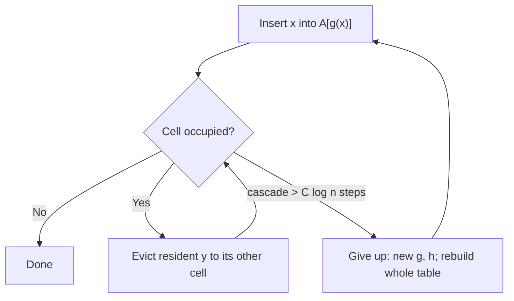

# 1. Lecture Plan and Cuckoo Hashing Recap

## Plan for the lecture

- Finish the proof of **cuckoo hashing** (stated last time, never analyzed) ([`0:16`](https://www.youtube.com/watch?v=rLMikQTOVnI&t=16)).
- One more result on **load balancing** (the power of two choices) ([`0:16`](https://www.youtube.com/watch?v=rLMikQTOVnI&t=16)).
- Then start **Fibonacci heaps** — hashing ends midway through today ([`0:40`](https://www.youtube.com/watch?v=rLMikQTOVnI&t=40)).
- Cuckoo hashing was previously used to construct **Bloom-filter-like structures for the retrieval problem** ([`0:40`](https://www.youtube.com/watch?v=rLMikQTOVnI&t=40)).

## The cuckoo hashing scheme

Setup ([`1:04`](https://www.youtube.com/watch?v=rLMikQTOVnI&t=64)):

- One array `A` of size `m`, **linear in n** (later fixed at `m = 4n`) ([`1:04`](https://www.youtube.com/watch?v=rLMikQTOVnI&t=64), [`22:53`](https://www.youtube.com/watch?v=rLMikQTOVnI&t=1373)).
- Two random hash functions `g` and `h`; every item `x` has exactly two candidate cells, `A[g(x)]` and `A[h(x)]` ([`1:04`](https://www.youtube.com/watch?v=rLMikQTOVnI&t=64)).

Insertion of `x` ([`1:04`](https://www.youtube.com/watch?v=rLMikQTOVnI&t=64), [`1:30`](https://www.youtube.com/watch?v=rLMikQTOVnI&t=90)):

1. Write `x` into `A[g(x)]` **unconditionally**.
2. If a resident `y` was there, evict it and send it to *its other* location — if `y` was there via `g`, move it to `h(y)`; if via `h`, move it to `g(y)` ([`1:48`](https://www.youtube.com/watch?v=rLMikQTOVnI&t=108)).
3. Evictions cascade as long as the new target cell is occupied ([`1:48`](https://www.youtube.com/watch?v=rLMikQTOVnI&t=108)).

Rebuild rule ([`1:48`](https://www.youtube.com/watch?v=rLMikQTOVnI&t=108), [`2:30`](https://www.youtube.com/watch?v=rLMikQTOVnI&t=150)):

- If a single insertion moves items for **at least `C log n` steps** (think `C ≈ 10`; the exact constant falls out of the analysis), give up.
- Pick fresh `g` and `h`, allocate a brand-new array, and **reinsert everything from scratch**.
- If a rebuild itself exceeds `C log n` on some insert, throw it away and rebuild again, repeating until it succeeds ([`3:03`](https://www.youtube.com/watch?v=rLMikQTOVnI&t=183)).

## What has to be proved

- Rebuilds succeed **with good probability**, so in expectation they are rare ([`3:17`](https://www.youtube.com/watch?v=rLMikQTOVnI&t=197)).
- Target claim: **E[time to insert] = O(1)** — a constant ([`3:17`](https://www.youtube.com/watch?v=rLMikQTOVnI&t=197)).

