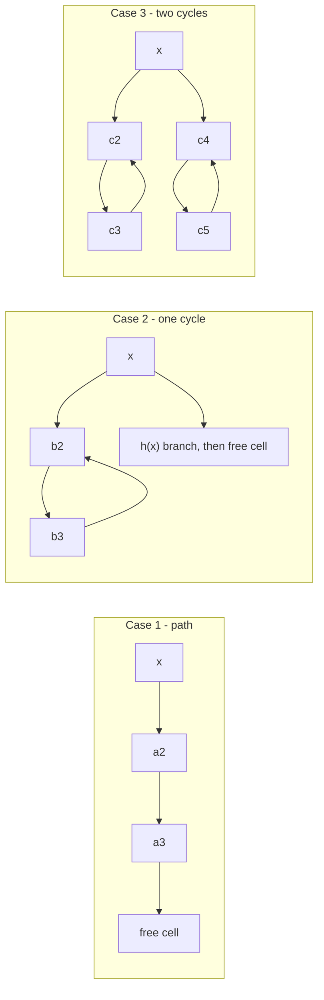

# 2. The Cuckoo Graph and the Three Insertion Cases

## The cuckoo graph

Defined in the previous lecture, and the object the whole analysis runs on ([`4:10`](https://www.youtube.com/watch?v=rLMikQTOVnI&t=250)):

- **`m` vertices** — one per cell of the array `A`.
- **`n` edges** — one per item `x`, joining `g(x)` to `h(x)`.
- The graph may contain **multi-edges and self-loops** ([`4:58`](https://www.youtube.com/watch?v=rLMikQTOVnI&t=298)).

An insertion traces a walk in this graph: each eviction follows the edge of the evicted item to its other endpoint.

## The three shapes an insertion can take

| Case | Shape | Outcome |
| --- | --- | --- |
| 1 | **Path** — `x` kicks out a chain of items and the chain ends in a free cell ([`5:32`](https://www.youtube.com/watch?v=rLMikQTOVnI&t=332)) | Terminates |
| 2 | **Single cycle** — the walk closes one cycle, items bounce back along it, `x` is then pushed into `h(x)` and continues ([`5:51`](https://www.youtube.com/watch?v=rLMikQTOVnI&t=351), [`7:03`](https://www.youtube.com/watch?v=rLMikQTOVnI&t=423), [`7:36`](https://www.youtube.com/watch?v=rLMikQTOVnI&t=456)) | Still terminates — a cycle alone is **not** fatal ([`8:25`](https://www.youtube.com/watch?v=rLMikQTOVnI&t=505)) |
| 3 | **Two cycles** — a second cycle closes after `x` has already bounced back through `h(x)` ([`8:25`](https://www.youtube.com/watch?v=rLMikQTOVnI&t=505), [`8:46`](https://www.youtube.com/watch?v=rLMikQTOVnI&t=526)) | **Infinite loop** — would run forever |

- The algorithm never inspects cycles; the `C log n` cutoff is what saves it, catching both very long paths and the double-cycle infinite loop ([`9:28`](https://www.youtube.com/watch?v=rLMikQTOVnI&t=568)).



## Random variables for the runtime

All defined **relative to inserting one item `x`** ([`11:23`](https://www.youtube.com/watch?v=rLMikQTOVnI&t=683)):

- `P_k` — indicator that the insertion traces a **path of length ≥ k** ([`9:51`](https://www.youtube.com/watch?v=rLMikQTOVnI&t=591)).
- `C_k` — indicator of a **case-2 (single cycle) configuration of length ≥ k** ([`9:51`](https://www.youtube.com/watch?v=rLMikQTOVnI&t=591)).
- `D` — indicator of a **double-cycle configuration** ([`11:23`](https://www.youtube.com/watch?v=rLMikQTOVnI&t=683)).

## The runtime recurrence

`T` = time to insert a single item. Its expectation decomposes as ([`12:20`](https://www.youtube.com/watch?v=rLMikQTOVnI&t=740), [`13:22`](https://www.youtube.com/watch?v=rLMikQTOVnI&t=802), [`13:51`](https://www.youtube.com/watch?v=rLMikQTOVnI&t=831)):

```
E[T] ≤ Σ_k E[P_k] + Σ_k E[C_k]
       + Pr[D = 1] · n · E[T]
       + Pr[walk exceeds C log n steps] · n · E[T]
```

- The two `n · E[T]` terms are the cost of a **full rebuild** (reinserting all `n` items) ([`13:22`](https://www.youtube.com/watch?v=rLMikQTOVnI&t=802)).
- **Proof strategy**: force both rebuild probabilities down to roughly `1/n²`, so multiplying by `n` makes them negligible and the two geometric sums dominate ([`14:29`](https://www.youtube.com/watch?v=rLMikQTOVnI&t=869)).
- Everything is then bounded by **linearity of expectation** over `E[P_k]`, `E[C_k]` and `Pr[D = 1]` ([`14:56`](https://www.youtube.com/watch?v=rLMikQTOVnI&t=896)).
