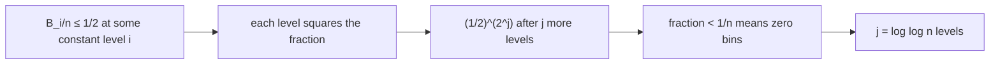

# 6. Intuition: Where log log n Comes From

Presented explicitly as a **non-rigorous argument** first, to expose the mechanism, with the fixes deferred ([`55:10`](https://www.youtube.com/watch?v=rLMikQTOVnI&t=3310), [`55:52`](https://www.youtube.com/watch?v=rLMikQTOVnI&t=3352)).

## Definitions

- **`B_i`** = number of bins with load **at least `i`** ([`57:05`](https://www.youtube.com/watch?v=rLMikQTOVnI&t=3425)).
- **`H(x)`** (capital, since `g`/`h` are taken) = the **height** of item `x`: `x` is the `H(x)`-th item inserted into its bin ([`57:41`](https://www.youtube.com/watch?v=rLMikQTOVnI&t=3461)).
- The non-rigorous step: pretend `B_i` is a **fixed** number rather than a random variable ([`57:05`](https://www.youtube.com/watch?v=rLMikQTOVnI&t=3425), [`57:41`](https://www.youtube.com/watch?v=rLMikQTOVnI&t=3461)).

## The squaring recurrence

- `B_{i+1} ≤ #{x : H(x) ≥ i + 1}` ([`58:42`](https://www.youtube.com/watch?v=rLMikQTOVnI&t=3522)).
- For `x` to reach height `≥ i + 1`, **both** of its bins must already hold load `≥ i` ([`59:58`](https://www.youtube.com/watch?v=rLMikQTOVnI&t=3598)).
- `g` and `h` are independent, so `Pr[H(x) ≥ i+1] ≤ (B_i / n)²` ([`1:00:41`](https://www.youtube.com/watch?v=rLMikQTOVnI&t=3641)).
- Summing over `n` items: `B_{i+1} ≤ n · (B_i / n)²`, i.e.

```
B_{i+1}/n ≤ (B_i/n)²
```

([`1:00:41`](https://www.youtube.com/watch?v=rLMikQTOVnI&t=3641), [`1:01:44`](https://www.youtube.com/watch?v=rLMikQTOVnI&t=3704))

## Why that gives log log n

- Once `B_i/n < 1/2`, the **fraction of heavy bins squares at every level** ([`1:02:19`](https://www.youtube.com/watch?v=rLMikQTOVnI&t=3739)).
- Suppose `B_10/n ≤ 1/2`. Then `B_{10+j}/n ≤ (1/2)^{2^j}` ([`1:02:19`](https://www.youtube.com/watch?v=rLMikQTOVnI&t=3739), [`1:02:57`](https://www.youtube.com/watch?v=rLMikQTOVnI&t=3777)).
- Done when the count drops below 1 bin, i.e. `B_{10+j}/n < 1/n` — which needs `2^j ≥ n`, i.e. **`j ≥ log log n`** ([`1:03:33`](https://www.youtube.com/watch?v=rLMikQTOVnI&t=3813), [`1:04:09`](https://www.youtube.com/watch?v=rLMikQTOVnI&t=3849)).



- **The whole result is doubly-exponential decay driven by the independence of the two hash functions** — that is the entire idea; everything that follows is making it rigorous ([`1:04:09`](https://www.youtube.com/watch?v=rLMikQTOVnI&t=3849), [`1:04:44`](https://www.youtube.com/watch?v=rLMikQTOVnI&t=3884)).
- What is illegitimate: `B_i` is random and cannot be assumed to equal its expectation; the real proof must show a good event holds **with high probability** at every level ([`1:04:09`](https://www.youtube.com/watch?v=rLMikQTOVnI&t=3849), [`1:04:44`](https://www.youtube.com/watch?v=rLMikQTOVnI&t=3884)).
