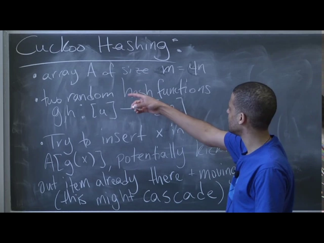
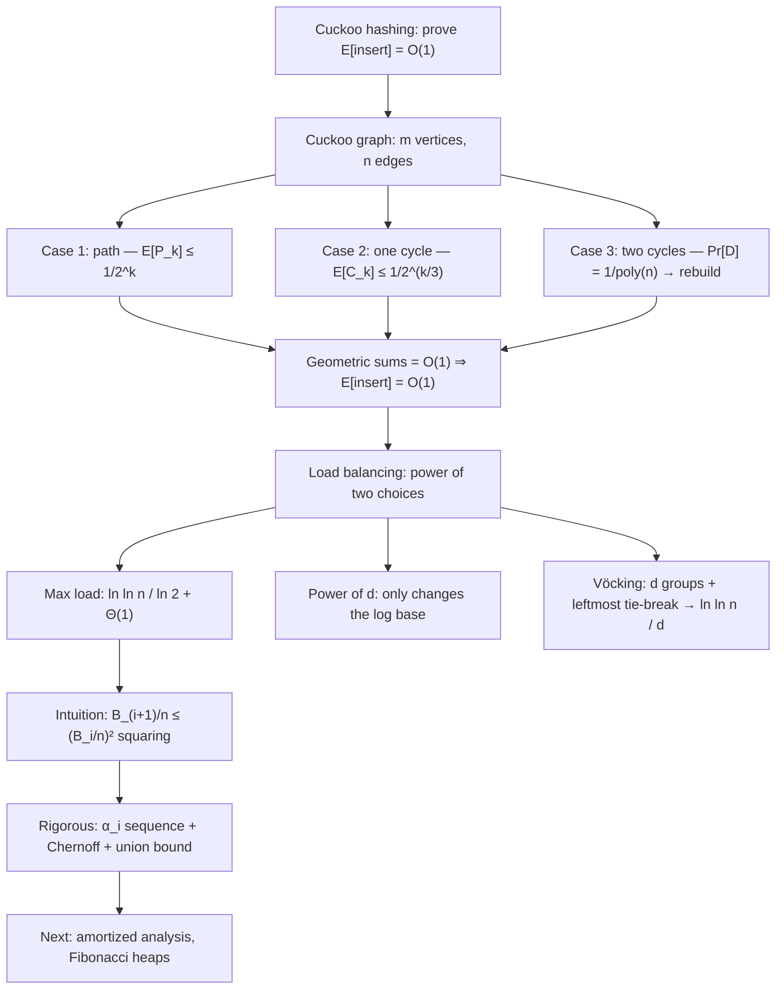

# Advanced Algorithms (COMPSCI 224), Lecture 5

*Harvard University · 1:21:37 · [Watch on YouTube](https://www.youtube.com/watch?v=rLMikQTOVnI)*

## Summary

The lecture that closes out hashing in COMPSCI 224. The first half completes the **expected-`O(1)` insertion proof for cuckoo hashing**: it recalls the scheme (two hash functions, unconditional placement, cascading evictions, rebuild after `C log n` steps), models an insertion as a walk in the **cuckoo graph**, splits it into three cases (path, single cycle, double cycle), and bounds each by fixing a configuration, computing its probability, and union-bounding — the array size `m = 4n` being chosen precisely to make the resulting series geometric. The second half turns to load balancing and the **power of two choices**: probing two random bins and inserting into the less loaded drops the maximum load from `Θ(log n / log log n)` to `ln ln n / ln 2 + Θ(1)`, an exponential improvement, while going from two to `d` choices only changes the base of the log. The lecturer walks through the doubly-exponential "squaring" intuition behind `log log n`, then attempts the rigorous Chernoff-based version and openly leaves two gaps for the written notes — an off-by-one in the double-cycle count and a conditioning-dependency issue in the main claim — before previewing amortized analysis and Fibonacci heaps.

## Topics

1. [Lecture Plan and Cuckoo Hashing Recap](01-lecture-plan-and-cuckoo-hashing-recap.md) — the scheme, the eviction cascade, and the `C log n` rebuild rule.
2. [The Cuckoo Graph and the Three Insertion Cases](02-the-cuckoo-graph-and-the-three-cases.md) — path, single cycle, double cycle, and the runtime recurrence they feed.
3. [Bounding Paths and Single Cycles](03-bounding-paths-and-single-cycles.md) — fix-a-configuration + union bound, and why `m = 4n`.
4. [Bounding Double Cycles and Closing the Proof](04-bounding-double-cycles-and-closing-the-proof.md) — the only dangerous case, the acknowledged off-by-one, and the free bound on the cutoff term.
5. [The Power of Two Choices](05-the-power-of-two-choices.md) — Azar–Broder–Karlin–Upfal, power of `d`, and Vöcking's asymmetric variant.
6. [Intuition: Where log log n Comes From](06-intuition-where-log-log-n-comes-from.md) — the non-rigorous squaring argument, in full.
7. [Making the Analysis Rigorous](07-making-the-analysis-rigorous.md) — the `α_i` sequence, Chernoff, and the dependency gap left unclosed.
8. [Preview: Amortized Analysis and Fibonacci Heaps](08-preview-heaps-and-fibonacci-heaps.md) — the heap interface and the Dijkstra payoff.

## Key takeaways

- **Cuckoo hashing inserts in expected `O(1)` time**, provided a run of more than `C log n` evictions triggers a full rebuild with fresh hash functions; the proof works by making both rebuild-triggering probabilities `1/poly(n)` so their `n · E[T]` cost vanishes ([`3:17`](https://www.youtube.com/watch?v=rLMikQTOVnI&t=197), [`14:29`](https://www.youtube.com/watch?v=rLMikQTOVnI&t=869), [`42:00`](https://www.youtube.com/watch?v=rLMikQTOVnI&t=2520)).
- **A cycle in the cuckoo graph is harmless; two cycles are fatal.** A single cycle unwinds and the insertion still terminates via `h(x)`, but a second cycle loops forever — it is caught only by the step cutoff ([`8:25`](https://www.youtube.com/watch?v=rLMikQTOVnI&t=505), [`8:46`](https://www.youtube.com/watch?v=rLMikQTOVnI&t=526), [`9:28`](https://www.youtube.com/watch?v=rLMikQTOVnI&t=568)).
- **`E[P_k] ≤ 1/2^k`** for eviction paths, and the constant `m = 4n` is chosen exactly to produce that base-2 geometric decay from the `2^k · (n/m)^k` bound ([`22:53`](https://www.youtube.com/watch?v=rLMikQTOVnI&t=1373), [`23:13`](https://www.youtube.com/watch?v=rLMikQTOVnI&t=1393)).
- **Single-cycle configurations need no new computation**: split the edges into three groups, note one group has `≥ k/3` edges, and reuse the path bound to get roughly `1/2^{k/3}` ([`24:28`](https://www.youtube.com/watch?v=rLMikQTOVnI&t=1468), [`25:10`](https://www.youtube.com/watch?v=rLMikQTOVnI&t=1510)).
- **Double-cycle probability is `k³/2^k` over a polynomial in `n`**, summing to `1/poly(n)`; the extra `k³` factor counts where each cycle starts and how long the first one is ([`36:44`](https://www.youtube.com/watch?v=rLMikQTOVnI&t=2204), [`39:11`](https://www.youtube.com/watch?v=rLMikQTOVnI&t=2351), [`41:04`](https://www.youtube.com/watch?v=rLMikQTOVnI&t=2464)).
- **Two live errors were acknowledged, not papered over**: an off-by-one in the double-cycle vertex/item count (his guess: a length-`k` tour carries `k − 2` items, not `k`, since items repeat), and a **conditioning dependency** that breaks the clean `(B_i/n)²` per-item probability once you condition on `E_i` — both deferred to the written notes ([`39:55`](https://www.youtube.com/watch?v=rLMikQTOVnI&t=2395), [`42:59`](https://www.youtube.com/watch?v=rLMikQTOVnI&t=2579), [`1:13:22`](https://www.youtube.com/watch?v=rLMikQTOVnI&t=4402)).
- **`n` balls into `n` bins with one random choice gives a max load of `Θ(log n / log log n)`**; a 2-wise independent hash function already gives `O(1)` expected query time with that same worst case w.h.p. ([`46:26`](https://www.youtube.com/watch?v=rLMikQTOVnI&t=2786), [`46:53`](https://www.youtube.com/watch?v=rLMikQTOVnI&t=2813)).
- **Two choices drop the max load to `ln ln n / ln 2 + Θ(1)`, tightly concentrated within ±O(1)** (Azar, Broder, Karlin, Upfal, SICOMP '99) — an exponential improvement from probing one extra bin ([`47:27`](https://www.youtube.com/watch?v=rLMikQTOVnI&t=2847), [`49:39`](https://www.youtube.com/watch?v=rLMikQTOVnI&t=2979), [`50:23`](https://www.youtube.com/watch?v=rLMikQTOVnI&t=3023)).
- **Going from 2 to `d` choices buys almost nothing**: the bound becomes `ln ln n / ln d`, only a change of log base, i.e. a constant factor — while query cost grows by a factor of `d` ([`50:52`](https://www.youtube.com/watch?v=rLMikQTOVnI&t=3052), [`51:17`](https://www.youtube.com/watch?v=rLMikQTOVnI&t=3077), [`51:57`](https://www.youtube.com/watch?v=rLMikQTOVnI&t=3117)).
- **Vöcking's variant beats plain power-of-`d`**: partition bins into `d` equal groups, probe one per group, and break ties by taking the **leftmost** bin — max load `ln ln n / d`, effectively moving the log base from `d` to `e^d`. Less randomness, better result ([`53:25`](https://www.youtube.com/watch?v=rLMikQTOVnI&t=3205), [`54:44`](https://www.youtube.com/watch?v=rLMikQTOVnI&t=3284), [`55:10`](https://www.youtube.com/watch?v=rLMikQTOVnI&t=3310)).
- **The `log log n` comes from a squaring recurrence**: since both bins must be full for an item to reach height `i+1` and the two hash functions are independent, `B_{i+1}/n ≤ (B_i/n)²`, so once the fraction is below `1/2` it drops to `(1/2)^{2^j}` and hits zero bins after `log log n` levels ([`1:00:41`](https://www.youtube.com/watch?v=rLMikQTOVnI&t=3641), [`1:02:19`](https://www.youtube.com/watch?v=rLMikQTOVnI&t=3739), [`1:03:33`](https://www.youtube.com/watch?v=rLMikQTOVnI&t=3813)).
- **The rigorous version replaces the random `B_i` with a deterministic `α_i`** (`α_6 = n/2e`, `α_{i+1} = e·α_i²/n`), starting at level 6 because `Pr[E_6] = 1` holds trivially and Chernoff tails there are small enough to survive a union bound over all levels ([`1:05:36`](https://www.youtube.com/watch?v=rLMikQTOVnI&t=3936), [`1:06:32`](https://www.youtube.com/watch?v=rLMikQTOVnI&t=3992), [`1:08:41`](https://www.youtube.com/watch?v=rLMikQTOVnI&t=4121)).
- **Fibonacci heaps give `O(1)` insert and decrease-key with `O(log n)` delete-min**, taking Dijkstra from `m log n` (binary heaps) to `m + n log n`, and speeding up all-pairs shortest paths run as `n` Dijkstras ([`1:20:28`](https://www.youtube.com/watch?v=rLMikQTOVnI&t=4828), [`1:20:45`](https://www.youtube.com/watch?v=rLMikQTOVnI&t=4845)).
