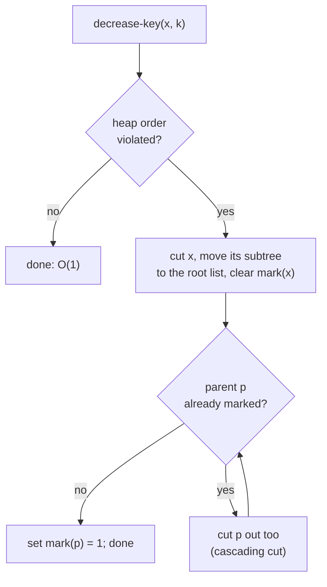

# 7. Fibonacci heaps: designing by being lazy

## The target and the guiding principle

- Targets: **constant-time insertion and constant-time decrease-key**, with delete-min at `O(log n)` [`44:17`](https://www.youtube.com/watch?v=gxp_FrgTkQI&t=2657), [`44:52`](https://www.youtube.com/watch?v=gxp_FrgTkQI&t=2692).
- Guiding principle, shared by many amortized data structures: **be lazy** — do not do work until you are forced to [`44:17`](https://www.youtube.com/watch?v=gxp_FrgTkQI&t=2657), [`44:52`](https://www.youtube.com/watch?v=gxp_FrgTkQI&t=2692).

## Laziness step 1 — defer all consolidation to delete-min

- A binomial heap eagerly restores the "one tree per rank" invariant on every insert, for no good reason: if you only ever insert, that merging work is pure waste [`45:12`](https://www.youtube.com/watch?v=gxp_FrgTkQI&t=2712), [`45:41`](https://www.youtube.com/watch?v=gxp_FrgTkQI&t=2741).
- **Fibonacci heap insert**: just append the new node to the top-level linked list [`45:41`](https://www.youtube.com/watch?v=gxp_FrgTkQI&t=2741).
- **All consolidation happens during delete-min**, which has to walk the root list anyway [`46:02`](https://www.youtube.com/watch?v=gxp_FrgTkQI&t=2762).

## Laziness step 2 — the "really lazy" decrease-key

- The bubble-up decrease-key walks the tree height, `O(log n)`; an adversary can repeat decrease-keys in a high-rank tree forever [`46:52`](https://www.youtube.com/watch?v=gxp_FrgTkQI&t=2812).
- Ultra-lazy alternative (a student's suggestion): decrease the key; if the heap order property is now violated, **cut the edge to the parent and splice the subtree into the top-level list** [`47:17`](https://www.youtube.com/watch?v=gxp_FrgTkQI&t=2837), [`47:34`](https://www.youtube.com/watch?v=gxp_FrgTkQI&t=2854), [`48:22`](https://www.youtube.com/watch?v=gxp_FrgTkQI&t=2902).
- Design heuristic offered: start with the laziest thing possible, then add back only the bare minimum needed to make the bounds work [`47:51`](https://www.youtube.com/watch?v=gxp_FrgTkQI&t=2871).

## Why pure laziness fails

The binomial-heap argument that "max rank ≤ `log n`" rested on rank-`k` trees having `2^k` nodes [`50:11`](https://www.youtube.com/watch?v=gxp_FrgTkQI&t=3011), [`50:30`](https://www.youtube.com/watch?v=gxp_FrgTkQI&t=3030). Unrestricted cutting destroys that:

- Take a rank-`k` tree and decrease-key every grandchild, cutting each away.
- You are left with a tree of **rank `k` holding only `k+1` items** [`51:00`](https://www.youtube.com/watch?v=gxp_FrgTkQI&t=3060), [`51:19`](https://www.youtube.com/watch?v=gxp_FrgTkQI&t=3079).
- Rank no longer certifies size, so the `O(log n)` bound on delete-min collapses [`51:19`](https://www.youtube.com/watch?v=gxp_FrgTkQI&t=3079).
- Intuition given: the root "thinks his tree is big, but little does he know he's losing all of his descendants" — the loss must somehow be communicated upward [`52:02`](https://www.youtube.com/watch?v=gxp_FrgTkQI&t=3122).

## The one extra rule: cascading cuts and mark bits

> If a node `p` loses **one** child to a cut, that is fine. If `p` loses a **second** child, cut `p` out too and make its subtree a top-level tree. [`52:27`](https://www.youtube.com/watch?v=gxp_FrgTkQI&t=3147)

- The rule **recurses**: `p` may itself be the second lost child of its own parent, which then cuts itself out, and so on — these are the **cascading cuts** [`53:33`](https://www.youtube.com/watch?v=gxp_FrgTkQI&t=3213), [`1:09:44`](https://www.youtube.com/watch?v=gxp_FrgTkQI&t=4184).
- Clarification for a student: no key swapping is involved. If `p` loses child `x` and then child `y`, then `y`'s subtree becomes one top-level tree and `p` with its remainder becomes a **separate** top-level tree — `p` and `y` no longer share a tree [`53:57`](https://www.youtube.com/watch?v=gxp_FrgTkQI&t=3237), [`54:12`](https://www.youtube.com/watch?v=gxp_FrgTkQI&t=3252), [`54:29`](https://www.youtube.com/watch?v=gxp_FrgTkQI&t=3269).
- Implementation: **one mark bit per node** — `mark(x) = 1` iff `x` has lost a child. The bit is **reset when the node is itself cut out** [`59:50`](https://www.youtube.com/watch?v=gxp_FrgTkQI&t=3590), [`1:00:31`](https://www.youtube.com/watch?v=gxp_FrgTkQI&t=3631).

