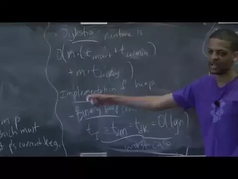
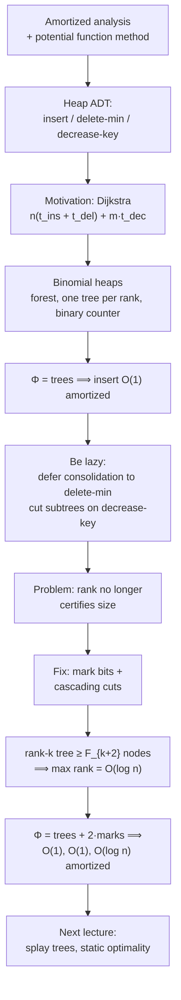

# Advanced Algorithms (COMPSCI 224), Lecture 6

*Harvard University · 1:23:46 · [Watch on YouTube](https://www.youtube.com/watch?v=gxp_FrgTkQI)*

## Summary

This lecture leaves the word RAM model behind and opens the course's unit on **amortized analysis**, introducing the potential function method and then applying it to priority queues. It builds **binomial heaps** as a warm-up — a forest of one tree per rank behaving like a binary counter — proves constant amortized insertion for them, and then derives **Fibonacci heaps** by making binomial heaps as lazy as possible: consolidation is deferred entirely to delete-min, and decrease-key just cuts a subtree loose. The one repair that makes laziness safe is the mark bit and cascading cuts, which forces rank-`k` trees to have at least `F_{k+2}` nodes and gives the `O(1)` / `O(1)` / `O(log n)` amortized bounds for insert, decrease-key and delete-min. The lecture closes with an extended Q&A on how to think about potential functions and a preview of splay trees and static optimality.

Classification: **educational video** (university lecture, blackboard-based, with live class Q&A).

## Topics

1. [Course logistics and lecture roadmap](01-course-logistics-and-roadmap.md) — [`0:00`](https://www.youtube.com/watch?v=gxp_FrgTkQI&t=0)
2. [Amortized analysis and the potential function method](02-amortized-analysis-and-the-potential-function-method.md) — [`2:03`](https://www.youtube.com/watch?v=gxp_FrgTkQI&t=123)
3. [The heap ADT and what Dijkstra needs from it](03-the-heap-adt-and-dijkstra.md) — [`10:47`](https://www.youtube.com/watch?v=gxp_FrgTkQI&t=647)
4. [Heap implementations and the landscape of known bounds](04-heap-implementations-and-known-bounds.md) — [`14:42`](https://www.youtube.com/watch?v=gxp_FrgTkQI&t=882)
5. [Binomial heaps: structure and operations](05-binomial-heaps-structure-and-operations.md) — [`27:56`](https://www.youtube.com/watch?v=gxp_FrgTkQI&t=1676)
6. [Amortized analysis of binomial heaps](06-amortized-analysis-of-binomial-heaps.md) — [`39:26`](https://www.youtube.com/watch?v=gxp_FrgTkQI&t=2366)
7. [Fibonacci heaps: designing by being lazy](07-fibonacci-heaps-the-lazy-design.md) — [`44:17`](https://www.youtube.com/watch?v=gxp_FrgTkQI&t=2657)
8. [Rank versus size: where the Fibonacci numbers come from](08-rank-versus-size-the-fibonacci-bound.md) — [`54:29`](https://www.youtube.com/watch?v=gxp_FrgTkQI&t=3269)
9. [Amortized analysis of Fibonacci heaps](09-amortized-analysis-of-fibonacci-heaps.md) — [`59:50`](https://www.youtube.com/watch?v=gxp_FrgTkQI&t=3590)
10. [Q&A: what potential functions are actually doing](10-qa-intuition-behind-potential-functions.md) — [`1:12:58`](https://www.youtube.com/watch?v=gxp_FrgTkQI&t=4378)
11. [Preview: splay trees and static optimality](11-preview-splay-trees-and-static-optimality.md) — [`1:20:16`](https://www.youtube.com/watch?v=gxp_FrgTkQI&t=4816)

## Key takeaways

- The potential function method is sound with only two requirements — `Φ(∅) = 0` and `Φ ≥ 0` — because summing `t_i + ΔΦ_i` telescopes to `Σ t_i + Φ(S_k) ≥ Σ t_i`; a per-operation amortized bound is then the **worst case** of `actual + ΔΦ` over that operation type [`9:34`](https://www.youtube.com/watch?v=gxp_FrgTkQI&t=574), [`10:27`](https://www.youtube.com/watch?v=gxp_FrgTkQI&t=627), [`1:19:19`](https://www.youtube.com/watch?v=gxp_FrgTkQI&t=4759).
- With `Φ = number of trees`, binomial heap insertion is **`O(1)` amortized** despite `O(log n)` worst case: the actual cost `t − t' + 1` cancels exactly against `ΔΦ = t' − t`, leaving 1 [`42:15`](https://www.youtube.com/watch?v=gxp_FrgTkQI&t=2535), [`43:23`](https://www.youtube.com/watch?v=gxp_FrgTkQI&t=2603).
- Pure laziness breaks the structure: unrestricted cutting on decrease-key can leave a **rank-`k` tree holding only `k+1` items**, destroying the "rank certifies size" argument that bounds delete-min [`51:19`](https://www.youtube.com/watch?v=gxp_FrgTkQI&t=3079), [`52:02`](https://www.youtube.com/watch?v=gxp_FrgTkQI&t=3122).
- The mark-bit rule (cut a node once it loses its **second** child) restores the bound: the smallest rank-`k` trees have sizes 1, 2, 3, 5, 8, i.e. at least `F_{k+2}`, which grows exponentially and forces max rank `= O(log n)` [`52:27`](https://www.youtube.com/watch?v=gxp_FrgTkQI&t=3147), [`58:41`](https://www.youtube.com/watch?v=gxp_FrgTkQI&t=3521), [`59:23`](https://www.youtube.com/watch?v=gxp_FrgTkQI&t=3563), [`1:07:49`](https://www.youtube.com/watch?v=gxp_FrgTkQI&t=4069).
- With `Φ = trees(H) + 2·marks(H)`, Fibonacci heaps achieve **insert `O(1)`, decrease-key `O(1)`, delete-min `O(log n)` amortized** — `c` cascading cuts cost `O(c)` but change potential by `+c − 2c`, so the cost collapses to a constant; delete-min's worst case, however, is still linear [`1:00:59`](https://www.youtube.com/watch?v=gxp_FrgTkQI&t=3659), [`1:10:26`](https://www.youtube.com/watch?v=gxp_FrgTkQI&t=4226), [`1:10:58`](https://www.youtube.com/watch?v=gxp_FrgTkQI&t=4258), [`1:12:58`](https://www.youtube.com/watch?v=gxp_FrgTkQI&t=4378).
- Constant delete-min is impossible for these comparison-based structures (heapsort would sort in `O(n)`), but word RAM escapes it: the better of fusion trees and van Emde Boas gives `O(√log n)` per operation [`22:14`](https://www.youtube.com/watch?v=gxp_FrgTkQI&t=1334), [`24:24`](https://www.youtube.com/watch?v=gxp_FrgTkQI&t=1464).
- Later work matched Fibonacci heap bounds in weaker models — Brodal (SODA '96) made them **worst case**, and Brodal–Lagogiannis–Tarjan (STOC 2012) achieved them on a **pure pointer machine** — motivated by Fibonacci heaps' large constants making them impractical [`20:28`](https://www.youtube.com/watch?v=gxp_FrgTkQI&t=1228), [`23:14`](https://www.youtube.com/watch?v=gxp_FrgTkQI&t=1394), [`27:20`](https://www.youtube.com/watch?v=gxp_FrgTkQI&t=1640).
