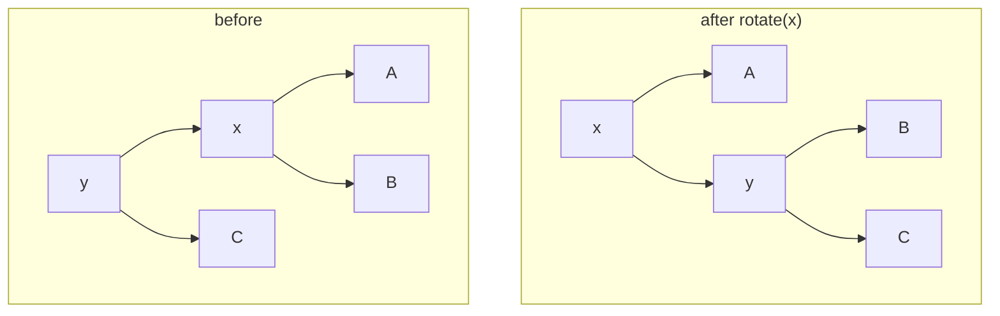

# 1. Splay Trees and the BST Model

> Note: the auto-generated transcript renders "splay" as "spllay"/"display" and "Sleator & Tarjan" as "Slater and Targen". Correct spellings are used below.

## What the data structure solves

- Splay trees are due to **Sleator and Tarjan**, dated to 1985 in the lecture [`0:00`](https://www.youtube.com/watch?v=LbX51mey3vo&t=0), [`0:36`](https://www.youtube.com/watch?v=LbX51mey3vo&t=36).
- They are a **comparison-based** solution to the dictionary problem, supporting [`0:36`](https://www.youtube.com/watch?v=LbX51mey3vo&t=36), [`1:35`](https://www.youtube.com/watch?v=LbX51mey3vo&t=95):
  - `insert(k, v)` — insert an item with key `k` and value `v`
  - `find(k)` — return the value associated with `k`
  - `delete(k)` — remove the item with key `k`
- Non-comparison-based alternative for the same problem: hash tables. The comparison-based version buys you extra operations such as **predecessor** [`2:22`](https://www.youtube.com/watch?v=LbX51mey3vo&t=142).
- Practical relevance: splay trees won the **Paris Kanellakis Theory and Practice Award in 1999**, cited for "one of the most widely used data structures invented in the last 20 years" [`2:22`](https://www.youtube.com/watch?v=LbX51mey3vo&t=142), [`2:52`](https://www.youtube.com/watch?v=LbX51mey3vo&t=172).

## The BST model

- A splay tree *is* a binary search tree; the difference is that **after every operation it rebalances itself** ("self-adjusting") [`3:13`](https://www.youtube.com/watch?v=LbX51mey3vo&t=193), [`3:43`](https://www.youtube.com/watch?v=LbX51mey3vo&t=223).
- The **BST model** defines what an algorithm is allowed to do [`4:17`](https://www.youtube.com/watch?v=LbX51mey3vo&t=257), [`4:52`](https://www.youtube.com/watch?v=LbX51mey3vo&t=292), [`28:42`](https://www.youtube.com/watch?v=LbX51mey3vo&t=1722):
  1. At the start of each operation, a single pointer sits at the **root**.
  2. Each step costs 1 and may be one of: follow a **child** pointer, follow the **parent** pointer, or **rotate** the node currently pointed at.
  3. For every access request, the pointer must reach the requested node.

## Rotation

- `rotate(x)` makes `x` the parent of its own parent `y`, with subtrees redistributed to preserve BST order [`5:23`](https://www.youtube.com/watch?v=LbX51mey3vo&t=323), [`5:56`](https://www.youtube.com/watch?v=LbX51mey3vo&t=356), [`6:30`](https://www.youtube.com/watch?v=LbX51mey3vo&t=390).
- The symmetric picture applies when `x` is the right child of `y`; the rest of the tree is untouched [`6:30`](https://www.youtube.com/watch?v=LbX51mey3vo&t=390).

## The three operations

| Operation | Implementation | Timestamp |
|---|---|---|
| `find(x)` | Search down as in any BST, then **splay `x`** so it becomes the new root | [`7:08`](https://www.youtube.com/watch?v=LbX51mey3vo&t=428), [`7:54`](https://www.youtube.com/watch?v=LbX51mey3vo&t=474) |
| `insert(x)` | Insert as in any BST, then **splay `x`** | [`8:19`](https://www.youtube.com/watch?v=LbX51mey3vo&t=499) |
| `delete(x)` | Splay `x` to the root, remove it; if `x` had two children, splay the **largest element of the left subtree** and make it the new root | [`8:19`](https://www.youtube.com/watch?v=LbX51mey3vo&t=499), [`9:08`](https://www.youtube.com/watch?v=LbX51mey3vo&t=548), [`9:55`](https://www.youtube.com/watch?v=LbX51mey3vo&t=595) |

- `splay` is a subroutine that performs rotations to bring `x` to the root — but it is deliberately **not** "rotate `x` until it is the root"; it is "slightly more involved" [`7:54`](https://www.youtube.com/watch?v=LbX51mey3vo&t=474).
- Baseline expectation: red-black / AVL trees already give O(log n) per operation; splay trees match that **amortized**, and additionally satisfy a family of stronger properties [`10:35`](https://www.youtube.com/watch?v=LbX51mey3vo&t=635).
