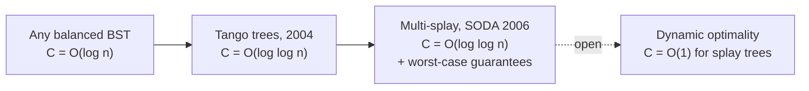

# 3. The Dynamic Optimality Conjecture

Called "the granddaddy of them all" — stated in the original 1985 paper and **open ever since (~30 years at the time of the lecture)** [`24:56`](https://www.youtube.com/watch?v=LbX51mey3vo&t=1496), [`25:33`](https://www.youtube.com/watch?v=LbX51mey3vo&t=1533), [`25:59`](https://www.youtube.com/watch?v=LbX51mey3vo&t=1559).

## Statement

- Let `OPT(σ)` = the **optimal cost of servicing access sequence `σ` in the BST model**, computed with full knowledge of `σ` in advance — an offline strategy that emits, at each step, "go up", "go down to child", or "rotate", subject to touching every node of `σ` in order [`25:59`](https://www.youtube.com/watch?v=LbX51mey3vo&t=1559), [`26:32`](https://www.youtube.com/watch?v=LbX51mey3vo&t=1592), [`27:23`](https://www.youtube.com/watch?v=LbX51mey3vo&t=1643).
- **Conjecture:** for all `σ`, `splay_cost(σ) ≤ C · OPT(σ)` for a **fixed constant `C` independent of `n` and `m`** [`27:23`](https://www.youtube.com/watch?v=LbX51mey3vo&t=1643), [`28:10`](https://www.youtube.com/watch?v=LbX51mey3vo&t=1690), [`29:10`](https://www.youtube.com/watch?v=LbX51mey3vo&t=1750).
- Contrast with static optimality: static compares against a **fixed** tree; dynamic optimality lets the competitor **change the tree over time** [`25:59`](https://www.youtube.com/watch?v=LbX51mey3vo&t=1559), [`26:32`](https://www.youtube.com/watch?v=LbX51mey3vo&t=1592).

## How small can the competitive ratio `C` be?

If `C` is allowed to depend on `n`, known results give:

| Result | Competitive ratio `C` | Notes | Timestamp |
|---|---|---|---|
| Any balanced BST (red-black, AVL) | **O(log n)** | Each access costs ≥ constant for OPT, and a balanced BST spends ≤ O(log n) | [`29:48`](https://www.youtube.com/watch?v=LbX51mey3vo&t=1788), [`30:26`](https://www.youtube.com/watch?v=LbX51mey3vo&t=1826) |
| **Tango trees** — Demaine, Harmon, Iacono, Pătraşcu (2004) | **O(log log n)** | Designed purely to drive `C` down; **not** dynamically optimal, and no good worst-case/amortized guarantees | [`30:26`](https://www.youtube.com/watch?v=LbX51mey3vo&t=1826), [`31:11`](https://www.youtube.com/watch?v=LbX51mey3vo&t=1871), [`31:59`](https://www.youtube.com/watch?v=LbX51mey3vo&t=1919) |
| **Multi-splay trees** — Wang, Derryberry, Sleator (SODA 2006) | **O(log log n)** | Same ratio **plus** O(log n) amortized per operation and O(log² n) worst case | [`31:11`](https://www.youtube.com/watch?v=LbX51mey3vo&t=1871), [`31:59`](https://www.youtube.com/watch?v=LbX51mey3vo&t=1919) |

- The O(log n) ratio "follows from really old results"; the research question is how close to **constant** one can get [`31:11`](https://www.youtube.com/watch?v=LbX51mey3vo&t=1871).

