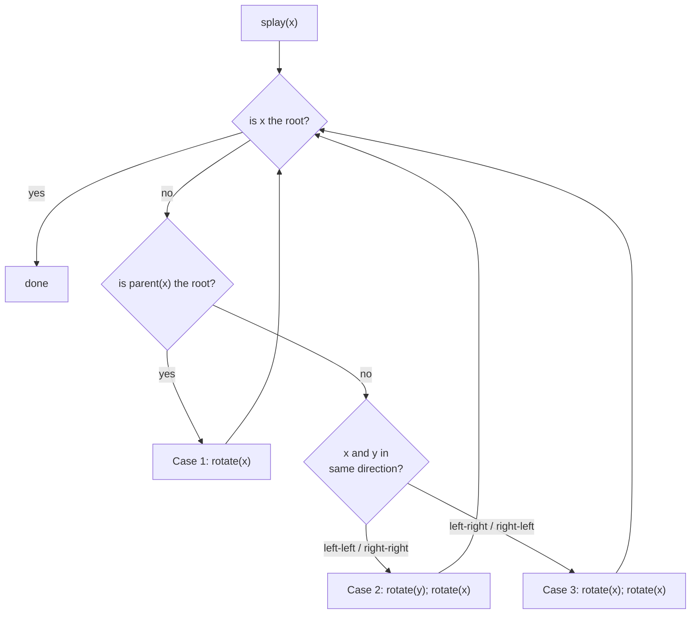

# 4. The `splay` Operation: Three Cases

## Why naive rotate-to-root fails

- The obvious idea — "rotate `x` repeatedly until it is the root" — provably does **not** rebalance [`32:34`](https://www.youtube.com/watch?v=LbX51mey3vo&t=1954).
- Counterexample walked through in class: a fully unbalanced path `6 → 5 → 4 → 3 → 2 → 1`. After repeatedly rotating `6` to the root, the tree becomes `6` on top with `1` below it and `2,3,4,5` strung out — **the depth was `n` before and is still `n` after** [`33:16`](https://www.youtube.com/watch?v=LbX51mey3vo&t=1996), [`33:42`](https://www.youtube.com/watch?v=LbX51mey3vo&t=2022), [`34:04`](https://www.youtube.com/watch?v=LbX51mey3vo&t=2044).

## Definition

Let `y = parent(x)` and `z = parent(y)`. Repeat until `x` is the root [`35:02`](https://www.youtube.com/watch?v=LbX51mey3vo&t=2102), [`35:42`](https://www.youtube.com/watch?v=LbX51mey3vo&t=2142), [`38:29`](https://www.youtube.com/watch?v=LbX51mey3vo&t=2309):

| Case | Condition | Action | Timestamp |
|---|---|---|---|
| **1** ("zig") | `y` is the root (`x` has no grandparent) | `rotate(x)` | [`36:17`](https://www.youtube.com/watch?v=LbX51mey3vo&t=2177), [`37:53`](https://www.youtube.com/watch?v=LbX51mey3vo&t=2273) |
| **2** ("zig-zig") | Same direction: `x` left of `y` **and** `y` left of `z`, or right/right | `rotate(y)` **then** `rotate(x)` | [`36:17`](https://www.youtube.com/watch?v=LbX51mey3vo&t=2177), [`36:58`](https://www.youtube.com/watch?v=LbX51mey3vo&t=2218), [`37:53`](https://www.youtube.com/watch?v=LbX51mey3vo&t=2273) |
| **3** ("zig-zag") | Opposite directions: `x` left of `y` and `y` right of `z`, or vice versa | `rotate(x)` **then** `rotate(x)` | [`36:58`](https://www.youtube.com/watch?v=LbX51mey3vo&t=2218), [`38:29`](https://www.youtube.com/watch?v=LbX51mey3vo&t=2309) |

- **The only structural difference between case 2 and case 3 is which node is rotated first** — case 2 rotates the *parent* first, case 3 rotates `x` twice. That single choice is what makes the analysis work [`37:53`](https://www.youtube.com/watch?v=LbX51mey3vo&t=2273), [`38:29`](https://www.youtube.com/watch?v=LbX51mey3vo&t=2309).

## Shapes produced

- **Case 2** transforms `z → y → x` (with subtrees `A, B` under `x`, then `C`, `D`) into `x → y → z` with `A, B, C, D` redistributed left-to-right [`39:03`](https://www.youtube.com/watch?v=LbX51mey3vo&t=2343), [`39:35`](https://www.youtube.com/watch?v=LbX51mey3vo&t=2375).
- **Case 3** lifts `x` above both `y` and `z`, making `y` and `z` its two children [`40:32`](https://www.youtube.com/watch?v=LbX51mey3vo&t=2432), [`40:52`](https://www.youtube.com/watch?v=LbX51mey3vo&t=2452), [`41:33`](https://www.youtube.com/watch?v=LbX51mey3vo&t=2493).

## Sanity check: splaying the leaf of a path

- Applying `splay` to the deepest node of a long path (the same worst case that defeats naive rotation) **halves the depth**: roughly half the path ends up on the new spine, each with one node hanging off it [`41:33`](https://www.youtube.com/watch?v=LbX51mey3vo&t=2493), [`42:37`](https://www.youtube.com/watch?v=LbX51mey3vo&t=2557), [`45:13`](https://www.youtube.com/watch?v=LbX51mey3vo&t=2713).
- Explicitly **not a proof**, only evidence the definition is heading in the right direction [`45:13`](https://www.youtube.com/watch?v=LbX51mey3vo&t=2713).

## Where does `splay` come from?

- Unlike Fibonacci heaps (derivable from binomial heaps), `splay` "seems to come out of nowhere" and is not obvious even in hindsight [`34:04`](https://www.youtube.com/watch?v=LbX51mey3vo&t=2044), [`35:02`](https://www.youtube.com/watch?v=LbX51mey3vo&t=2102).
- Anecdote: a friend of the lecturer repeatedly asked Sleator at CMU why they chose this rule; the answers varied, one being simply **"the math works"** [`34:39`](https://www.youtube.com/watch?v=LbX51mey3vo&t=2079).
