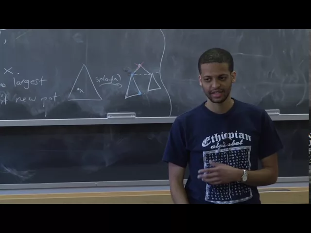
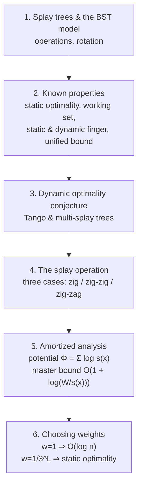

# Advanced Algorithms (COMPSCI 224), Lecture 7

*Harvard University · 1:26:46 · [Watch on YouTube](https://www.youtube.com/watch?v=LbX51mey3vo)*

## Summary

A university lecture (Harvard COMPSCI 224, Advanced Algorithms) devoted entirely to **splay trees** — Sleator and Tarjan's self-adjusting binary search tree — as a second worked example of amortized analysis for a data structure. The first half is a survey: the BST model, how `find`/`insert`/`delete` are built on top of a `splay` subroutine, and the catalogue of properties splay trees are known (or conjectured) to satisfy — static optimality, working set, static and dynamic finger, the unresolved unified bound, and the 30-year-open **dynamic optimality conjecture**. The second half is the actual proof: a potential function `Φ = Σ log s(x)` built on **arbitrary item weights**, worked through case 2 of `splay` in full, yielding a master bound of `O(1 + log(W/s(x)))` per operation — from which uniform weights give O(log n) and weights `1/3^{L_i}` give static optimality.

Classification: **educational video** (lecture in a graduate algorithms course), so the notes follow the lecture's own progression from definitions, to catalogued results, to the proof.

## Topics

1. [Splay Trees and the BST Model](01-splay-trees-and-the-bst-model.md) — the dictionary problem, the BST model, rotations, and how `find`/`insert`/`delete` reduce to `splay` [`0:00`](https://www.youtube.com/watch?v=LbX51mey3vo&t=0)
2. [The Known Properties of Splay Trees](02-known-properties-of-splay-trees.md) — static optimality, working set, static finger, dynamic finger, and the unified bound [`10:35`](https://www.youtube.com/watch?v=LbX51mey3vo&t=635)
3. [The Dynamic Optimality Conjecture](03-dynamic-optimality-conjecture.md) — the open conjecture and how low the competitive ratio has been pushed [`24:56`](https://www.youtube.com/watch?v=LbX51mey3vo&t=1496)
4. [The `splay` Operation: Three Cases](04-the-splay-operation.md) — why naive rotate-to-root fails, and the zig / zig-zig / zig-zag rules [`32:34`](https://www.youtube.com/watch?v=LbX51mey3vo&t=1954)
5. [Amortized Analysis via the Potential Function](05-amortized-analysis-via-potential-function.md) — weights, ranks, `Φ`, and the full case-2 proof [`45:56`](https://www.youtube.com/watch?v=LbX51mey3vo&t=2756)
6. [Choosing Weights: O(log n) and Static Optimality](06-choosing-weights-log-n-and-static-optimality.md) — two instantiations of the master bound [`1:14:36`](https://www.youtube.com/watch?v=LbX51mey3vo&t=4476)

## Key takeaways

- **The whole analysis reduces to one master inequality:** the amortized cost of `splay(x)` is `O(1 + log(W / s(x)))`, where `W` is the total item weight and `s(x)` the weight of `x`'s subtree. Every property of splay trees is then obtained by choosing the weight function — this is why the weights are left arbitrary throughout [`57:44`](https://www.youtube.com/watch?v=LbX51mey3vo&t=3464), [`1:14:03`](https://www.youtube.com/watch?v=LbX51mey3vo&t=4443), [`1:25:24`](https://www.youtube.com/watch?v=LbX51mey3vo&t=5124).
- **Uniform weights `w(x) = 1` immediately give O(log n) amortized per operation** — `W = n`, `s(x) ≥ 1` — matching red-black/AVL trees with no balance information stored [`1:14:36`](https://www.youtube.com/watch?v=LbX51mey3vo&t=4476).
- **Weights `w(i) = 1/3^{L_i}` (from a fixed tree `T` placing `i` at level `L_i`) prove static optimality:** splay trees service the sequence in `O(m + n² + Σ m_i L_i)` versus `T`'s `O(m + Σ m_i L_i)`, from *any* arbitrary starting configuration. The proof needs only two facts — `Φ ∈ [−n², 0]` so it cannot swing by more than `n²`, and `W ≤ Σ_L (2/3)^L` is a convergent constant [`1:19:45`](https://www.youtube.com/watch?v=LbX51mey3vo&t=4785), [`1:20:31`](https://www.youtube.com/watch?v=LbX51mey3vo&t=4831), [`1:23:37`](https://www.youtube.com/watch?v=LbX51mey3vo&t=5017), [`1:24:51`](https://www.youtube.com/watch?v=LbX51mey3vo&t=5091).
- **The `−2` in the potential drop is the crux of the case-2 proof, and it is what AM–GM buys.** Bounding `r'(z) ≤ r'(x)` naively still gives `O(r'(x) − r(x))` but loses the `−2` that cancels the two rotations' actual cost; the AM–GM step plus the structural fact `s(x) + s'(z) ≤ s'(x)` yields `r'(z) ≤ 2r'(x) − r(x) − 2` [`1:07:53`](https://www.youtube.com/watch?v=LbX51mey3vo&t=4073), [`1:09:12`](https://www.youtube.com/watch?v=LbX51mey3vo&t=4152), [`1:10:30`](https://www.youtube.com/watch?v=LbX51mey3vo&t=4230).
- **Rotating `x` to the root naively is provably useless:** on the path `6→5→4→3→2→1`, repeated `rotate(6)` leaves the depth at `n`. The zig-zig rule (rotate the *parent* first) is exactly the fix — splaying a path leaf roughly **halves** its depth [`33:42`](https://www.youtube.com/watch?v=LbX51mey3vo&t=2022), [`34:04`](https://www.youtube.com/watch?v=LbX51mey3vo&t=2044), [`45:13`](https://www.youtube.com/watch?v=LbX51mey3vo&t=2713).
- **Dynamic optimality remains open after ~30 years.** Any balanced BST is O(log n)-competitive against offline OPT; Tango trees (Demaine–Harmon–Iacono–Pătraşcu 2004) push this to O(log log n), and multi-splay trees (Wang–Derryberry–Sleator, SODA 2006) match O(log log n) while also giving O(log n) amortized and O(log² n) worst case. Whether splay trees themselves are O(1)-competitive is unknown [`27:23`](https://www.youtube.com/watch?v=LbX51mey3vo&t=1643), [`30:26`](https://www.youtube.com/watch?v=LbX51mey3vo&t=1826), [`31:11`](https://www.youtube.com/watch?v=LbX51mey3vo&t=1871), [`31:59`](https://www.youtube.com/watch?v=LbX51mey3vo&t=1919).
- **The unified bound is open even for the whole BST model, not just splay trees.** Iacono (2001) achieves it with a non-BST structure; the best BST-model result is Derryberry–Sleator (2009) at `O(m log log n + unified bound)`, where the goal is `m` [`23:16`](https://www.youtube.com/watch?v=LbX51mey3vo&t=1396), [`23:44`](https://www.youtube.com/watch?v=LbX51mey3vo&t=1424), [`24:28`](https://www.youtube.com/watch?v=LbX51mey3vo&t=1468).
- **Splay trees are not just a theory artifact:** they won the Paris Kanellakis Theory and Practice Award in 1999 for being one of the most widely used data structures invented in the preceding 20 years [`2:22`](https://www.youtube.com/watch?v=LbX51mey3vo&t=142), [`2:52`](https://www.youtube.com/watch?v=LbX51mey3vo&t=172).
