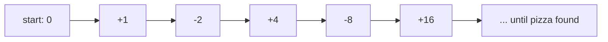

# 3. Toy example — "free pizza" (searching a line)

## Setup

- A very long hallway with rooms `1…n` evenly spaced on one side; you start in front of room `n/2`, relabelled as position `0`, with the ends at `−n/2` and `+n/2` ([`11:44`](https://www.youtube.com/watch?v=aHW6HKVC-SY&t=704), [`14:05`](https://www.youtube.com/watch?v=aHW6HKVC-SY&t=845)).
- Free pizza is in exactly one room; you have no signal and cannot ask, so you must walk to find it ([`12:19`](https://www.youtube.com/watch?v=aHW6HKVC-SY&t=739)).
- OPT knows the room and walks straight there; you do not even know the direction ([`12:42`](https://www.youtube.com/watch?v=aHW6HKVC-SY&t=762)).
- Peeking into a room you are standing in front of is free — you inspect every room you pass ([`18:06`](https://www.youtube.com/watch?v=aHW6HKVC-SY&t=1086), [`18:31`](https://www.youtube.com/watch?v=aHW6HKVC-SY&t=1111)).

## The zig-zag (doubling) strategy

- Alternate directions, **doubling the distance each phase**: visit room `1`, then `−2`, then `4`, then `−8`, then `16`, … ([`14:50`](https://www.youtube.com/watch?v=aHW6HKVC-SY&t=890)).

## Analysis

- Let the pizza be in room `T`. **OPT pays `T`** ([`15:32`](https://www.youtube.com/watch?v=aHW6HKVC-SY&t=932), [`15:53`](https://www.youtube.com/watch?v=aHW6HKVC-SY&t=953)).
- We pay `1+1 + 2+2 + 4+4 + … + 2^m + 2^m`, then finally `T` steps to reach the room ([`15:53`](https://www.youtube.com/watch?v=aHW6HKVC-SY&t=953), [`16:30`](https://www.youtube.com/watch?v=aHW6HKVC-SY&t=990)).
- The last overshoot satisfies `2^m ≤ 2T`, because the previous phase went less than `T` ([`16:30`](https://www.youtube.com/watch?v=aHW6HKVC-SY&t=990), [`17:04`](https://www.youtube.com/watch?v=aHW6HKVC-SY&t=1024)).
- The geometric series sums to at most `4T`, doubled for the round trips gives `8T`, plus the final `T`:

  **total ≤ 9T ⇒ the doubling search is 9-competitive (a constant-competitive algorithm)** ([`17:04`](https://www.youtube.com/watch?v=aHW6HKVC-SY&t=1024), [`17:42`](https://www.youtube.com/watch?v=aHW6HKVC-SY&t=1062)).
