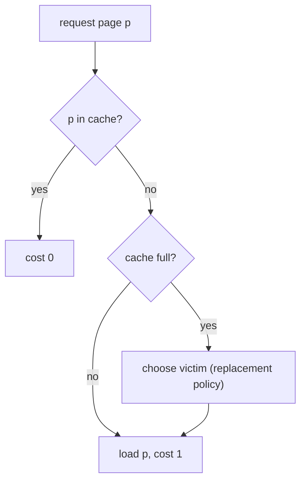

# 7. Paging as generalized list update

## Generalizing the cost function

- Replace "accessing the `i`-th item costs `i`" with **cost `f(i)`** ([`44:08`](https://www.youtube.com/watch?v=aHW6HKVC-SY&t=2648)).
- `f(i) = i` recovers plain list update; **paging** is the choice ([`45:12`](https://www.youtube.com/watch?v=aHW6HKVC-SY&t=2712)):

  `f(i) = 0 if i ≤ k`, `f(i) = 1 otherwise`

- Extra rule in the paging model: when accessing item `i` with `i > k`, you **must transpose it down to a position ≤ k** ([`46:10`](https://www.youtube.com/watch?v=aHW6HKVC-SY&t=2770)).
- Interpretation: **the first `k` list positions are memory/cache; everything past them is disk**, and accessing memory is free ([`48:27`](https://www.youtube.com/watch?v=aHW6HKVC-SY&t=2907)).

## The paging problem itself

- Two levels of storage: `k` cache lines of fast memory, and an effectively infinite disk split into blocks of one cache line ([`20:13`](https://www.youtube.com/watch?v=aHW6HKVC-SY&t=1213), [`47:00`](https://www.youtube.com/watch?v=aHW6HKVC-SY&t=2820)).
- A hit is free; a miss **costs 1** to fetch from disk, after which the page stays free to access ([`47:43`](https://www.youtube.com/watch?v=aHW6HKVC-SY&t=2863)).
- If memory is full, the fetch forces an **eviction** — this choice is the entire decision problem ([`20:41`](https://www.youtube.com/watch?v=aHW6HKVC-SY&t=1241), [`48:04`](https://www.youtube.com/watch?v=aHW6HKVC-SY&t=2884)).

## Cache replacement heuristics and their list-update twins

| Policy | Rule | List-update analogue |
| --- | --- | --- |
| **LRU** | Evict the least recently accessed page ([`49:06`](https://www.youtube.com/watch?v=aHW6HKVC-SY&t=2946)) | **Exactly move-to-front** ([`49:35`](https://www.youtube.com/watch?v=aHW6HKVC-SY&t=2975)) |
| **LFU** | Evict the least frequently accessed page over all history so far ([`49:35`](https://www.youtube.com/watch?v=aHW6HKVC-SY&t=2975), [`50:05`](https://www.youtube.com/watch?v=aHW6HKVC-SY&t=3005)) | *Not* frequency count — a student points out that a forced fetch of a cold page distorts the distribution, and the lecturer agrees ([`50:05`](https://www.youtube.com/watch?v=aHW6HKVC-SY&t=3005), [`50:37`](https://www.youtube.com/watch?v=aHW6HKVC-SY&t=3037)) |
| **FIFO** | Evict the page brought in longest ago ([`50:54`](https://www.youtube.com/watch?v=aHW6HKVC-SY&t=3054)) | — |
| **Most-recently-fetched** | Evict the page most recently brought in; listed in the Sleator–Tarjan paper, and the lecturer says he doesn't understand why anyone would use it ([`50:54`](https://www.youtube.com/watch?v=aHW6HKVC-SY&t=3054), [`51:42`](https://www.youtube.com/watch?v=aHW6HKVC-SY&t=3102)) | — |

## What OPT looks like

- **Farthest-in-the-future** eviction is optimal for paging — unimplementable, since it needs the future ([`1:00:38`](https://www.youtube.com/watch?v=aHW6HKVC-SY&t=3638)).
- Attributed to **Belady**, IBM Journal of Systems, ~1966 ([`1:01:09`](https://www.youtube.com/watch?v=aHW6HKVC-SY&t=3669)).
