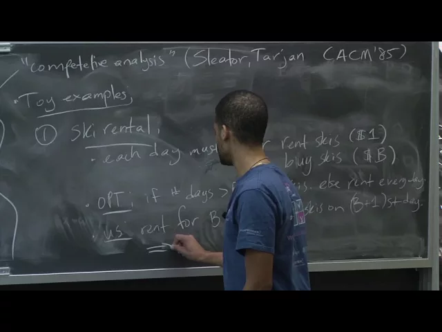
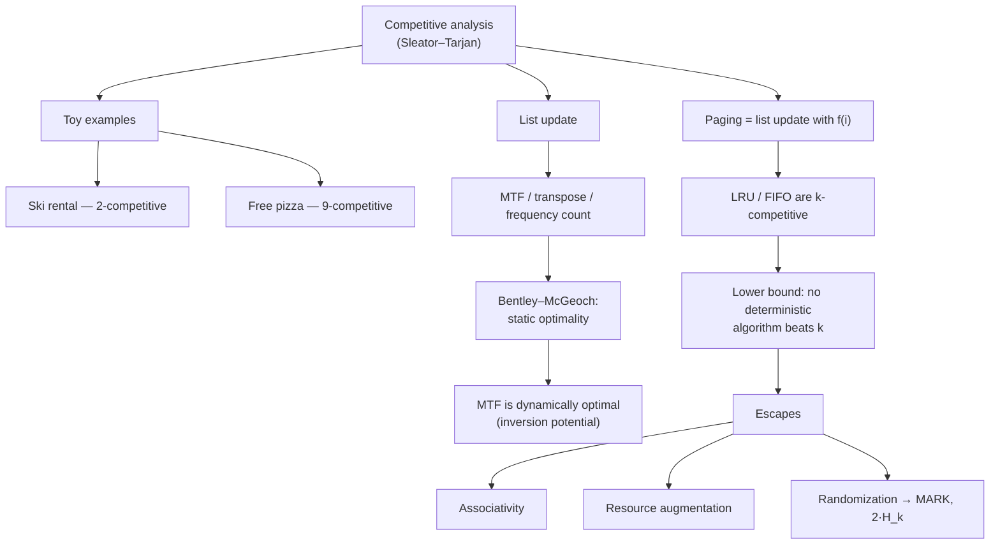

# Advanced Algorithms (COMPSCI 224), Lecture 8

An introduction to **online algorithms** and **competitive analysis**: how to make irrevocable decisions without knowing the future, and how to prove you never spend much more than an omniscient optimum. After two warm-up examples (ski rental, searching a hallway), the lecture works through the two problems Sleator and Tarjan introduced competitive analysis for — **list update**, where move-to-front is proved dynamically optimal by a potential-function argument, and **paging**, where LRU and FIFO are `k`-competitive and no deterministic policy can do better. It closes with three ways around that lower bound — limited associativity, resource augmentation, and randomization — and begins the analysis of the randomized MARK algorithm, which reaches `Θ(log k)` against oblivious adversaries.

## Topics

1. [Online algorithms and competitive analysis](./01-online-algorithms-and-competitive-analysis.md)
2. [Toy example — ski rental](./02-toy-example-ski-rental.md)
3. [Toy example — "free pizza" (searching a line)](./03-toy-example-free-pizza-search.md)
4. [The list update problem and its heuristics](./04-list-update-problem-and-heuristics.md)
5. [Bentley–McGeoch: worst-case analysis and static optimality](./05-bentley-mcgeoch-and-static-optimality.md)
6. [Move-to-front is dynamically optimal](./06-move-to-front-is-dynamically-optimal.md)
7. [Paging as generalized list update](./07-paging-as-generalized-list-update.md)
8. [LRU/FIFO are k-competitive — and the matching lower bound](./08-k-competitiveness-and-the-lower-bound.md)
9. [Circumventing the k lower bound](./09-circumventing-the-lower-bound.md)
10. [The randomized marking algorithm](./10-randomized-marking-algorithm.md)

## Key takeaways

- **Competitive analysis replaces probabilistic modelling with a worst-case ratio**: `A` is `r`-competitive if `cost_A(σ) ≤ r · cost_OPT(σ) + c` for every request sequence, where OPT knows the future — introduced by Sleator and Tarjan in the same year as the splay-tree paper ([`5:55`](https://www.youtube.com/watch?v=aHW6HKVC-SY&t=355), [`6:34`](https://www.youtube.com/watch?v=aHW6HKVC-SY&t=394)).
- **Rent-then-buy is 2-competitive for ski rental**: renting for `B` days and buying on day `B+1` costs at most `2B` where OPT pays `B` ([`10:30`](https://www.youtube.com/watch?v=aHW6HKVC-SY&t=630)); the exponential zig-zag search for the pizza room costs at most `9T` against OPT's `T` ([`17:04`](https://www.youtube.com/watch?v=aHW6HKVC-SY&t=1024), [`17:42`](https://www.youtube.com/watch?v=aHW6HKVC-SY&t=1062)).
- **Move-to-front is dynamically optimal for list update**: `cost_MTF(S) ≤ 2·cost_A(S) + paid − free − m` for *every* algorithm `A`, even one allowed paid exchanges and full knowledge of the future — proved with the number of inversions between the two lists as potential, giving amortized cost `≤ 2i − 1` per access ([`32:51`](https://www.youtube.com/watch?v=aHW6HKVC-SY&t=1971), [`35:13`](https://www.youtube.com/watch?v=aHW6HKVC-SY&t=2113), [`43:10`](https://www.youtube.com/watch?v=aHW6HKVC-SY&t=2590)). Empirically, Bentley–McGeoch found frequency count strong, MTF usually equal or better, and **transpose bad** ([`27:29`](https://www.youtube.com/watch?v=aHW6HKVC-SY&t=1649)).
- **Paging is tight at `k`**: LRU and FIFO are `k`-competitive via the phase argument on one-bit LRU (`≤ k` faults per phase vs OPT's `≥ 1`), and no deterministic online algorithm can beat `k` — shown by an adversary over `k+1` pages that always requests what was just evicted while OPT, evicting farthest-in-future, faults once per `k` accesses ([`51:42`](https://www.youtube.com/watch?v=aHW6HKVC-SY&t=3102), [`52:47`](https://www.youtube.com/watch?v=aHW6HKVC-SY&t=3167), [`55:25`](https://www.youtube.com/watch?v=aHW6HKVC-SY&t=3325), [`1:05:45`](https://www.youtube.com/watch?v=aHW6HKVC-SY&t=3945)). Ratio `k` is not automatic: **LFU is unboundedly bad** ([`56:10`](https://www.youtube.com/watch?v=aHW6HKVC-SY&t=3370)).
- **Weakening the adversary buys big improvements**: with resource augmentation LRU/FIFO become `k/(k − k′ + 1)`-competitive — about 2-competitive when OPT has half the cache ([`1:09:41`](https://www.youtube.com/watch?v=aHW6HKVC-SY&t=4181)); and against an **oblivious** adversary the randomized MARK algorithm (evict a uniformly random unmarked page) achieves `2·H_k ≈ 2 ln k`, with a matching `Ω(log k)` lower bound for any randomized scheme ([`1:15:40`](https://www.youtube.com/watch?v=aHW6HKVC-SY&t=4540), [`1:17:44`](https://www.youtube.com/watch?v=aHW6HKVC-SY&t=4664)). Randomness is worthless against omniscient or adaptive adversaries ([`1:12:08`](https://www.youtube.com/watch?v=aHW6HKVC-SY&t=4328), [`1:13:16`](https://www.youtube.com/watch?v=aHW6HKVC-SY&t=4396)).
