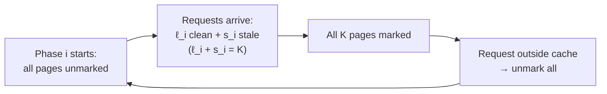

# 2. The MARK algorithm, phases, and clean/stale pages

The randomized paging algorithm whose analysis occupies the first half of the lecture.

## The algorithm

Due to **Fiat et al.**, *Journal of Algorithms*, ~1991 ([`3:51`](https://www.youtube.com/watch?v=KBVkri8k3Ao&t=231)). It is a particular implementation of the "one-bit LRU" from the previous lecture, but with a randomized eviction choice ([`4:18`](https://www.youtube.com/watch?v=KBVkri8k3Ao&t=258)).

Rules ([`4:47`](https://www.youtube.com/watch?v=KBVkri8k3Ao&t=287), [`5:33`](https://www.youtube.com/watch?v=KBVkri8k3Ao&t=333)):

1. On bringing page `p` into cache, **evict a uniformly random *unmarked* page**, then **mark `p`**.
2. If every page in cache is marked and a request arrives for a page outside the cache, **unmark all pages** and continue.

Notation used throughout: `M` denotes the MARK algorithm; `K` is the cache size ([`7:56`](https://www.youtube.com/watch?v=KBVkri8k3Ao&t=476)).

## The claim

Expected competitive ratio is `2·H_K`, where `H_K = 1 + 1/2 + 1/3 + … + 1/K` is the `K`-th harmonic number, which equals `ln K` up to a constant — provable by sandwiching the sum between integrals in both directions ([`5:33`](https://www.youtube.com/watch?v=KBVkri8k3Ao&t=333), [`6:02`](https://www.youtube.com/watch?v=KBVkri8k3Ao&t=362)).

## Phases

The analysis chops the request sequence into **phases** ([`6:23`](https://www.youtube.com/watch?v=KBVkri8k3Ao&t=383), [`7:00`](https://www.youtube.com/watch?v=KBVkri8k3Ao&t=420), [`7:16`](https://www.youtube.com/watch?v=KBVkri8k3Ao&t=436)):

- A phase **starts** when all pages are unmarked.
- A phase **ends** when all pages are marked and a request to a page outside the cache is about to arrive.
- Consequence: except possibly for the last one, exactly `K` distinct pages are requested per phase ([`9:33`](https://www.youtube.com/watch?v=KBVkri8k3Ao&t=573)).

## Two page classifications

Both are **time-sensitive** — a page is clean/stale *at a particular moment* ([`8:23`](https://www.youtube.com/watch?v=KBVkri8k3Ao&t=503)).

| Type | Definition | Timestamp |
|---|---|---|
| **Clean** | `p` was **not** requested in the previous phase and **not yet** requested this phase | [`8:23`](https://www.youtube.com/watch?v=KBVkri8k3Ao&t=503) |
| **Stale** | `p` **was** requested last phase but **not yet** this phase | [`8:51`](https://www.youtube.com/watch?v=KBVkri8k3Ao&t=531) |

## Variables for phase `i`

- `ℓ_i` = number of **clean** pages requested in phase `i` ([`9:33`](https://www.youtube.com/watch?v=KBVkri8k3Ao&t=573)).
- `s_i` = number of **stale** pages requested in phase `i`, with the identity **`s_i = K − ℓ_i`** ([`10:06`](https://www.youtube.com/watch?v=KBVkri8k3Ao&t=606)).
- `d_i` = number of pages in **OPT's** cache at the *beginning* of phase `i` that are **not** in MARK's cache ([`10:48`](https://www.youtube.com/watch?v=KBVkri8k3Ao&t=648)).
- `d'_i` = the same count at the *end* of phase `i`; therefore **`d'_i = d_{i+1}`** ([`11:35`](https://www.youtube.com/watch?v=KBVkri8k3Ao&t=695)).

## Standing assumption

MARK and OPT start with **identical cache contents**, so `d_initial = 0`. Without it no competitive ratio is possible: OPT could start holding exactly the pages about to be requested while the algorithm holds none of them ([`13:53`](https://www.youtube.com/watch?v=KBVkri8k3Ao&t=833), [`14:17`](https://www.youtube.com/watch?v=KBVkri8k3Ao&t=857)).
