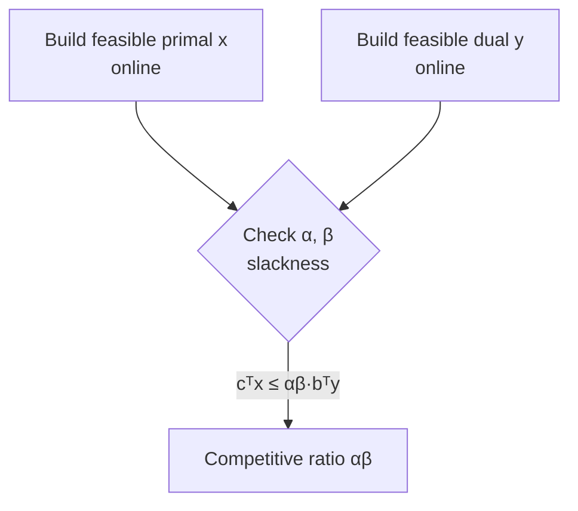

# 8. Lemma: approximate complementary slackness

The analytic engine of the primal-dual framework ([`1:12:14`](https://www.youtube.com/watch?v=KBVkri8k3Ao&t=4334)).

## Statement

Let `x, y` be **feasible** solutions to the primal and dual respectively — feasible meaning they satisfy all constraints, not that they are optimal ([`1:12:53`](https://www.youtube.com/watch?v=KBVkri8k3Ao&t=4373), [`1:14:05`](https://www.youtube.com/watch?v=KBVkri8k3Ao&t=4445)).

Recall the primal: `minimize cᵀx s.t. Ax ≥ b, x ≥ 0` ([`1:12:53`](https://www.youtube.com/watch?v=KBVkri8k3Ao&t=4373)).

Suppose there exist `α, β > 0` such that ([`1:13:29`](https://www.youtube.com/watch?v=KBVkri8k3Ao&t=4409), [`1:14:05`](https://www.youtube.com/watch?v=KBVkri8k3Ao&t=4445), [`1:14:53`](https://www.youtube.com/watch?v=KBVkri8k3Ao&t=4493)):

- **Primal condition:** for all `i`, if `x_i > 0` then the corresponding dual constraint is *nearly tight*:
  `c_i/α ≤ (Aᵀy)_i ≤ c_i`  (the upper bound is just dual feasibility).
- **Dual condition:** for all `i`, if `y_i > 0` then the corresponding primal constraint is *nearly tight*:
  `b_i ≤ a_i · x ≤ β·b_i`.

**Then `cᵀx ≤ α·β·bᵀy`** ([`1:15:32`](https://www.youtube.com/watch?v=KBVkri8k3Ao&t=4532)).

Proof is pure definition-chasing and was assigned to homework ([`1:15:32`](https://www.youtube.com/watch?v=KBVkri8k3Ao&t=4532), [`1:16:06`](https://www.youtube.com/watch?v=KBVkri8k3Ao&t=4566)).

## Why it gives an approximation guarantee

Chain the inequalities ([`1:16:44`](https://www.youtube.com/watch?v=KBVkri8k3Ao&t=4604), [`1:17:11`](https://www.youtube.com/watch?v=KBVkri8k3Ao&t=4631), [`1:17:39`](https://www.youtube.com/watch?v=KBVkri8k3Ao&t=4659), [`1:17:58`](https://www.youtube.com/watch?v=KBVkri8k3Ao&t=4678)):

```
bᵀy  ≤  OPT_dual  ≤  OPT_primal        (y feasible; weak duality)
cᵀx  ≤  α·β·bᵀy   ≤  α·β·OPT_primal    (the lemma)
```

So **the constructed `x` is within a factor `α·β` of optimal** ([`1:17:58`](https://www.youtube.com/watch?v=KBVkri8k3Ao&t=4678)).

## Practical reading

If you can construct *any* pair of feasible primal/dual solutions satisfying these slackness conditions, you immediately get a bound on how close your solution is to OPT — the point of the lemma is to give control over your competitive ratio, not to be elegant ([`1:16:06`](https://www.youtube.com/watch?v=KBVkri8k3Ao&t=4566), [`1:18:16`](https://www.youtube.com/watch?v=KBVkri8k3Ao&t=4696), [`1:18:50`](https://www.youtube.com/watch?v=KBVkri8k3Ao&t=4730)).


