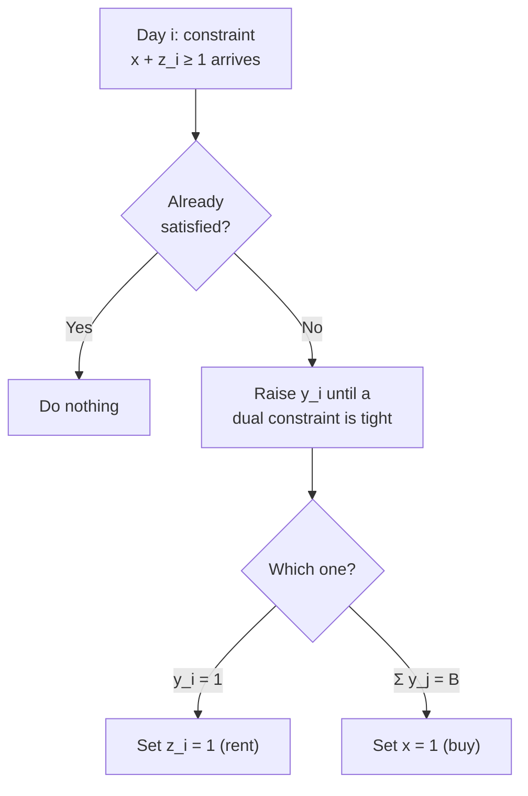

# 9. The primal-dual 2-competitive ski rental algorithm

Acknowledged as **overkill** for a `2`-competitive ratio — last lecture got it simply. The point is to build fluency in the language before the harder problems ([`1:07:56`](https://www.youtube.com/watch?v=KBVkri8k3Ao&t=4076), [`1:18:50`](https://www.youtube.com/watch?v=KBVkri8k3Ao&t=4730), [`1:19:06`](https://www.youtube.com/watch?v=KBVkri8k3Ao&t=4746)).

## The algorithm

When constraint `x + z_i ≥ 1` arrives ([`1:19:06`](https://www.youtube.com/watch?v=KBVkri8k3Ao&t=4746), [`1:19:46`](https://www.youtube.com/watch?v=KBVkri8k3Ao&t=4786), [`1:20:19`](https://www.youtube.com/watch?v=KBVkri8k3Ao&t=4819), [`1:20:49`](https://www.youtube.com/watch?v=KBVkri8k3Ao&t=4849), [`1:21:48`](https://www.youtube.com/watch?v=KBVkri8k3Ao&t=4908)):

1. **If already satisfied → do nothing.**
2. **Otherwise**, raise the corresponding dual variable `y_i` until **some dual constraint becomes tight**. Only two can:
   - `y_i = 1`, or
   - `Σ_j y_j = B`.
3. **Set the primal variable corresponding to the newly tight dual constraint to 1:**
   - `y_i = 1` tight → set `z_i = 1` (rent today).
   - `Σ y_j = B` tight → set `x = 1` (buy).

## Feasibility

At termination we hold **a pair of feasible solutions** ([`1:21:48`](https://www.youtube.com/watch?v=KBVkri8k3Ao&t=4908), [`1:22:26`](https://www.youtube.com/watch?v=KBVkri8k3Ao&t=4946)):

- The primal solution is **integral** and feasible (every arriving constraint gets satisfied on arrival).
- The dual solution is feasible because raising stops exactly at tightness — no constraint is ever violated.

## Extracting `α` and `β`

Apply the approximate complementary slackness lemma ([`1:22:26`](https://www.youtube.com/watch?v=KBVkri8k3Ao&t=4946)):

| Condition | Reasoning | Value |
|---|---|---|
| `x > 0` | means `Σ y_j = B` became tight — **zero slack** | `α = 1` ([`1:23:09`](https://www.youtube.com/watch?v=KBVkri8k3Ao&t=4989)) |
| `z_i > 0` | means `y_i = 1` became tight — **zero slack** | `α = 1` ([`1:23:33`](https://www.youtube.com/watch?v=KBVkri8k3Ao&t=5013)) |
| `y_i > 0` | `x + z_i ≥ 1` holds, but we may have set **both** `x` and `z_i` to 1, so it is at most 2 | `β = 2` ([`1:23:33`](https://www.youtube.com/watch?v=KBVkri8k3Ao&t=5013), [`1:24:01`](https://www.youtube.com/watch?v=KBVkri8k3Ao&t=5041)) |

**Result:** `α·β = 1 · 2 = 2` → the algorithm is **`2`-competitive** ([`1:24:01`](https://www.youtube.com/watch?v=KBVkri8k3Ao&t=5041)).

## Deferred to next lecture

- The randomized `e/(e-1)`-competitive ski rental algorithm ("a little bit fancier").
- Online set cover.

([`1:24:01`](https://www.youtube.com/watch?v=KBVkri8k3Ao&t=5041))
