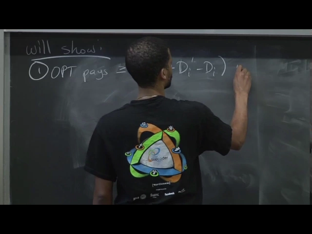
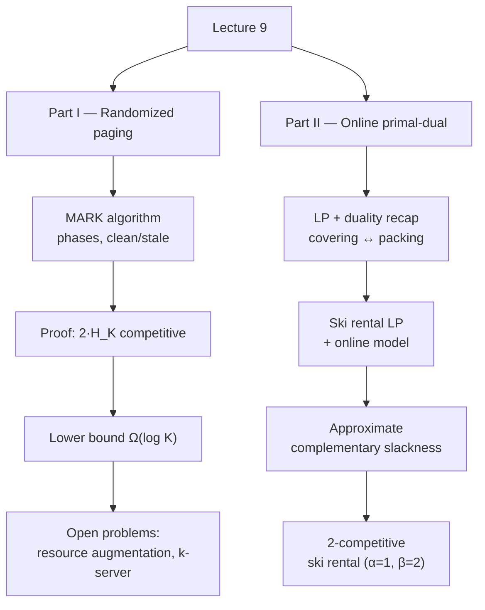

# Advanced Algorithms (COMPSCI 224), Lecture 9

*Harvard University · 1:24:56 · [Watch on YouTube](https://www.youtube.com/watch?v=KBVkri8k3Ao)*

## Summary

A university lecture in two halves. The first half completes the analysis of **MARK**, the randomized paging algorithm of Fiat et al., proving it is `2·H_K` competitive via a phase-based argument on "clean" and "stale" pages, then proving a matching-up-to-constants `Ω(log K)` lower bound for *any* paging algorithm using a uniformly random request sequence and coupon collector. A survey interlude covers what is known and still open: the `H_K`-optimal algorithms of McGeoch–Sleator and Achlioptas et al., an apparently open factor-2 gap under resource augmentation, and the `k`-server problem with its own decades-old factor-2 gap. The second half introduces the **online primal-dual framework** of Buchbinder and Naor — an LP/duality recap, the online constraint-arrival model with monotone variables, the approximate complementary slackness lemma, and a worked re-derivation of `2`-competitive ski rental in that language.

**Classification:** educational video (university lecture, proof-driven).

## Topics

1. [Lecture roadmap](./01-lecture-roadmap.md) — what the lecture promises to cover and what it actually reaches.
2. [The MARK algorithm, phases, and clean/stale pages](./02-mark-algorithm-and-phases.md) — the algorithm, the phase decomposition, and all the notation for the proof.
3. [Proof that MARK is `2·H_K` competitive](./03-proof-2hk-competitive.md) — the OPT lower bound, the MARK upper bound, and where the factor of 2 is lost.
4. [Lower bound: `Ω(log K)` for randomized paging](./04-lower-bound-omega-log-k.md) — random sequence over `K+1` pages plus coupon collector.
5. [State of the art, open problems, and generalizations](./05-state-of-the-art-and-generalizations.md) — `H_K`-optimal algorithms, resource augmentation, `k`-server, weighted paging.
6. [Linear programming and duality recap](./06-lp-and-duality-recap.md) — covering/packing LPs and the dual derived as the best provable lower bound.
7. [Ski rental as an LP, and what "online" means for an LP](./07-ski-rental-lp-and-online-model.md) — the primal/dual pair and the monotone constraint-arrival model.
8. [Lemma: approximate complementary slackness](./08-approximate-complementary-slackness.md) — the `α·β` guarantee that powers the framework.
9. [The primal-dual 2-competitive ski rental algorithm](./09-primal-dual-ski-rental.md) — the algorithm and its `α = 1`, `β = 2` analysis.

## Key takeaways

- **MARK is `2·H_K` competitive**, where `H_K = 1 + 1/2 + … + 1/K = Θ(ln K)`; the bound comes from two per-phase facts — OPT pays at least `max(ℓ_i − d_i, d'_i)` and MARK pays at most `ℓ_i · H_K` in expectation ([`12:13`](https://www.youtube.com/watch?v=KBVkri8k3Ao&t=733), [`13:00`](https://www.youtube.com/watch?v=KBVkri8k3Ao&t=780), [`30:25`](https://www.youtube.com/watch?v=KBVkri8k3Ao&t=1825)).
- **The factor of 2 comes from a single step**: replacing `max(ℓ_i − d_i, d'_i)` with the average of the two terms so the `d` terms telescope across phases ([`15:55`](https://www.youtube.com/watch?v=KBVkri8k3Ao&t=955), [`16:32`](https://www.youtube.com/watch?v=KBVkri8k3Ao&t=992)).
- **The randomness only buys you the stale requests**: clean requests cost `ℓ_i` deterministically, while the `s`-th stale request misses with probability exactly `c/(K − s)`, summing to `ℓ_i·(H_K − H_{ℓ_i})` ([`24:59`](https://www.youtube.com/watch?v=KBVkri8k3Ao&t=1499), [`27:25`](https://www.youtube.com/watch?v=KBVkri8k3Ao&t=1645), [`29:43`](https://www.youtube.com/watch?v=KBVkri8k3Ao&t=1783)).
- **No paging algorithm beats `Ω(log K)`**: on a uniform random sequence over `K+1` pages, any algorithm pays `M/(K+1)` while furthest-in-the-future OPT faults only once per `Θ(K log K)` requests by coupon collector — a `log K` gap ([`32:59`](https://www.youtube.com/watch?v=KBVkri8k3Ao&t=1979), [`36:33`](https://www.youtube.com/watch?v=KBVkri8k3Ao&t=2193), [`37:07`](https://www.youtube.com/watch?v=KBVkri8k3Ao&t=2227)).
- **MARK's factor of 2 is not necessary**: McGeoch & Sleator (Algorithmica 1991) hit exactly `H_K`, matching the lower bound, and Achlioptas et al. (TCS 2000) gave a simpler algorithm and analysis at the same ratio ([`15:23`](https://www.youtube.com/watch?v=KBVkri8k3Ao&t=923), [`39:14`](https://www.youtube.com/watch?v=KBVkri8k3Ao&t=2354)).
- **Two factor-2 gaps are flagged as open**: under resource augmentation (your cache `K`, OPT's `h`) Young's `2·ln(K/(K−h+1))` still sits a factor of 2 above his own `ln(K/(K−h+1))` lower bound, and for `k`-server the work function algorithm's `2K−1` sits a factor of 2 above the `K` deterministic lower bound — open for 20+ years ([`41:13`](https://www.youtube.com/watch?v=KBVkri8k3Ao&t=2473), [`41:48`](https://www.youtube.com/watch?v=KBVkri8k3Ao&t=2508), [`44:56`](https://www.youtube.com/watch?v=KBVkri8k3Ao&t=2696)).
- **The `k`-server randomized frontier**: Bansal, Buchbinder, Mądry & Naor (2011) achieved roughly `log²K · log³n · log log n`, the first polylog bound, but the target is `polylog(K)` with **no dependence on `n`** ([`45:58`](https://www.youtube.com/watch?v=KBVkri8k3Ao&t=2758), [`46:34`](https://www.youtube.com/watch?v=KBVkri8k3Ao&t=2794)).
- **The dual is not an arbitrary definition** — it is the LP whose optimum is the best lower bound provable by taking non-negative combinations of the primal constraints, which makes weak duality (`OPT_P ≥ OPT_D`) immediate ([`59:06`](https://www.youtube.com/watch?v=KBVkri8k3Ao&t=3546), [`1:00:00`](https://www.youtube.com/watch?v=KBVkri8k3Ao&t=3600), [`1:02:21`](https://www.youtube.com/watch?v=KBVkri8k3Ao&t=3741)).
- **Approximate complementary slackness converts construction into a ratio**: feasible `x, y` satisfying the `α`/`β` near-tightness conditions imply `cᵀx ≤ α·β·bᵀy ≤ α·β·OPT` ([`1:15:32`](https://www.youtube.com/watch?v=KBVkri8k3Ao&t=4532), [`1:17:58`](https://www.youtube.com/watch?v=KBVkri8k3Ao&t=4678)).
- **Ski rental via primal-dual gives exactly `2`**: raising `y_i` until a dual constraint is tight makes both primal conditions perfectly tight (`α = 1`), while possibly setting both `x` and `z_i` to 1 gives `β = 2` ([`1:23:09`](https://www.youtube.com/watch?v=KBVkri8k3Ao&t=4989), [`1:24:01`](https://www.youtube.com/watch?v=KBVkri8k3Ao&t=5041)).
- **The online LP model is what makes the framework non-trivial**: rows of `A` arrive one at a time, must be satisfied immediately, and variables start at 0 and only increase — otherwise you could just re-solve the LP each step ([`1:09:12`](https://www.youtube.com/watch?v=KBVkri8k3Ao&t=4152), [`1:09:38`](https://www.youtube.com/watch?v=KBVkri8k3Ao&t=4178)).
