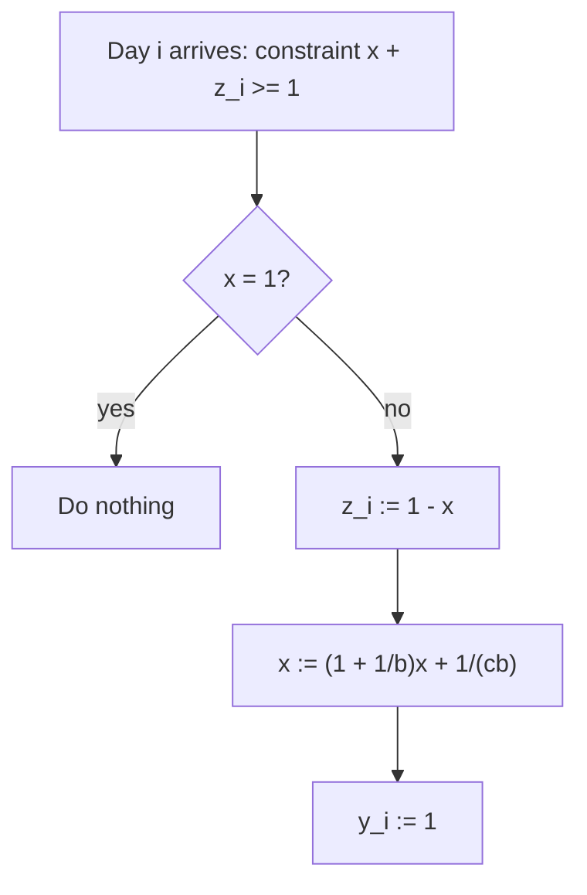

# 2. The fractional online algorithm for ski rental

## The algorithm

Initialize `x = 0`, all `z_i = 0`, all `y_i = 0`. Constraints `x + z_i ≥ 1` arrive one per day ([`7:59`](https://www.youtube.com/watch?v=Jsg9TwLRTbM&t=479)).

On seeing constraint `i`:

- **If `x = 1`** — do nothing ([`7:59`](https://www.youtube.com/watch?v=Jsg9TwLRTbM&t=479)).
- **Else** ([`9:04`](https://www.youtube.com/watch?v=Jsg9TwLRTbM&t=544)):
  1. `z_i ← 1 − x`
  2. `x ← (1 + 1/b)·x + 1/(cb)`  — `c` is a constant fixed later
  3. `y_i ← 1`

## Two things to prove

1. The **ratio** between the primal and dual objectives.
2. **Feasibility** of both the primal and dual solutions ([`9:48`](https://www.youtube.com/watch?v=Jsg9TwLRTbM&t=588)).

## Bounding primal / dual per step

- At each step either both objectives stay put, or the **dual objective increases by exactly 1** (because `y_i` goes to 1) ([`10:11`](https://www.youtube.com/watch?v=Jsg9TwLRTbM&t=611), [`10:51`](https://www.youtube.com/watch?v=Jsg9TwLRTbM&t=651)).
- The primal change is `b·Δx + z_i`. With `Δx = (1 + 1/b)x + 1/(cb) − x = x/b + 1/(cb)`, multiplying by `b` gives `x + 1/c` ([`11:39`](https://www.youtube.com/watch?v=Jsg9TwLRTbM&t=699), [`12:20`](https://www.youtube.com/watch?v=Jsg9TwLRTbM&t=740)).
- Adding `z_i = 1 − x` cancels the `x`, so the primal change is exactly **`1 + 1/c`** ([`12:20`](https://www.youtube.com/watch?v=Jsg9TwLRTbM&t=740)).
- Therefore **primal / dual ≤ (1 + 1/c) / 1 = 1 + 1/c** ([`13:03`](https://www.youtube.com/watch?v=Jsg9TwLRTbM&t=783)).
