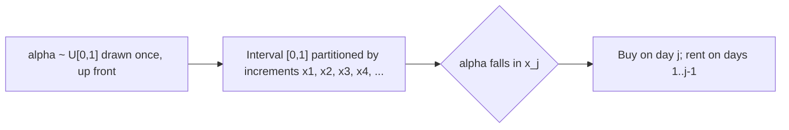

# 4. Randomized rounding: from fractional to integral

## The problem and the fix

- We cannot fractionally rent or buy — the decision must be **integral**. The fix is **randomization**, arranged so the fractional cost is achieved **in expectation** ([`20:01`](https://www.youtube.com/watch?v=Jsg9TwLRTbM&t=1201), [`20:20`](https://www.youtube.com/watch?v=Jsg9TwLRTbM&t=1220)).

## The randomized algorithm

1. Initialize `x`, `z_i`, `y_i` to 0 as before, **and** draw one **`α ~ Uniform[0,1]`** at the very beginning ([`21:20`](https://www.youtube.com/watch?v=Jsg9TwLRTbM&t=1280)).
2. Keep updating the fractional `x`, `z_i`, `y_i` exactly as before ([`21:48`](https://www.youtube.com/watch?v=Jsg9TwLRTbM&t=1308)).
3. Picture the increments `x_1, x_2, x_3, …` laid end to end on the interval `[0, 1]`. **Buy on the day whose increment `α` lands in** ([`22:27`](https://www.youtube.com/watch?v=Jsg9TwLRTbM&t=1347), [`22:57`](https://www.youtube.com/watch?v=Jsg9TwLRTbM&t=1377), [`23:29`](https://www.youtube.com/watch?v=Jsg9TwLRTbM&t=1409)).

- Because the increments `x_i` are **deterministic**, drawing `α` up front already fixes the buy day — noted in Q&A ([`28:10`](https://www.youtube.com/watch?v=Jsg9TwLRTbM&t=1690)).

## Expected-cost analysis

- `E[cost] = E[money spent buying] + E[money spent renting]` ([`24:24`](https://www.youtube.com/watch?v=Jsg9TwLRTbM&t=1464)).
- **Buying:** `E = b · Pr[buy] = b · Pr[α ≤ x] = b·x`, since `α` is uniform on `[0,1]` and `x = Σ_i x_i` ([`24:24`](https://www.youtube.com/watch?v=Jsg9TwLRTbM&t=1464), [`25:13`](https://www.youtube.com/watch?v=Jsg9TwLRTbM&t=1513)).
- **Renting:** by linearity of expectation over indicator variables, `E = Σ_i Pr[rent on day i]` ([`25:42`](https://www.youtube.com/watch?v=Jsg9TwLRTbM&t=1542), [`26:12`](https://www.youtube.com/watch?v=Jsg9TwLRTbM&t=1572)).
- You rent on day `i` iff `α > x_1 + … + x_{i−1}`, whose probability is `1 − (value of x at that time)` = exactly **`z_i`** ([`26:34`](https://www.youtube.com/watch?v=Jsg9TwLRTbM&t=1594), [`27:12`](https://www.youtube.com/watch?v=Jsg9TwLRTbM&t=1632)).

## Result

- `E[cost] = b·x + Σ_i z_i`, which is **exactly the primal objective** — the fractional cost is attained in expectation ([`27:45`](https://www.youtube.com/watch?v=Jsg9TwLRTbM&t=1665)).
- So we have a genuine integral randomized algorithm with competitive ratio close to **e/(e − 1)** ([`27:45`](https://www.youtube.com/watch?v=Jsg9TwLRTbM&t=1665)).
- Off-by-one caveat raised in Q&A: at the start of day `i` the increment has not been applied yet; even if the indexing were off by one, adding an extra `x_i` would only **help** the bound ([`28:56`](https://www.youtube.com/watch?v=Jsg9TwLRTbM&t=1736), [`29:44`](https://www.youtube.com/watch?v=Jsg9TwLRTbM&t=1784)).
