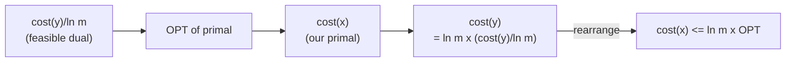

# 7. The primal-dual view of the same algorithm

## Historical aside

- The Alon et al. conference version appeared in **'03**, before Buchbinder and Naor's primal-dual framework for online algorithms, so the original paper almost certainly used only the **primal** view ([`53:36`](https://www.youtube.com/watch?v=Jsg9TwLRTbM&t=3216), [`53:57`](https://www.youtube.com/watch?v=Jsg9TwLRTbM&t=3237)).

## Adding the dual

- Keep the `x_S` evolution unchanged; also start `y = 0` and, while evolving to satisfy element `i`'s constraint, evolve `y_i` by ([`54:18`](https://www.youtube.com/watch?v=Jsg9TwLRTbM&t=3258)):

  `dy_i(t)/dt = 1`   — i.e. `y_i` rises by 1 per second ([`55:32`](https://www.youtube.com/watch?v=Jsg9TwLRTbM&t=3332)).

- Per time unit: primal objective rises by **at most 1**, dual objective rises by **exactly 1**. Therefore **`cost(x) ≤ cost(y)`** ([`55:32`](https://www.youtube.com/watch?v=Jsg9TwLRTbM&t=3332), [`55:59`](https://www.youtube.com/watch?v=Jsg9TwLRTbM&t=3359)).

## Why the dual must be infeasible

- If both were feasible, `cost(x) ≤ cost(y)` plus weak duality (`dual ≤ primal`) would force primal = dual = optimum — which cannot be. **So `y` is deliberately infeasible** ([`56:16`](https://www.youtube.com/watch?v=Jsg9TwLRTbM&t=3376)).

## Claim: `y / ln m` is dual feasible

- Need: for every set `S`, `Σ_{i ∈ S} y_i ≤ ln m` — i.e. each dual constraint is violated by at most a `ln m` factor ([`56:38`](https://www.youtube.com/watch?v=Jsg9TwLRTbM&t=3398), [`57:14`](https://www.youtube.com/watch?v=Jsg9TwLRTbM&t=3434)).
- **Proof:** whenever some `y_i` in that sum increases, `x_S` is simultaneously increasing for every `S ∋ i`. But `x_S` can only grow for **`ln m` seconds** before reaching 1, after which evolution stops. Since the sum grows at rate exactly 1, it reaches at most **`ln m`** ([`57:51`](https://www.youtube.com/watch?v=Jsg9TwLRTbM&t=3471), [`58:24`](https://www.youtube.com/watch?v=Jsg9TwLRTbM&t=3504), [`58:52`](https://www.youtube.com/watch?v=Jsg9TwLRTbM&t=3532), [`59:39`](https://www.youtube.com/watch?v=Jsg9TwLRTbM&t=3579)).

## The chain

- `cost(y)/ln m ≤ dual-opt ≤ primal-opt ≤ cost(x) ≤ cost(y)`; since cost is linear, rearranging yields **`cost(x) ≤ ln m · OPT`** ([`59:39`](https://www.youtube.com/watch?v=Jsg9TwLRTbM&t=3579), [`1:00:12`](https://www.youtube.com/watch?v=Jsg9TwLRTbM&t=3612), [`1:00:40`](https://www.youtube.com/watch?v=Jsg9TwLRTbM&t=3640)).

## What changed

- Nothing about the algorithm or the bound. The **difference is the proof technique**: the purely primal view compares directly with OPT, while the primal-dual view never mentions OPT — it just constructs a dual solution ([`1:00:57`](https://www.youtube.com/watch?v=Jsg9TwLRTbM&t=3657)).
